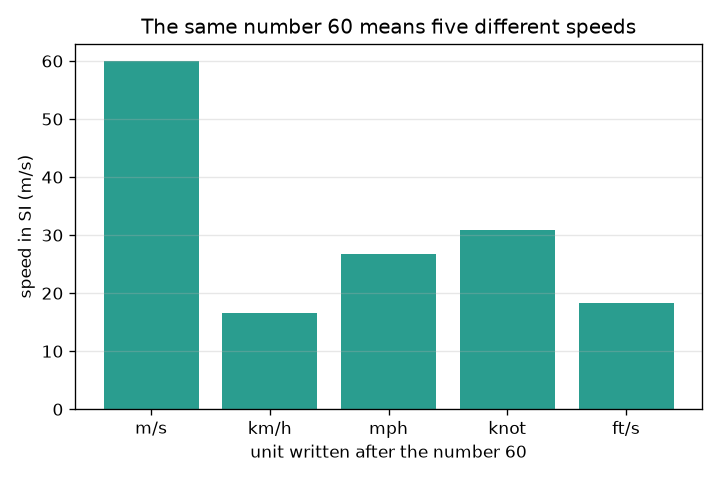
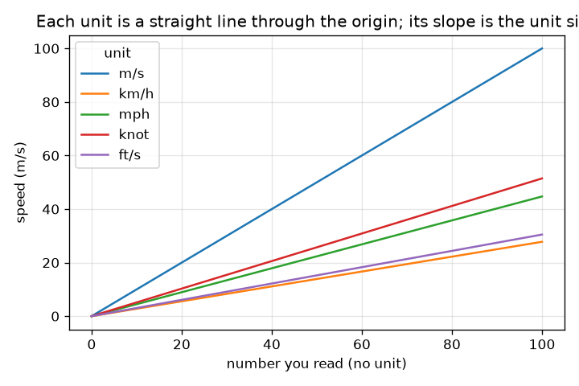

# सत्र 1: बिना इकाई की संख्या उत्तर नहीं है

*स्तर 1 (वैचारिक इंटरैक्टिव मॉडल) · लगभग 60 मिनट · openunits*

> यह एक सरलीकृत शैक्षिक मॉडल है। यह कोई प्रमाणित डिज़ाइन उपकरण नहीं है और इसका उपयोग वास्तविक संरचनाओं, विद्युत संस्थापनों, वाहनों, औद्योगिक प्रक्रियाओं या चिकित्सा निर्णयों के लिए नहीं किया जाना चाहिए।

**पूर्व-आवश्यकताएँ (Prerequisites)**

- दशमलव संख्याओं का गुणा और भाग; दस की घातें।
- आपने PRIMER.md पढ़ लिया है और एक बार `python start.py 1` चला लिया है।

**सीखने के उद्देश्य (Learning objectives)।** इस सत्र के बाद आप:

- समझा सकेंगे कि किसी संख्या को उत्तर बनने के लिए अपनी इकाई (unit) क्यों चाहिए।
- SI में हर इकाई के आकार का उपयोग करके लंबाई और गति की इकाइयों के बीच बदल सकेंगे।
- SI उपसर्गों (prefixes) (किलो, मिली, माइक्रो और अन्य) का दस की घातों के रूप में उपयोग कर सकेंगे।
- उचित संख्या में सार्थक अंकों (significant figures) तक पूर्णांकन कर सकेंगे और इकाई रूपांतरण रेखाओं का ग्राफ़ पढ़ सकेंगे।

## A. वास्तविक जीवन की समस्या
एक मित्र संदेश भेजता है 'कार ने 60 किए'। साठ क्या? मीटर प्रति सेकंड एक तेज़ धावक है, किलोमीटर प्रति घंटा शहर में धीमी ड्राइव है, मील प्रति घंटा उससे थोड़ा तेज़। इकाइयों को मिलाना केवल स्कूल की ग़लती नहीं है: इसकी वास्तविक इंजीनियरिंग परियोजनाओं को भारी क़ीमत चुकानी पड़ी है। क्या हम एक ऐसा रूपांतरक (converter) बना सकते हैं जो कभी इकाई न भूले, और देख सकते हैं कि एक छूटी हुई इकाई किसी संख्या को कितना बदल सकती है?

## B. अवधारणा और सिद्धांत
SI (इकाइयों की अंतर्राष्ट्रीय प्रणाली) लंबाई के लिए मीटर (m), द्रव्यमान के लिए किलोग्राम (kg) और समय के लिए सेकंड (s) का उपयोग करती है। हर दूसरी इकाई किसी SI इकाई का एक निश्चित गुणज है: 1 km = 1000 m, 1 ft = 0.3048 m और 1 mile = 1609.344 m ठीक-ठीक। रूपांतरण के लिए, पहले SI में बदलें और फिर लक्ष्य इकाई में: नई इकाई में संख्या पुरानी संख्या गुणा (पुरानी इकाई का आकार) भाग (नई इकाई का आकार) है। उपसर्ग किसी इकाई के आगे लिखी गई दस की घात है: किलो = 10^3, मिली = 10^-3, माइक्रो = 10^-6। सार्थक अंक बताते हैं कि किसी संख्या के कितने अंकों पर आप भरोसा कर सकते हैं: परिणाम को निवेश डेटा से अधिक अंकों का दावा नहीं करना चाहिए।

| प्रतीक | अर्थ | इकाई |
|---|---|---|
| n | इकाई से पहले लिखी गई संख्या | कोई इकाई नहीं |
| F_u | SI में इकाई u का आकार | SI इकाइयाँ प्रति इकाई |
| v | एक गति | m/s |
| k | किसी उपसर्ग की दस की घात | कोई इकाई नहीं |

**मान्यताएँ (Assumptions)**

- फ़ुट, मील और नॉट (नॉटिकल मील 1852 m) के लिए सटीक परिभाषाएँ उपयोग की गई हैं।
- केवल एक ही प्रकार की इकाइयों के बीच रूपांतरण की अनुमति है (लंबाई से लंबाई, गति से गति)।
- पूर्णांकन अंत में होता है, गणना के बीच में नहीं।

$$ n_{\text{new}}=n_{\text{old}}\,\frac{F_{\text{old}}}{F_{\text{new}}} $$

$$ 1\ \text{km/h}=\frac{1000\ \text{m}}{3600\ \text{s}}=0.2778\ \text{m/s} $$

$$ \text{kilo}=10^{3},\qquad \text{milli}=10^{-3},\qquad \text{micro}=10^{-6} $$

## C. दृश्य व्याख्या
पहला चित्र अकेली संख्या 60 को पाँच अलग-अलग इकाइयों के साथ लिखा हुआ दिखाता है, जिसे m/s में उस गति के रूप में खींचा गया है जिसका वह वास्तव में अर्थ है: 16.7 m/s (km/h) से 60 m/s (m/s) तक। दूसरा चित्र हर इकाई के लिए, पढ़ी गई संख्या के विरुद्ध m/s में गति आलेखित करता है। हर इकाई शून्य से होकर जाने वाली एक सीधी रेखा है और उसकी ढलान इकाई का आकार है, इसलिए अधिक खड़ी रेखा एक बड़ी इकाई है।

*पाँच अलग-अलग इकाइयों के साथ संख्या 60 का अर्थ है पाँच अलग-अलग गतियाँ।*

*हर इकाई शून्य से होकर जाने वाली एक सीधी रेखा है; उसकी ढलान m/s में इकाई का आकार है।*

## D. इंटरैक्टिव सिमुलेशन
पाठ चलाएँ (`python start.py 1`), फिर लाइव ऐप खोलें: [सत्र 1: एक गति रूपांतरक](https://krunalpanchal1995.github.io/pan-iit-oss/openunits/session-01/) (या इसी फ़ोल्डर में `app.html`)। एक संख्या और एक इकाई कोड चुनें (1 m/s, 2 km/h, 3 mph, 4 knot, 5 ft/s)। चित्र दृश्य में बार और ग्राफ़ दृश्य में रेखाएँ देखें; रीडआउट वही गति तीन इकाइयों में दिखाता है।

**चुनौती।** वह सेटिंग खोजें जिसका अर्थ km/h इकाई के साथ 27.8 m/s है।

## E. हल किया गया उदाहरण और प्रयोग
**समस्या।** एक संकेत-पट्ट पर 72 km/h लिखा है। m/s में गति ज्ञात करें। फिर 60 mph को km/h में बदलें और उत्तर 3 सार्थक अंकों तक दें।

1. 1 km/h = 1000 m / 3600 s = 0.27778 m/s।
2. 72 km/h = 72 * 0.27778 = 20.0 m/s।
3. 1 mph = 1609.344 m / 3600 s = 0.44704 m/s, और 1 km/h = 0.27778 m/s।
4. 60 mph = 60 * 0.44704 / 0.27778 = 96.56 km/h।
5. 3 सार्थक अंकों तक: 96.6 km/h।

**उत्तर।** 72 km/h ठीक 20 m/s है, और 60 mph, 96.6 km/h है (3 सार्थक अंक)।

**प्रयोग।** फ़ीते से 10.0 m चिह्नित करें, उसे स्थिर चाल से चलें और फ़ोन की स्टॉपवॉच से समय नापें। m/s में अपनी गति निकालें, फिर 3.6 से गुणा करके km/h में बदलें। सामान्य पैदल चाल कुछ km/h होती है; अपने फ़ोन के क़दम-गिनने वाले ऐप से तुलना करें। कोई भी अंतर शुरू और रुकने पर प्रतिक्रिया समय से आता है (7 s की चाल पर लगभग 0.2 s की त्रुटि 3 प्रतिशत है): रूपांतरण सटीक है, मापन नहीं।

## F. मूल्यांकन और डिज़ाइन चुनौती
**प्रश्न प्रकार A: वैचारिक।** 'कार कितनी तेज़ थी?' का '60' पूरा उत्तर क्यों नहीं है? आपको क्या जोड़ना होगा, और जब दो लोग असहमत हों तो SI इकाई कैसे मदद करती है?

संकेत

सोचें कि km/h, mph और m/s के साथ 60 का क्या अर्थ है।

चरण-दर-चरण हल

अकेली संख्या यह नहीं बताती कि वह किस इकाई में गिनती है; 60 का अर्थ 16.7 m/s, 26.8 m/s या 60 m/s हो सकता है। उत्तर एक संख्या और उसकी इकाई दोनों मिलकर है। दोनों को SI (m/s) में बदलने से दोनों कथन एक ही पैमाने पर आ जाते हैं ताकि उनकी तुलना की जा सके।

**प्रश्न प्रकार B: संख्यात्मक।** 100 km/h को m/s और mph में बदलें। जाँचें कि आपके उत्तर समझदारी भरे हैं।

संकेत

1 km/h = 0.27778 m/s और 1 mph = 0.44704 m/s का उपयोग करें।

चरण-दर-चरण हल

100 km/h = 100 / 3.6 = 27.78 m/s। mph में: 27.78 / 0.44704 = 62.14 mph। जाँच (sanity check): एक मील एक किलोमीटर से लंबा है, इसलिए mph संख्या km/h संख्या से छोटी होनी चाहिए: 62, 100 से छोटा है। ठीक है।

**प्रश्न प्रकार C: ग्राफ़ और सिमुलेशन की व्याख्या।** पढ़ी गई संख्या के विरुद्ध गति के ग्राफ़ में, संख्या 60 के लिए कौन-सी इकाई सबसे अधिक गति देती है, और कौन-सी सबसे कम? हर रेखा की ढलान का क्या अर्थ है?

संकेत

x अक्ष पर 60 पर रेखाओं की ऊँचाइयों की तुलना करें।

चरण-दर-चरण हल

60 पर, m/s देता है 60 m/s (सबसे अधिक), mph 26.8 m/s, knot 30.9 m/s, ft/s 18.3 m/s और km/h 16.7 m/s (सबसे कम)। ढलान m/s में एक इकाई का आकार है, इसलिए m/s की ढलान 1 और km/h की ढलान 0.278 है।

**प्रश्न प्रकार D: डिज़ाइन और अनुकूलन (optimisation) चुनौती।** डिज़ाइन: आगंतुकों के लिए एक सड़क संकेत को 50 km/h की सीमा और उसका mph समतुल्य दिखाना है। एक पूर्णांकन चुनें और उसका औचित्य दें, स्पष्टता और सटीकता के बीच समझौते (trade-off) को नोट करते हुए।

संकेत

50 km/h को mph में बदलें और ऊपर पूर्णांकन की तुलना नीचे पूर्णांकन से करें।

चरण-दर-चरण हल

50 km/h = 50 * 1000 / 1609.344 = 31.07 mph। नीचे 30 mph तक पूर्णांकन पढ़ने में आसान है पर mph संख्या का पालन करने वाले चालक को 1.07 mph (3.5 प्रतिशत) बहुत धीमे चलने देगा, जो सुरक्षित है; ऊपर 31 या 32 तक पूर्णांकन मीट्रिक सीमा से थोड़ा ऊपर गति को आमंत्रित करता है। एक समझदार डिज़ाइन 31 mph (निकटतम पूर्ण संख्या) दिखाता है या km/h में क़ानूनी संख्या के साथ 'लगभग 30 mph' बताता है। मान्यता: पूर्ण संख्याएँ दशमलव से पढ़ने में आसान हैं।

[RUBRIC.md](../../RUBRIC.md) से स्वयं को अंक दें। काग़ज़ पर काम करने के लिए [गतिविधि पत्रक (activity sheet)](activity_sheet.md) प्रिंट करें।

## सामान्य भ्रांतियाँ (Common misconceptions)
| सामान्य भ्रांति | वास्तव में क्या सच है |
|---|---|
| संख्या ही उत्तर है; इकाई सजावट है। | इकाई उत्तर का हिस्सा है। 60 m/s और 60 km/h में 3.6 के गुणांक का अंतर है। |
| उपसर्ग आकार को केवल थोड़ा बदलते हैं। | उपसर्ग दस की घात है: 1 km, 1000 m है और 1 mm, 0.001 m है, इसलिए एक किलोमीटर दस लाख मिलीमीटर है। |
| अधिक अंकों का अर्थ है बेहतर उत्तर। | अतिरिक्त अंक ऐसी परिशुद्धता (precision) का दावा करते हैं जो आपके पास नहीं है। परिणाम उसमें गए डेटा से अधिक परिशुद्ध नहीं हो सकता। |

## शब्दावली (Glossary)
- **SI**: इकाइयों की अंतर्राष्ट्रीय प्रणाली, मीटर, किलोग्राम और सेकंड पर बनी
- **उपसर्ग (prefix)**: किसी इकाई के आगे का एक अक्षर जिसका अर्थ दस की घात है (k = 1000, m = 0.001)
- **रूपांतरण गुणांक (conversion factor)**: किसी दूसरी इकाई की एक इकाई में SI इकाइयों की संख्या, जैसे एक फ़ुट में 0.3048 m
- **सार्थक अंक (significant figures)**: किसी संख्या के वे अंक जिन पर आप भरोसा कर सकते हैं

## समापन
1. [exercises.md](exercises.md) में दिए गए तीन कोडिंग कार्य करें।
2. अपने बदलावों के बाद `python start.py 1` फिर से चलाएँ। यह चेकपॉइंट के साथ समाप्त होता है; जब यह `PASS` छापे, तो आपका काम पूरा हो गया। (केवल चेकपॉइंट: `python start.py check 1`।)

आगे: [सत्र 2](../session-02/README.md)
