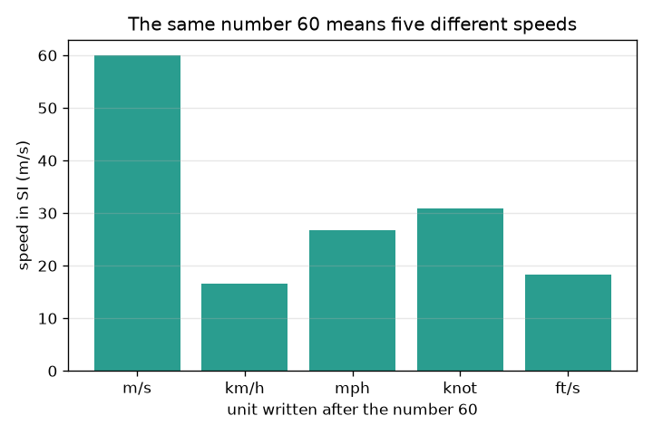
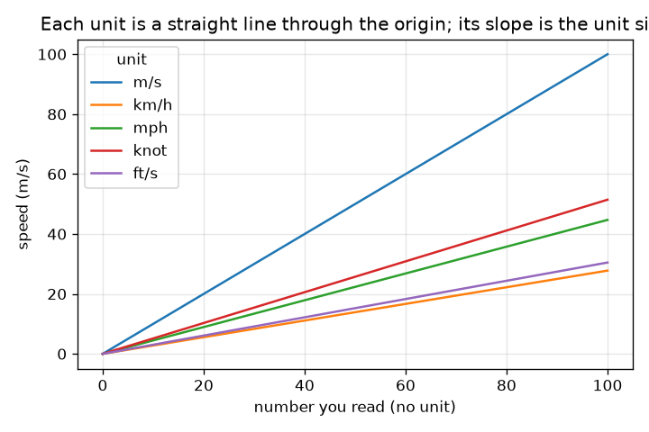

# സെഷൻ 1: യൂണിറ്റില്ലാത്ത ഒരു സംഖ്യ ഉത്തരമല്ല

[Session 1 — हिन्दी](README.hi.md) · [Session 1 — മലയാളം](README.ml.md)

*ലെവൽ 1 (ആശയപരമായ ഇന്ററാക്ടീവ് മോഡൽ) · ഏകദേശം 60 മിനിറ്റ് · openunits*

> ഇത് ലളിതമാക്കിയ ഒരു വിദ്യാഭ്യാസ മോഡലാണ്. ഇത് സാധൂകരിക്കപ്പെട്ട (validated) ഡിസൈൻ ഉപകരണമല്ല; യഥാർത്ഥ ഘടനകൾ, വൈദ്യുത സംവിധാനങ്ങൾ, വാഹനങ്ങൾ, വ്യാവസായിക പ്രക്രിയകൾ അല്ലെങ്കിൽ വൈദ്യശാസ്ത്ര തീരുമാനങ്ങൾ എന്നിവയ്ക്ക് ഇത് ഉപയോഗിക്കരുത്.

**മുൻ‌അറിവ് (Prerequisites)**

- ദശാംശ സംഖ്യകൾ ഗുണിക്കലും ഹരിക്കലും; 10-ന്റെ ഘാതങ്ങൾ.
- നിങ്ങൾ PRIMER.md വായിക്കുകയും `python start.py 1` ഒരിക്കൽ പ്രവർത്തിപ്പിക്കുകയും ചെയ്തിട്ടുണ്ട്.

**പഠന ലക്ഷ്യങ്ങൾ (Learning objectives).** ഈ സെഷനു ശേഷം നിങ്ങൾക്ക് കഴിയും:

- ഒരു സംഖ്യ ഉത്തരമാകാൻ അതിന് യൂണിറ്റ് വേണ്ടത് എന്തുകൊണ്ടെന്ന് വിശദീകരിക്കാൻ.
- SI-യിലെ ഓരോ യൂണിറ്റിന്റെയും വലുപ്പം ഉപയോഗിച്ച് നീളത്തിന്റെയും വേഗതയുടെയും യൂണിറ്റുകൾക്കിടയിൽ പരിവർത്തനം ചെയ്യാൻ.
- SI പ്രിഫിക്സുകൾ (കിലോ, മില്ലി, മൈക്രോ തുടങ്ങിയവ) 10-ന്റെ ഘാതങ്ങളായി ഉപയോഗിക്കാൻ.
- അർത്ഥവത്തായ എണ്ണം സാർത്ഥക അക്കങ്ങളിലേക്ക് (significant figures) റൗണ്ട് ചെയ്യാനും യൂണിറ്റ് പരിവർത്തന രേഖകളുടെ ഗ്രാഫ് വായിക്കാനും.

## A. യഥാർത്ഥ ലോക പ്രശ്നം
ഒരു സുഹൃത്ത് 'കാർ 60 ഓടി' എന്ന് മെസേജ് അയയ്ക്കുന്നു. അറുപത് എന്ത്? സെക്കൻഡിൽ മീറ്റർ എന്നത് വേഗതയേറിയ ഒരു ഓട്ടക്കാരനാണ്, മണിക്കൂറിൽ കിലോമീറ്റർ എന്നത് നഗരത്തിലെ പതുക്കെയുള്ള ഡ്രൈവ് ആണ്, മണിക്കൂറിൽ മൈൽ അതിനേക്കാൾ അല്പം വേഗത്തിലാണ്. യൂണിറ്റുകൾ കൂട്ടിക്കലർത്തുന്നത് ഒരു സ്കൂൾ തെറ്റ് മാത്രമല്ല: അത് യഥാർത്ഥ എൻജിനീയറിംഗ് പദ്ധതികൾക്ക് വലിയ നഷ്ടമുണ്ടാക്കിയിട്ടുണ്ട്. യൂണിറ്റ് ഒരിക്കലും മറക്കാത്ത ഒരു കൺവെർട്ടർ നമുക്ക് നിർമ്മിക്കാമോ, യൂണിറ്റ് ഇല്ലാതിരിക്കുന്നത് ഒരു സംഖ്യയെ എത്രമാത്രം മാറ്റുമെന്ന് കാണാമോ?

## B. ആശയവും സിദ്ധാന്തവും
SI (അന്താരാഷ്ട്ര യൂണിറ്റ് സമ്പ്രദായം) നീളത്തിന് മീറ്റർ (m), പിണ്ഡത്തിന് കിലോഗ്രാം (kg), സമയത്തിന് സെക്കൻഡ് (s) എന്നിവ ഉപയോഗിക്കുന്നു. മറ്റെല്ലാ യൂണിറ്റുകളും ഒരു SI യൂണിറ്റിന്റെ സ്ഥിരമായ ഗുണിതമാണ്: 1 km = 1000 m, 1 ft = 0.3048 m, 1 mile = 1609.344 m കൃത്യമായി. പരിവർത്തനം ചെയ്യാൻ SI-യിലേക്ക് മാറ്റുക, പിന്നെ ലക്ഷ്യ യൂണിറ്റിലേക്ക്: പുതിയ യൂണിറ്റിലെ സംഖ്യ പഴയ സംഖ്യ ഗുണം (പഴയ യൂണിറ്റിന്റെ വലുപ്പം) ഹരിക്കണം (പുതിയ യൂണിറ്റിന്റെ വലുപ്പം) ആണ്. പ്രിഫിക്സ് എന്നത് ഒരു യൂണിറ്റിന് മുന്നിൽ എഴുതുന്ന 10-ന്റെ ഘാതമാണ്: കിലോ = 10^3, മില്ലി = 10^-3, മൈക്രോ = 10^-6. സാർത്ഥക അക്കങ്ങൾ ഒരു സംഖ്യയിലെ എത്ര അക്കങ്ങളെ വിശ്വസിക്കാം എന്ന് പറയുന്നു: ഒരു ഫലം ഇൻപുട്ട് ഡാറ്റയേക്കാൾ കൂടുതൽ അക്കങ്ങൾ അവകാശപ്പെടരുത്.

| ചിഹ്നം | അർത്ഥം | യൂണിറ്റ് |
|---|---|---|
| n | യൂണിറ്റിന് മുമ്പ് എഴുതിയ സംഖ്യ | യൂണിറ്റില്ല |
| F_u | യൂണിറ്റ് u-ന്റെ SI-യിലെ വലുപ്പം | ഓരോ യൂണിറ്റിനും SI യൂണിറ്റുകൾ |
| v | ഒരു വേഗത | m/s |
| k | ഒരു പ്രിഫിക്സിന്റെ 10-ന്റെ ഘാതം | യൂണിറ്റില്ല |

**അനുമാനങ്ങൾ (Assumptions)**

- അടി, മൈൽ, നോട്ട് എന്നിവയ്ക്ക് കൃത്യമായ നിർവചനങ്ങൾ ഉപയോഗിക്കുന്നു (നോട്ടിക്കൽ മൈൽ 1852 m).
- ഒരേ തരത്തിലുള്ള യൂണിറ്റുകൾക്കിടയിലുള്ള പരിവർത്തനങ്ങൾ മാത്രമേ അനുവദിക്കൂ (നീളത്തിൽ നിന്ന് നീളത്തിലേക്ക്, വേഗതയിൽ നിന്ന് വേഗതയിലേക്ക്).
- റൗണ്ടിംഗ് നടക്കുന്നത് അവസാനമാണ്, കണക്കുകൂട്ടലിന്റെ ഇടയിലല്ല.

$$ n_{\text{new}}=n_{\text{old}}\,\frac{F_{\text{old}}}{F_{\text{new}}} $$

$$ 1\ \text{km/h}=\frac{1000\ \text{m}}{3600\ \text{s}}=0.2778\ \text{m/s} $$

$$ \text{kilo}=10^{3},\qquad \text{milli}=10^{-3},\qquad \text{micro}=10^{-6} $$

## C. ദൃശ്യ വിശദീകരണം
ആദ്യ ചിത്രം അഞ്ച് വ്യത്യസ്ത യൂണിറ്റുകളോടെ എഴുതിയ 60 എന്ന വെറും സംഖ്യയെ, അത് യഥാർത്ഥത്തിൽ അർത്ഥമാക്കുന്ന m/s-ലെ വേഗതയായി വരച്ച് കാണിക്കുന്നു: 16.7 m/s (km/h) മുതൽ 60 m/s (m/s) വരെ. രണ്ടാമത്തെ ചിത്രം ഓരോ യൂണിറ്റിനും, m/s-ലെ വേഗതയെ നിങ്ങൾ വായിക്കുന്ന സംഖ്യയ്ക്കെതിരെ വരയ്ക്കുന്നു. ഓരോ യൂണിറ്റും പൂജ്യത്തിലൂടെ കടന്നുപോകുന്ന നേർരേഖയാണ്, അതിന്റെ ചരിവ് യൂണിറ്റിന്റെ വലുപ്പമാണ്, അതിനാൽ കുത്തനെയുള്ള രേഖ വലിയ യൂണിറ്റാണ്.

*60 എന്ന സംഖ്യ അഞ്ച് വ്യത്യസ്ത യൂണിറ്റുകളോടെ അഞ്ച് വ്യത്യസ്ത വേഗതകളെ അർത്ഥമാക്കുന്നു.*

*ഓരോ യൂണിറ്റും പൂജ്യത്തിലൂടെയുള്ള നേർരേഖയാണ്; അതിന്റെ ചരിവ് m/s-ലെ യൂണിറ്റ് വലുപ്പമാണ്.*

## D. ഇന്ററാക്ടീവ് സിമുലേഷൻ
പാഠം പ്രവർത്തിപ്പിക്കുക (`python start.py 1`), തുടർന്ന് ലൈവ് ആപ്പ് തുറക്കുക: [സെഷൻ 1: ഒരു വേഗത കൺവെർട്ടർ](https://krunalpanchal1995.github.io/pan-iit-oss/openunits/session-01/) (അല്ലെങ്കിൽ ഈ ഫോൾഡറിലെ `app.html`). ഒരു സംഖ്യയും യൂണിറ്റ് കോഡും തിരഞ്ഞെടുക്കുക (1 m/s, 2 km/h, 3 mph, 4 knot, 5 ft/s). ചിത്ര കാഴ്ചയിലെ ബാറുകളും ഗ്രാഫ് കാഴ്ചയിലെ രേഖകളും നിരീക്ഷിക്കുക; റീഡൗട്ട് അതേ വേഗതയെ മൂന്ന് യൂണിറ്റുകളിൽ കാണിക്കുന്നു.

**വെല്ലുവിളി.** യൂണിറ്റ് km/h ഉപയോഗിച്ച് 27.8 m/s അർത്ഥമാക്കുന്ന ക്രമീകരണം കണ്ടെത്തുക.

## E. ഉദാഹരണ പ്രശ്നവും പരീക്ഷണവും
**പ്രശ്നം.** ഒരു ബോർഡ് 72 km/h എന്ന് പറയുന്നു. വേഗത m/s-ൽ കണ്ടെത്തുക. പിന്നെ 60 mph നെ km/h ലേക്ക് മാറ്റി ഉത്തരം 3 സാർത്ഥക അക്കങ്ങളിൽ നൽകുക.

1. 1 km/h = 1000 m / 3600 s = 0.27778 m/s.
2. 72 km/h = 72 * 0.27778 = 20.0 m/s.
3. 1 mph = 1609.344 m / 3600 s = 0.44704 m/s, 1 km/h = 0.27778 m/s.
4. 60 mph = 60 * 0.44704 / 0.27778 = 96.56 km/h.
5. 3 സാർത്ഥക അക്കങ്ങളിൽ: 96.6 km/h.

**ഉത്തരം.** 72 km/h കൃത്യമായി 20 m/s ആണ്, 60 mph എന്നത് 96.6 km/h ആണ് (3 സാർത്ഥക അക്കങ്ങൾ).

**പരീക്ഷണം.** ടേപ്പ് ഉപയോഗിച്ച് 10.0 m അടയാളപ്പെടുത്തുക, സ്ഥിരമായ വേഗതയിൽ അത് നടക്കുക, ഫോൺ സ്റ്റോപ്പ്‌വാച്ച് ഉപയോഗിച്ച് സമയം എടുക്കുക. നിങ്ങളുടെ വേഗത m/s-ൽ കണക്കാക്കുക, പിന്നെ 3.6 കൊണ്ട് ഗുണിച്ച് km/h ആക്കുക. സാധാരണ നടപ്പ് വേഗത ഏതാനും km/h ആണ്; നിങ്ങളുടെ ഫോണിലെ ചുവട് എണ്ണുന്ന ആപ്പുമായി താരതമ്യം ചെയ്യുക. ഏതെങ്കിലും വ്യത്യാസം തുടക്കത്തിലും അവസാനത്തിലുമുള്ള പ്രതികരണ സമയത്തിൽ നിന്നാണ് (7 s നടപ്പിൽ ഏകദേശം 0.2 s പിശക് 3 ശതമാനമാണ്): പരിവർത്തനം കൃത്യമാണ്, അളവെടുപ്പ് അല്ല.

## F. മൂല്യനിർണ്ണയവും ഡിസൈൻ വെല്ലുവിളിയും
**ചോദ്യ തരം A: ആശയപരം.** 'കാർ എത്ര വേഗത്തിൽ ഓടി?' എന്ന ചോദ്യത്തിന് '60' പൂർണ്ണ ഉത്തരമല്ലാത്തത് എന്തുകൊണ്ട്? നിങ്ങൾ എന്ത് ചേർക്കണം, രണ്ടുപേർ വിയോജിക്കുമ്പോൾ SI യൂണിറ്റ് സഹായിക്കുന്നത് എന്തുകൊണ്ട്?

സൂചന

km/h, mph, m/s എന്നിവയോടൊപ്പം 60 എന്തർത്ഥമാക്കുന്നു എന്ന് ചിന്തിക്കുക.

ഘട്ടം ഘട്ടമായുള്ള പരിഹാരം

സംഖ്യ മാത്രം ഏത് യൂണിറ്റിലാണ് എണ്ണുന്നതെന്ന് പറയുന്നില്ല; 60 എന്നാൽ 16.7 m/s, 26.8 m/s അല്ലെങ്കിൽ 60 m/s ആകാം. ഒരു ഉത്തരം എന്നത് യൂണിറ്റോടു കൂടിയ സംഖ്യയാണ്. രണ്ടും SI (m/s) ലേക്ക് മാറ്റുന്നത് രണ്ട് പ്രസ്താവനകളെയും ഒരേ സ്കെയിലിൽ കൊണ്ടുവരുന്നു, അങ്ങനെ അവ താരതമ്യം ചെയ്യാം.

**ചോദ്യ തരം B: സംഖ്യാപരം.** 100 km/h നെ m/s ലേക്കും mph ലേക്കും മാറ്റുക. നിങ്ങളുടെ ഉത്തരങ്ങൾ യുക്തിസഹമാണോ എന്ന് പരിശോധിക്കുക.

സൂചന

1 km/h = 0.27778 m/s, 1 mph = 0.44704 m/s ഉപയോഗിക്കുക.

ഘട്ടം ഘട്ടമായുള്ള പരിഹാരം

100 km/h = 100 / 3.6 = 27.78 m/s. mph-ൽ: 27.78 / 0.44704 = 62.14 mph. യുക്തിപരിശോധന (sanity check): ഒരു മൈൽ ഒരു കിലോമീറ്ററിനേക്കാൾ നീളമുള്ളതാണ്, അതിനാൽ mph സംഖ്യ km/h സംഖ്യയേക്കാൾ ചെറുതായിരിക്കണം: 62 എന്നത് 100-നേക്കാൾ ചെറുതാണ്. ശരി.

**ചോദ്യ തരം C: ഗ്രാഫ്, സിമുലേഷൻ വ്യാഖ്യാനം.** വായിച്ച സംഖ്യയ്ക്കെതിരായ വേഗതയുടെ ഗ്രാഫിൽ, സംഖ്യ 60-ന് ഏത് യൂണിറ്റ് ഏറ്റവും ഉയർന്ന വേഗത നൽകുന്നു, ഏത് ഏറ്റവും കുറഞ്ഞത്? ഓരോ രേഖയുടെയും ചരിവ് എന്താണ് അർത്ഥമാക്കുന്നത്?

സൂചന

x അക്ഷത്തിൽ 60-ൽ രേഖകളുടെ ഉയരങ്ങൾ താരതമ്യം ചെയ്യുക.

ഘട്ടം ഘട്ടമായുള്ള പരിഹാരം

60-ൽ m/s 60 m/s നൽകുന്നു (ഏറ്റവും ഉയർന്നത്), mph 26.8 m/s, knot 30.9 m/s, ft/s 18.3 m/s, km/h 16.7 m/s (ഏറ്റവും താഴ്ന്നത്). ചരിവ് m/s-ലെ ഒരു യൂണിറ്റിന്റെ വലുപ്പമാണ്, അതിനാൽ m/s-ന് ചരിവ് 1, km/h-ന് ചരിവ് 0.278.

**ചോദ്യ തരം D: ഡിസൈൻ, ഒപ്റ്റിമൈസേഷൻ വെല്ലുവിളി.** ഡിസൈൻ: സന്ദർശകർക്കുള്ള ഒരു റോഡ് ബോർഡ് 50 km/h പരിധിയും അതിന്റെ mph തുല്യതയും കാണിക്കണം. ഒരു റൗണ്ടിംഗ് തിരഞ്ഞെടുത്ത് അത് ന്യായീകരിക്കുക, വ്യക്തതയും കൃത്യതയും തമ്മിലുള്ള വിട്ടുവീഴ്ച (trade-off) സൂചിപ്പിക്കുക.

സൂചന

50 km/h നെ mph ആക്കി മുകളിലേക്ക് റൗണ്ട് ചെയ്യുന്നതിനെ താഴേക്ക് റൗണ്ട് ചെയ്യുന്നതുമായി താരതമ്യം ചെയ്യുക.

ഘട്ടം ഘട്ടമായുള്ള പരിഹാരം

50 km/h = 50 * 1000 / 1609.344 = 31.07 mph. 30 mph ലേക്ക് താഴേക്ക് റൗണ്ട് ചെയ്യുന്നത് വായിക്കാൻ എളുപ്പമാണ്, പക്ഷേ mph സംഖ്യ പിന്തുടരുന്ന ഡ്രൈവർ 1.07 mph (3.5 ശതമാനം) പതുക്കെ പോകും, അത് സുരക്ഷിതമാണ്; 31 അല്ലെങ്കിൽ 32 ലേക്ക് മുകളിലേക്ക് റൗണ്ട് ചെയ്യുന്നത് മെട്രിക് പരിധിക്ക് അല്പം മുകളിൽ അമിത വേഗതയെ ക്ഷണിക്കുന്നു. വിവേകമുള്ള ഡിസൈൻ 31 mph (ഏറ്റവും അടുത്ത പൂർണ്ണസംഖ്യ) കാണിക്കുന്നു, അല്ലെങ്കിൽ നിയമപരമായ സംഖ്യ km/h-ൽ നൽകി 'ഏകദേശം 30 mph' എന്ന് പറയുന്നു. അനുമാനം: ദശാംശങ്ങളേക്കാൾ പൂർണ്ണസംഖ്യകൾ വായിക്കാൻ എളുപ്പമാണ്.

[RUBRIC.md](../../RUBRIC.md) ഉപയോഗിച്ച് സ്വയം സ്കോർ ചെയ്യുക. പേപ്പറിൽ ചെയ്യാൻ [പ്രവർത്തന ഷീറ്റ്](activity_sheet.md) പ്രിന്റ് ചെയ്യുക.

## സാധാരണ തെറ്റിദ്ധാരണകൾ
| സാധാരണ തെറ്റിദ്ധാരണ | യഥാർത്ഥത്തിൽ ശരിയായത് |
|---|---|
| സംഖ്യയാണ് ഉത്തരം; യൂണിറ്റ് അലങ്കാരം മാത്രം. | യൂണിറ്റ് ഉത്തരത്തിന്റെ ഭാഗമാണ്. 60 m/s-ഉം 60 km/h-ഉം 3.6 ഇരട്ടി വ്യത്യാസപ്പെടുന്നു. |
| പ്രിഫിക്സുകൾ വലുപ്പത്തെ അല്പം മാത്രം മാറ്റുന്നു. | പ്രിഫിക്സ് 10-ന്റെ ഘാതമാണ്: 1 km എന്നത് 1000 m ആണ്, 1 mm എന്നത് 0.001 m ആണ്, അതിനാൽ ഒരു കിലോമീറ്റർ ഒരു ദശലക്ഷം മില്ലിമീറ്ററാണ്. |
| കൂടുതൽ അക്കങ്ങൾ എന്നാൽ മികച്ച ഉത്തരം. | അധിക അക്കങ്ങൾ നിങ്ങൾക്കില്ലാത്ത കൃത്യത അവകാശപ്പെടുന്നു. ഒരു ഫലത്തിന് അതിലേക്ക് പോയ ഡാറ്റയേക്കാൾ കൃത്യമാകാൻ കഴിയില്ല. |

## പദാവലി (Glossary)
- **SI**: മീറ്റർ, കിലോഗ്രാം, സെക്കൻഡ് എന്നിവയിൽ അധിഷ്ഠിതമായ അന്താരാഷ്ട്ര യൂണിറ്റ് സമ്പ്രദായം
- **പ്രിഫിക്സ് (prefix)**: ഒരു യൂണിറ്റിന് മുന്നിലെ, 10-ന്റെ ഘാതം അർത്ഥമാക്കുന്ന അക്ഷരം (k = 1000, m = 0.001)
- **പരിവർത്തന ഘടകം (conversion factor)**: മറ്റൊരു യൂണിറ്റിന്റെ ഒന്നിലെ SI യൂണിറ്റുകളുടെ എണ്ണം, ഉദാഹരണത്തിന് ഒരു അടിയിലെ 0.3048 m
- **സാർത്ഥക അക്കങ്ങൾ (significant figures)**: ഒരു സംഖ്യയിലെ വിശ്വസിക്കാവുന്ന അക്കങ്ങൾ

## പൂർത്തിയാക്കുക
1. [exercises.md](exercises.md)-ലെ മൂന്ന് കോഡിംഗ് ടാസ്കുകൾ ചെയ്യുക.
2. നിങ്ങളുടെ മാറ്റങ്ങൾക്ക് ശേഷം `python start.py 1` വീണ്ടും പ്രവർത്തിപ്പിക്കുക. അത് ചെക്ക്പോയിന്റോടെ അവസാനിക്കുന്നു; അത് `PASS` പ്രിന്റ് ചെയ്യുമ്പോൾ നിങ്ങൾ പൂർത്തിയാക്കി. (ചെക്ക്പോയിന്റ് മാത്രം: `python start.py check 1`.)

അടുത്തത്: [സെഷൻ 2](../session-02/README.md)
