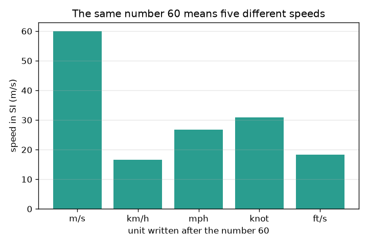
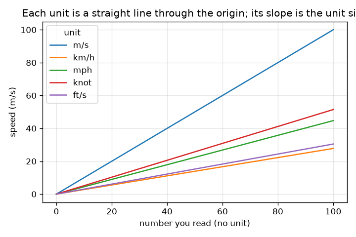

# அமர்வு 1: அலகு இல்லாத எண் ஒரு விடை அல்ல

[Session 1 — हिन्दी](README.hi.md) · [Session 1 — മലയാളം](README.ml.md) · [Session 1 — தமிழ்](README.ta.md)

*நிலை 1 (கருத்தியல் ஊடாடும் மாதிரி) · சுமார் 60 நிமிடங்கள் · openunits*

> இது எளிமைப்படுத்தப்பட்ட ஒரு கல்வி மாதிரி. இது சரிபார்க்கப்பட்ட (validated) வடிவமைப்புக் கருவி அல்ல; உண்மையான கட்டமைப்புகள், மின் அமைப்புகள், வாகனங்கள், தொழில்துறை செயல்முறைகள் அல்லது மருத்துவ முடிவுகளுக்கு இதைப் பயன்படுத்த வேண்டாம்.

**முன்தேவைகள் (Prerequisites)**

- தசம எண்களைப் பெருக்குதலும் வகுத்தலும்; 10-இன் அடுக்குகள்.
- நீங்கள் PRIMER.md-ஐப் படித்து `python start.py 1` ஐ ஒருமுறை இயக்கியுள்ளீர்கள்.

**கற்றல் நோக்கங்கள் (Learning objectives).** இந்த அமர்வுக்குப் பிறகு உங்களால் முடியும்:

- ஒரு எண் விடையாக இருக்க அதற்கு அலகு ஏன் தேவை என்று விளக்க.
- SI-இல் ஒவ்வொரு அலகின் அளவையும் பயன்படுத்தி நீளம் மற்றும் வேகத்தின் அலகுகளுக்கு இடையே மாற்ற.
- SI முன்னொட்டுகளை (கிலோ, மில்லி, மைக்ரோ மற்றும் பிற) 10-இன் அடுக்குகளாகப் பயன்படுத்த.
- பொருத்தமான எண்ணிக்கையிலான முக்கிய இலக்கங்களுக்கு (significant figures) முழுமையாக்கவும், அலகு மாற்றக் கோடுகளின் வரைபடத்தை வாசிக்கவும்.

## A. நிஜ உலகப் பிரச்சினை
ஒரு நண்பர் 'கார் 60 ஓடியது' என்று குறுஞ்செய்தி அனுப்புகிறார். அறுபது என்ன? வினாடிக்கு மீட்டர் என்பது வேகமான ஓட்டக்காரர், மணிக்கு கிலோமீட்டர் என்பது நகரத்தில் மெதுவான பயணம், மணிக்கு மைல் அதை விட சற்று வேகமானது. அலகுகளைக் கலப்பது பள்ளித் தவறு மட்டுமல்ல: அது உண்மையான பொறியியல் திட்டங்களுக்குப் பெரும் இழப்பை ஏற்படுத்தியுள்ளது. அலகை ஒருபோதும் மறக்காத ஒரு மாற்றியை நாம் உருவாக்க முடியுமா, அலகு இல்லாதது ஒரு எண்ணை எவ்வளவு மாற்றும் என்று பார்க்க முடியுமா?

## B. கருத்தும் கோட்பாடும்
SI (அனைத்துலக அலகு முறை) நீளத்துக்கு மீட்டர் (m), நிறைக்கு கிலோகிராம் (kg), நேரத்துக்கு வினாடி (s) ஆகியவற்றைப் பயன்படுத்துகிறது. மற்ற எல்லா அலகுகளும் ஒரு SI அலகின் நிலையான மடங்கு: 1 km = 1000 m, 1 ft = 0.3048 m, 1 mile = 1609.344 m துல்லியமாக. மாற்ற, SI-க்கு மாற்றி பிறகு இலக்கு அலகுக்கு மாற்றுங்கள்: புதிய அலகில் உள்ள எண் பழைய எண் பெருக்கல் (பழைய அலகின் அளவு) வகுத்தல் (புதிய அலகின் அளவு). முன்னொட்டு என்பது ஓர் அலகுக்கு முன்னால் எழுதப்படும் 10-இன் அடுக்கு: கிலோ = 10^3, மில்லி = 10^-3, மைக்ரோ = 10^-6. முக்கிய இலக்கங்கள் ஓர் எண்ணின் எத்தனை இலக்கங்களை நம்பலாம் என்று கூறுகின்றன: ஒரு முடிவு உள்ளீட்டுத் தரவை விட அதிக இலக்கங்களைக் கோரக்கூடாது.

| குறியீடு | பொருள் | அலகு |
|---|---|---|
| n | அலகுக்கு முன் எழுதப்பட்ட எண் | அலகு இல்லை |
| F_u | அலகு u-இன் SI-இல் அளவு | ஒரு அலகுக்கு SI அலகுகள் |
| v | ஒரு வேகம் | m/s |
| k | ஒரு முன்னொட்டின் 10-இன் அடுக்கு | அலகு இல்லை |

**அனுமானங்கள் (Assumptions)**

- அடி, மைல், நாட் ஆகியவற்றுக்குத் துல்லியமான வரையறைகள் பயன்படுத்தப்படுகின்றன (கடல் மைல் 1852 m).
- ஒரே வகை அலகுகளுக்கு இடையிலான மாற்றங்கள் மட்டுமே அனுமதிக்கப்படுகின்றன (நீளத்திலிருந்து நீளத்துக்கு, வேகத்திலிருந்து வேகத்துக்கு).
- முழுமையாக்கம் முடிவில் நடக்கிறது, கணக்கீட்டின் நடுவில் அல்ல.

$$ n_{\text{new}}=n_{\text{old}}\,\frac{F_{\text{old}}}{F_{\text{new}}} $$

$$ 1\ \text{km/h}=\frac{1000\ \text{m}}{3600\ \text{s}}=0.2778\ \text{m/s} $$

$$ \text{kilo}=10^{3},\qquad \text{milli}=10^{-3},\qquad \text{micro}=10^{-6} $$

## C. காட்சி விளக்கம்
முதல் படம் ஐந்து வெவ்வேறு அலகுகளுடன் எழுதப்பட்ட வெறும் எண் 60-ஐ, அது உண்மையில் குறிக்கும் m/s வேகமாக வரைந்து காட்டுகிறது: 16.7 m/s (km/h) முதல் 60 m/s (m/s) வரை. இரண்டாவது படம் ஒவ்வொரு அலகுக்கும், m/s-இல் வேகத்தை நீங்கள் வாசிக்கும் எண்ணுக்கு எதிராக வரைகிறது. ஒவ்வொரு அலகும் பூஜ்ஜியம் வழியாகச் செல்லும் நேர்க்கோடு, அதன் சரிவு அலகின் அளவு, எனவே செங்குத்தான கோடு பெரிய அலகு.

*எண் 60 ஐந்து வெவ்வேறு அலகுகளுடன் ஐந்து வெவ்வேறு வேகங்களைக் குறிக்கிறது.*

*ஒவ்வொரு அலகும் பூஜ்ஜியம் வழியான நேர்க்கோடு; அதன் சரிவு m/s-இல் அலகின் அளவு.*

## D. ஊடாடும் உருவகப்படுத்துதல்
பாடத்தை இயக்கவும் (`python start.py 1`), பிறகு நேரலை செயலியைத் திறக்கவும்: [அமர்வு 1: ஒரு வேக மாற்றி](https://krunalpanchal1995.github.io/pan-iit-oss/openunits/session-01/) (அல்லது இந்தக் கோப்புறையில் உள்ள `app.html`). ஓர் எண்ணையும் அலகுக் குறியீட்டையும் தேர்ந்தெடுங்கள் (1 m/s, 2 km/h, 3 mph, 4 knot, 5 ft/s). படக் காட்சியில் உள்ள பட்டைகளையும் வரைபடக் காட்சியில் உள்ள கோடுகளையும் கவனியுங்கள்; வாசிப்புத் திரை அதே வேகத்தை மூன்று அலகுகளில் காட்டுகிறது.

**சவால்.** அலகு km/h உடன் 27.8 m/s ஐக் குறிக்கும் அமைப்பைக் கண்டறியுங்கள்.

## E. எடுத்துக்காட்டுக் கணக்கும் சோதனையும்
**கணக்கு.** ஒரு பலகை 72 km/h என்று சொல்கிறது. வேகத்தை m/s-இல் காண்க. பிறகு 60 mph ஐ km/h ஆக மாற்றி விடையை 3 முக்கிய இலக்கங்களில் தருக.

1. 1 km/h = 1000 m / 3600 s = 0.27778 m/s.
2. 72 km/h = 72 * 0.27778 = 20.0 m/s.
3. 1 mph = 1609.344 m / 3600 s = 0.44704 m/s, 1 km/h = 0.27778 m/s.
4. 60 mph = 60 * 0.44704 / 0.27778 = 96.56 km/h.
5. 3 முக்கிய இலக்கங்களில்: 96.6 km/h.

**விடை.** 72 km/h சரியாக 20 m/s, 60 mph என்பது 96.6 km/h (3 முக்கிய இலக்கங்கள்).

**சோதனை.** அளவு நாடாவால் 10.0 m குறித்து, சீரான வேகத்தில் நடந்து, போன் ஸ்டாப்வாட்சால் நேரத்தை அளவிடுங்கள். உங்கள் வேகத்தை m/s-இல் கணக்கிட்டு, பிறகு 3.6 ஆல் பெருக்கி km/h ஆக மாற்றுங்கள். வழக்கமான நடை வேகம் சில km/h; உங்கள் போனின் அடி எண்ணும் செயலியுடன் ஒப்பிடுங்கள். எந்த வேறுபாடும் தொடக்கத்திலும் முடிவிலும் உள்ள எதிர்வினை நேரத்திலிருந்து வருகிறது (7 s நடையில் சுமார் 0.2 s பிழை 3 சதவீதம்): மாற்றம் துல்லியமானது, அளவீடு அல்ல.

## F. மதிப்பீடும் வடிவமைப்புச் சவாலும்
**கேள்வி வகை A: கருத்தியல்.** 'கார் எவ்வளவு வேகமாக ஓடியது?' என்பதற்கு '60' முழுமையான விடை அல்லாதது ஏன்? நீங்கள் எதைச் சேர்க்க வேண்டும், இருவர் வேறுபடும்போது SI அலகு ஏன் உதவுகிறது?

குறிப்பு

km/h, mph, m/s உடன் 60 என்ன பொருள் தரும் என்று சிந்தியுங்கள்.

படிப்படியான தீர்வு

எண் மட்டும் எந்த அலகில் எண்ணுகிறது என்று சொல்வதில்லை; 60 என்பது 16.7 m/s, 26.8 m/s அல்லது 60 m/s ஆக இருக்கலாம். ஒரு விடை என்பது அலகுடன் கூடிய எண். இரண்டையும் SI (m/s)-க்கு மாற்றுவது இரு கூற்றுகளையும் ஒரே அளவுகோலில் கொண்டுவருகிறது, அதனால் அவற்றை ஒப்பிடலாம்.

**கேள்வி வகை B: எண்ணியல்.** 100 km/h ஐ m/s ஆகவும் mph ஆகவும் மாற்றுங்கள். உங்கள் விடைகள் பொருத்தமானவையா என்று சரிபாருங்கள்.

குறிப்பு

1 km/h = 0.27778 m/s, 1 mph = 0.44704 m/s பயன்படுத்துங்கள்.

படிப்படியான தீர்வு

100 km/h = 100 / 3.6 = 27.78 m/s. mph-இல்: 27.78 / 0.44704 = 62.14 mph. நியாயச் சோதனை (sanity check): ஒரு மைல் ஒரு கிலோமீட்டரை விட நீளமானது, எனவே mph எண் km/h எண்ணை விடச் சிறியதாக இருக்க வேண்டும்: 62 என்பது 100-ஐ விடச் சிறியது. சரி.

**கேள்வி வகை C: வரைபடம், உருவகப்படுத்துதல் விளக்கம்.** வாசித்த எண்ணுக்கு எதிரான வேகத்தின் வரைபடத்தில், எண் 60-க்கு எந்த அலகு அதிக வேகத்தைத் தருகிறது, எது குறைந்ததை? ஒவ்வொரு கோட்டின் சரிவும் எதைக் குறிக்கிறது?

குறிப்பு

x அச்சில் 60-இல் கோடுகளின் உயரங்களை ஒப்பிடுங்கள்.

படிப்படியான தீர்வு

60-இல், m/s 60 m/s தருகிறது (அதிகம்), mph 26.8 m/s, knot 30.9 m/s, ft/s 18.3 m/s, km/h 16.7 m/s (குறைவு). சரிவு என்பது m/s-இல் ஓர் அலகின் அளவு, எனவே m/s-க்கு சரிவு 1, km/h-க்கு சரிவு 0.278.

**கேள்வி வகை D: வடிவமைப்பு, உகப்பாக்கச் சவால்.** வடிவமைப்பு: பார்வையாளர்களுக்கான ஒரு சாலைப் பலகை 50 km/h வரம்பையும் அதன் mph சமமதிப்பையும் காட்ட வேண்டும். ஒரு முழுமையாக்கத்தைத் தேர்ந்தெடுத்து நியாயப்படுத்துங்கள், தெளிவுக்கும் துல்லியத்துக்கும் இடையிலான சமரசத்தை (trade-off) குறிப்பிடுங்கள்.

குறிப்பு

50 km/h ஐ mph ஆக மாற்றி, மேல்நோக்கிய முழுமையாக்கத்தை கீழ்நோக்கியதுடன் ஒப்பிடுங்கள்.

படிப்படியான தீர்வு

50 km/h = 50 * 1000 / 1609.344 = 31.07 mph. 30 mph ஆகக் கீழ்நோக்கி முழுமையாக்குவது படிக்க எளிது, ஆனால் mph எண்ணைப் பின்பற்றும் ஓட்டுநர் 1.07 mph (3.5 சதவீதம்) மெதுவாகச் செல்வார், அது பாதுகாப்பானது; 31 அல்லது 32 ஆக மேல்நோக்கி முழுமையாக்குவது மெட்ரிக் வரம்பை விடச் சற்று அதிக வேகத்தை அழைக்கிறது. விவேகமான வடிவமைப்பு 31 mph (அருகிலுள்ள முழு எண்) காட்டுகிறது, அல்லது சட்ட எண்ணை km/h-இல் கொடுத்து 'சுமார் 30 mph' என்று கூறுகிறது. அனுமானம்: தசமங்களை விட முழு எண்கள் படிக்க எளிது.

[RUBRIC.md](../../RUBRIC.md) கொண்டு சுய மதிப்பெண் இடுங்கள். காகிதத்தில் செய்ய [செயல்பாட்டுத் தாளை](activity_sheet.md) அச்சிடுங்கள்.

## பொதுவான தவறான புரிதல்கள்
| பொதுவான தவறான புரிதல் | உண்மையில் சரியானது |
|---|---|
| எண்ணே விடை; அலகு அலங்காரம். | அலகு விடையின் பகுதி. 60 m/s-உம் 60 km/h-உம் 3.6 மடங்கு வேறுபடுகின்றன. |
| முன்னொட்டுகள் அளவை சிறிதளவே மாற்றுகின்றன. | முன்னொட்டு 10-இன் அடுக்கு: 1 km என்பது 1000 m, 1 mm என்பது 0.001 m, எனவே ஒரு கிலோமீட்டர் ஒரு மில்லியன் மில்லிமீட்டர். |
| அதிக இலக்கங்கள் என்றால் சிறந்த விடை. | கூடுதல் இலக்கங்கள் உங்களிடம் இல்லாத துல்லியத்தைக் கோருகின்றன. ஒரு முடிவு அதற்குள் சென்ற தரவை விடத் துல்லியமாக இருக்க முடியாது. |

## சொற்களஞ்சியம் (Glossary)
- **SI**: மீட்டர், கிலோகிராம், வினாடி அடிப்படையிலான அனைத்துலக அலகு முறை
- **முன்னொட்டு (prefix)**: அலகுக்கு முன் உள்ள, 10-இன் அடுக்கைக் குறிக்கும் எழுத்து (k = 1000, m = 0.001)
- **மாற்றுக் காரணி (conversion factor)**: மற்றோர் அலகின் ஒன்றில் உள்ள SI அலகுகளின் எண்ணிக்கை, எ.கா. ஓர் அடியில் 0.3048 m
- **முக்கிய இலக்கங்கள் (significant figures)**: ஓர் எண்ணில் நம்பத்தக்க இலக்கங்கள்

## முடித்தல்
1. [exercises.md](exercises.md)-இல் உள்ள மூன்று நிரலாக்கப் பணிகளைச் செய்யுங்கள்.
2. உங்கள் மாற்றங்களுக்குப் பிறகு `python start.py 1` ஐ மீண்டும் இயக்குங்கள். அது சோதனைச் சாவடியுடன் முடிகிறது; அது `PASS` அச்சிடும்போது நீங்கள் முடித்துவிட்டீர்கள். (சோதனைச் சாவடி மட்டும்: `python start.py check 1`.)

அடுத்தது: [அமர்வு 2](../session-02/README.md)
