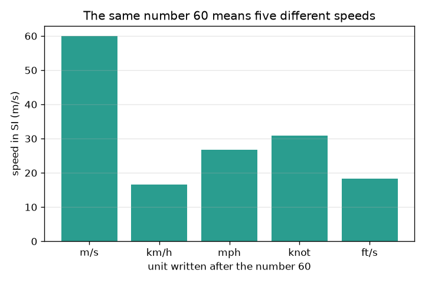
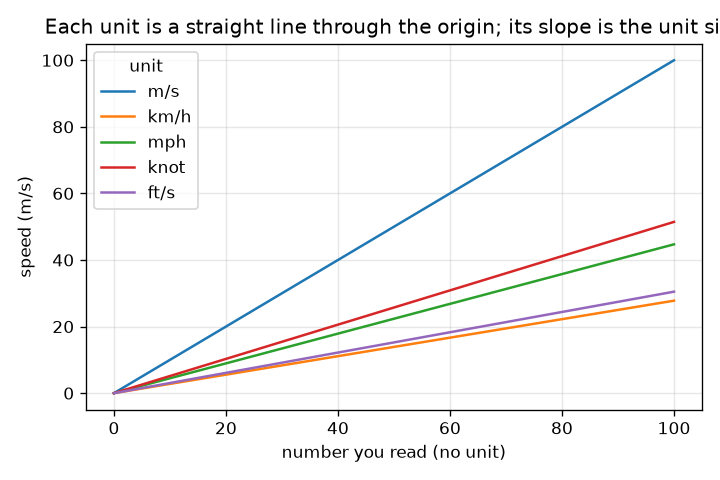

# సెషన్ 1: యూనిట్ లేని సంఖ్య జవాబు కాదు

[Session 1 — हिन्दी](README.hi.md) · [Session 1 — മലയാളം](README.ml.md) · [Session 1 — தமிழ்](README.ta.md) · [Session 1 — తెలుగు](README.te.md)

*స్థాయి 1 (భావనాత్మక ఇంటరాక్టివ్ మోడల్) · సుమారు 60 నిమిషాలు · openunits*

> ఇది సరళీకృత విద్యా నమూనా. ఇది ధృవీకరించబడిన (validated) డిజైన్ సాధనం కాదు; నిజమైన నిర్మాణాలు, విద్యుత్ వ్యవస్థలు, వాహనాలు, పారిశ్రామిక ప్రక్రియలు లేదా వైద్య నిర్ణయాల కోసం దీన్ని ఉపయోగించవద్దు.

**ముందస్తు అవసరాలు (Prerequisites)**

- దశాంశ సంఖ్యలను గుణించడం, భాగించడం; 10 యొక్క ఘాతాలు.
- మీరు PRIMER.md చదివి `python start.py 1` ను ఒకసారి నడిపారు.

**అభ్యాస లక్ష్యాలు (Learning objectives).** ఈ సెషన్ తర్వాత మీరు వీటిని చేయగలరు:

- ఒక సంఖ్య జవాబు కావాలంటే దానికి యూనిట్ ఎందుకు అవసరమో వివరించడం.
- SI లో ప్రతి యూనిట్ పరిమాణాన్ని ఉపయోగించి పొడవు, వేగం యూనిట్ల మధ్య మార్చడం.
- SI ఉపసర్గలను (కిలో, మిల్లీ, మైక్రో మరియు ఇతరాలు) 10 యొక్క ఘాతాలుగా వాడటం.
- తగిన సంఖ్యలో సార్థక అంకెలకు (significant figures) రౌండ్ చేసి, యూనిట్ మార్పిడి రేఖల గ్రాఫ్ చదవడం.

## A. నిజ ప్రపంచ సమస్య
ఒక స్నేహితుడు 'కారు 60 వెళ్ళింది' అని మెసేజ్ పెడతాడు. అరవై ఏమిటి? సెకనుకు మీటర్లు అంటే వేగంగా పరుగెత్తే అథ్లెట్, గంటకు కిలోమీటర్లు అంటే నగరంలో నెమ్మదిగా డ్రైవ్, గంటకు మైళ్ళు దానికంటే కొంచెం వేగం. యూనిట్లను కలిపేయడం పాఠశాల తప్పు మాత్రమే కాదు: అది నిజమైన ఇంజనీరింగ్ ప్రాజెక్టులకు భారీ నష్టం కలిగించింది. యూనిట్‌ను ఎప్పుడూ మరచిపోని కన్వర్టర్‌ను మనం తయారు చేయగలమా, యూనిట్ లేకపోవడం సంఖ్యను ఎంత మార్చగలదో చూడగలమా?

## B. భావన మరియు సిద్ధాంతం
SI (అంతర్జాతీయ యూనిట్ల వ్యవస్థ) పొడవుకు మీటర్ (m), ద్రవ్యరాశికి కిలోగ్రామ్ (kg), కాలానికి సెకను (s) వాడుతుంది. మిగతా ప్రతి యూనిట్ ఒక SI యూనిట్ యొక్క స్థిర గుణిజం: 1 km = 1000 m, 1 ft = 0.3048 m, 1 mile = 1609.344 m ఖచ్చితంగా. మార్చడానికి SI కి మార్చి, తర్వాత లక్ష్య యూనిట్‌కు మార్చండి: కొత్త యూనిట్‌లో సంఖ్య పాత సంఖ్య గుణించు (పాత యూనిట్ పరిమాణం) భాగించు (కొత్త యూనిట్ పరిమాణం). ఉపసర్గ అంటే యూనిట్ ముందు రాసే 10 యొక్క ఘాతం: కిలో = 10^3, మిల్లీ = 10^-3, మైక్రో = 10^-6. సార్థక అంకెలు ఒక సంఖ్యలోని ఎన్ని అంకెలను నమ్మవచ్చో చెబుతాయి: ఫలితం ఇన్‌పుట్ డేటా కంటే ఎక్కువ అంకెలను క్లెయిమ్ చేయకూడదు.

| గుర్తు | అర్థం | యూనిట్ |
|---|---|---|
| n | యూనిట్ ముందు రాసిన సంఖ్య | యూనిట్ లేదు |
| F_u | యూనిట్ u యొక్క SI లో పరిమాణం | ప్రతి యూనిట్‌కు SI యూనిట్లు |
| v | ఒక వేగం | m/s |
| k | ఒక ఉపసర్గ యొక్క 10 ఘాతం | యూనిట్ లేదు |

**ఊహలు (Assumptions)**

- అడుగులు, మైళ్ళు, నాట్లకు ఖచ్చితమైన నిర్వచనాలు వాడబడతాయి (నాటికల్ మైలు 1852 m).
- ఒకే రకం యూనిట్ల మధ్య మార్పిడులు మాత్రమే అనుమతించబడతాయి (పొడవు నుండి పొడవుకు, వేగం నుండి వేగానికి).
- రౌండింగ్ చివరిలో జరుగుతుంది, లెక్క మధ్యలో కాదు.

$$ n_{\text{new}}=n_{\text{old}}\,\frac{F_{\text{old}}}{F_{\text{new}}} $$

$$ 1\ \text{km/h}=\frac{1000\ \text{m}}{3600\ \text{s}}=0.2778\ \text{m/s} $$

$$ \text{kilo}=10^{3},\qquad \text{milli}=10^{-3},\qquad \text{micro}=10^{-6} $$

## C. దృశ్య వివరణ
మొదటి చిత్రం ఐదు వేర్వేరు యూనిట్లతో రాసిన కేవలం సంఖ్య 60 ను, అది నిజంగా సూచించే m/s వేగంగా గీసి చూపిస్తుంది: 16.7 m/s (km/h) నుండి 60 m/s (m/s) వరకు. రెండవ చిత్రం ప్రతి యూనిట్‌కు, m/s లో వేగాన్ని మీరు చదివే సంఖ్యకు వ్యతిరేకంగా గీస్తుంది. ప్రతి యూనిట్ సున్నా గుండా వెళ్ళే సరళరేఖ, దాని వాలు యూనిట్ పరిమాణం, కాబట్టి నిటారైన రేఖ పెద్ద యూనిట్.

*సంఖ్య 60 ఐదు వేర్వేరు యూనిట్లతో ఐదు వేర్వేరు వేగాలను సూచిస్తుంది.*

*ప్రతి యూనిట్ సున్నా గుండా సరళరేఖ; దాని వాలు m/s లో యూనిట్ పరిమాణం.*

## D. ఇంటరాక్టివ్ అనుకరణ
పాఠాన్ని నడపండి (`python start.py 1`), తర్వాత లైవ్ యాప్‌ను తెరవండి: [సెషన్ 1: వేగం కన్వర్టర్](https://krunalpanchal1995.github.io/pan-iit-oss/openunits/session-01/) (లేదా ఈ ఫోల్డర్‌లోని `app.html`). ఒక సంఖ్యను, ఒక యూనిట్ కోడ్‌ను ఎంచుకోండి (1 m/s, 2 km/h, 3 mph, 4 knot, 5 ft/s). చిత్ర వీక్షణలోని బార్లను, గ్రాఫ్ వీక్షణలోని రేఖలను గమనించండి; రీడ్‌అవుట్ అదే వేగాన్ని మూడు యూనిట్లలో చూపిస్తుంది.

**సవాలు.** యూనిట్ km/h తో 27.8 m/s ను సూచించే సెట్టింగ్‌ను కనుగొనండి.

## E. ఉదాహరణ సమస్య మరియు ప్రయోగం
**సమస్య.** ఒక సైన్ బోర్డు 72 km/h అని చెబుతుంది. వేగాన్ని m/s లో కనుగొనండి. తర్వాత 60 mph ను km/h కి మార్చి జవాబును 3 సార్థక అంకెలలో ఇవ్వండి.

1. 1 km/h = 1000 m / 3600 s = 0.27778 m/s.
2. 72 km/h = 72 * 0.27778 = 20.0 m/s.
3. 1 mph = 1609.344 m / 3600 s = 0.44704 m/s, 1 km/h = 0.27778 m/s.
4. 60 mph = 60 * 0.44704 / 0.27778 = 96.56 km/h.
5. 3 సార్థక అంకెలలో: 96.6 km/h.

**జవాబు.** 72 km/h ఖచ్చితంగా 20 m/s, 60 mph అంటే 96.6 km/h (3 సార్థక అంకెలు).

**ప్రయోగం.** టేపుతో 10.0 m గుర్తించి, స్థిరమైన వేగంతో నడిచి, ఫోన్ స్టాప్‌వాచ్‌తో సమయం కొలవండి. మీ వేగాన్ని m/s లో లెక్కించి, తర్వాత 3.6 తో గుణించి km/h కి మార్చండి. సాధారణ నడక వేగం కొన్ని km/h; మీ ఫోన్‌లోని అడుగులు లెక్కించే యాప్‌తో పోల్చండి. ఏ తేడా అయినా ఆరంభం, ముగింపులోని ప్రతిస్పందన సమయం నుండి వస్తుంది (7 s నడకలో సుమారు 0.2 s లోపం 3 శాతం): మార్పిడి ఖచ్చితమైనది, కొలత కాదు.

## F. మూల్యాంకనం మరియు డిజైన్ సవాలు
**ప్రశ్న రకం A: భావనాత్మక.** 'కారు ఎంత వేగంగా వెళ్ళింది?' అనే దానికి '60' పూర్తి జవాబు కాకపోవడం ఎందుకు? మీరు ఏమి జోడించాలి, ఇద్దరు విభేదించినప్పుడు SI యూనిట్ ఎందుకు సహాయపడుతుంది?

సూచన

km/h, mph, m/s తో 60 అంటే ఏమిటో ఆలోచించండి.

దశలవారీ పరిష్కారం

సంఖ్య మాత్రమే ఏ యూనిట్‌లో లెక్కిస్తున్నారో చెప్పదు; 60 అంటే 16.7 m/s, 26.8 m/s లేదా 60 m/s కావచ్చు. జవాబు అంటే యూనిట్‌తో కూడిన సంఖ్య. రెండింటినీ SI (m/s) కి మార్చడం రెండు ప్రకటనలను ఒకే స్కేలుపైకి తెస్తుంది, తద్వారా వాటిని పోల్చవచ్చు.

**ప్రశ్న రకం B: సంఖ్యాత్మక.** 100 km/h ను m/s గా, mph గా మార్చండి. మీ జవాబులు సహేతుకమేనా అని తనిఖీ చేయండి.

సూచన

1 km/h = 0.27778 m/s, 1 mph = 0.44704 m/s వాడండి.

దశలవారీ పరిష్కారం

100 km/h = 100 / 3.6 = 27.78 m/s. mph లో: 27.78 / 0.44704 = 62.14 mph. సహేతుకత తనిఖీ (sanity check): ఒక మైలు ఒక కిలోమీటర్ కంటే పొడవు, కాబట్టి mph సంఖ్య km/h సంఖ్య కంటే చిన్నదిగా ఉండాలి: 62 అనేది 100 కంటే చిన్నది. బాగుంది.

**ప్రశ్న రకం C: గ్రాఫ్, అనుకరణ వివరణ.** చదివిన సంఖ్యకు వ్యతిరేకంగా వేగం గ్రాఫ్‌లో, సంఖ్య 60 కి ఏ యూనిట్ అత్యధిక వేగాన్ని, ఏది అత్యల్పాన్ని ఇస్తుంది? ప్రతి రేఖ వాలు దేన్ని సూచిస్తుంది?

సూచన

x అక్షం మీద 60 వద్ద రేఖల ఎత్తులను పోల్చండి.

దశలవారీ పరిష్కారం

60 వద్ద, m/s 60 m/s ఇస్తుంది (అత్యధికం), mph 26.8 m/s, knot 30.9 m/s, ft/s 18.3 m/s, km/h 16.7 m/s (అత్యల్పం). వాలు అంటే m/s లో ఒక యూనిట్ పరిమాణం, కాబట్టి m/s కి వాలు 1, km/h కి వాలు 0.278.

**ప్రశ్న రకం D: డిజైన్, ఆప్టిమైజేషన్ సవాలు.** డిజైన్: సందర్శకుల కోసం ఒక రోడ్డు సైన్ 50 km/h పరిమితిని, దాని mph సమానాన్ని చూపాలి. ఒక రౌండింగ్‌ను ఎంచుకుని సమర్థించండి, స్పష్టత, ఖచ్చితత్వం మధ్య రాజీని (trade-off) గమనించండి.

సూచన

50 km/h ను mph గా మార్చి, పైకి రౌండ్ చేయడాన్ని కిందికి రౌండ్ చేయడంతో పోల్చండి.

దశలవారీ పరిష్కారం

50 km/h = 50 * 1000 / 1609.344 = 31.07 mph. 30 mph కి కిందికి రౌండ్ చేయడం చదవడానికి సులభం, కానీ mph సంఖ్యను అనుసరించే డ్రైవర్ 1.07 mph (3.5 శాతం) నెమ్మదిగా వెళ్తాడు, అది సురక్షితం; 31 లేదా 32 కి పైకి రౌండ్ చేయడం మెట్రిక్ పరిమితికి కొంచెం మించిన అధిక వేగాన్ని ఆహ్వానిస్తుంది. సహేతుకమైన డిజైన్ 31 mph (సమీప పూర్ణాంకం) చూపుతుంది, లేదా చట్టబద్ధ సంఖ్యను km/h లో ఇచ్చి 'సుమారు 30 mph' అని చెబుతుంది. ఊహ: దశాంశాల కంటే పూర్ణాంకాలు చదవడం సులభం.

[RUBRIC.md](../../RUBRIC.md) తో స్వయంగా స్కోర్ చేసుకోండి. కాగితంపై చేయడానికి [కార్యాచరణ షీట్](activity_sheet.md) ప్రింట్ చేయండి.

## సాధారణ అపోహలు
| సాధారణ అపోహ | వాస్తవంగా సరైనది |
|---|---|
| సంఖ్యే జవాబు; యూనిట్ అలంకారం. | యూనిట్ జవాబులో భాగం. 60 m/s, 60 km/h 3.6 రెట్లు తేడా. |
| ఉపసర్గలు పరిమాణాన్ని కొంచెం మాత్రమే మారుస్తాయి. | ఉపసర్గ అంటే 10 యొక్క ఘాతం: 1 km అంటే 1000 m, 1 mm అంటే 0.001 m, కాబట్టి ఒక కిలోమీటర్ ఒక మిలియన్ మిల్లీమీటర్లు. |
| ఎక్కువ అంకెలు అంటే మెరుగైన జవాబు. | అదనపు అంకెలు మీకు లేని ఖచ్చితత్వాన్ని క్లెయిమ్ చేస్తాయి. ఫలితం అందులోకి వెళ్ళిన డేటా కంటే ఖచ్చితంగా ఉండలేదు. |

## పదకోశం (Glossary)
- **SI**: మీటర్, కిలోగ్రామ్, సెకను ఆధారంగా నిర్మించిన అంతర్జాతీయ యూనిట్ల వ్యవస్థ
- **ఉపసర్గ (prefix)**: యూనిట్ ముందు ఉండి, 10 యొక్క ఘాతాన్ని సూచించే అక్షరం (k = 1000, m = 0.001)
- **మార్పిడి కారకం (conversion factor)**: మరొక యూనిట్‌లోని ఒకదానిలో ఉన్న SI యూనిట్ల సంఖ్య, ఉదాహరణకు ఒక అడుగులో 0.3048 m
- **సార్థక అంకెలు (significant figures)**: ఒక సంఖ్యలో నమ్మదగిన అంకెలు

## ముగించండి
1. [exercises.md](exercises.md) లోని మూడు కోడింగ్ పనులు చేయండి.
2. మీ మార్పుల తర్వాత `python start.py 1` ను మళ్ళీ నడపండి. అది చెక్‌పాయింట్‌తో ముగుస్తుంది; అది `PASS` ముద్రించినప్పుడు మీరు పూర్తి చేశారు. (చెక్‌పాయింట్ మాత్రమే: `python start.py check 1`.)

తదుపరి: [సెషన్ 2](../session-02/README.md)
