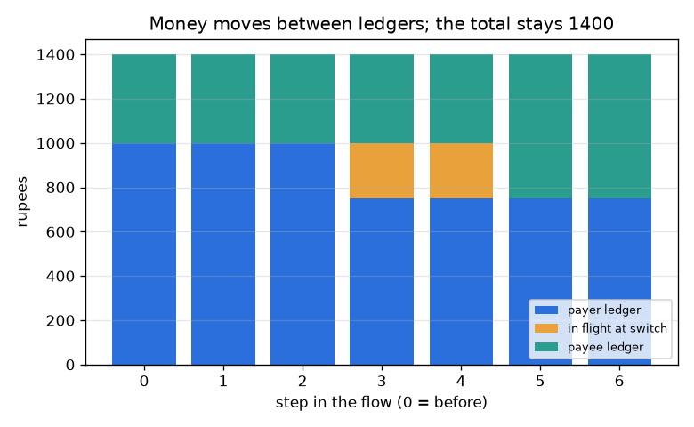
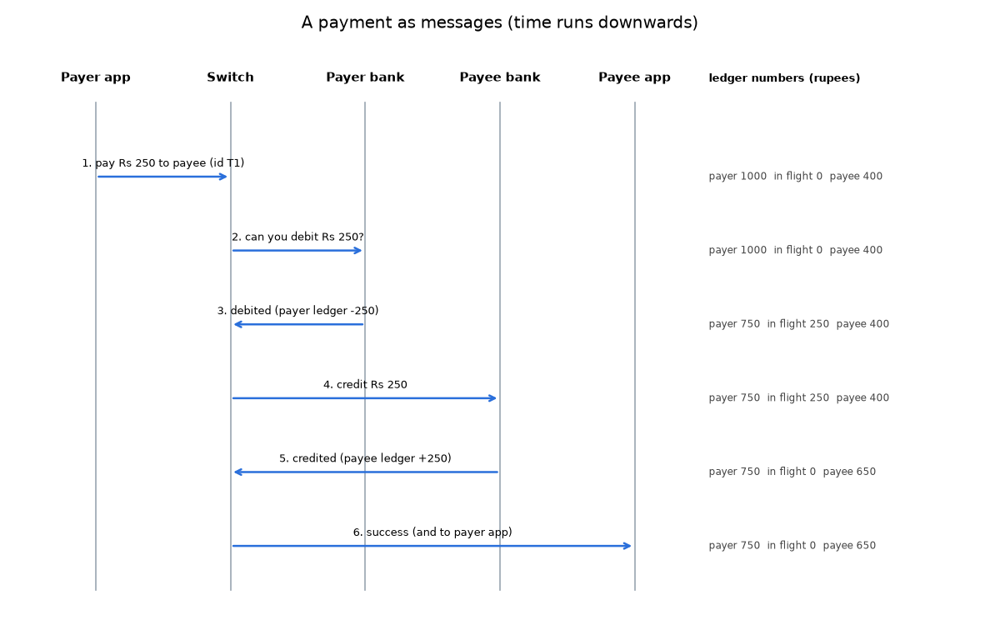

# सत्र 1: भुगतान के पात्र और उसका संदेश प्रवाह

*स्तर 1 (वैचारिक इंटरैक्टिव मॉडल) · लगभग 60 मिनट · openupi*

> यह एक सरलीकृत शैक्षिक मॉडल है। यह कोई प्रमाणित डिज़ाइन उपकरण नहीं है और इसका उपयोग वास्तविक संरचनाओं, बिजली की स्थापनाओं, वाहनों, औद्योगिक प्रक्रियाओं या चिकित्सा निर्णयों के लिए नहीं किया जाना चाहिए।

**पूर्वापेक्षाएँ (Prerequisites)**

- पूर्ण संख्याओं को जोड़ना और घटाना; दंड आरेख (bar chart) पढ़ना।
- आपने PRIMER.md पढ़ लिया है और `python start.py 1` एक बार चला लिया है।

**सीखने के उद्देश्य।** इस सत्र के बाद आप:

- डिजिटल भुगतान के पाँच पात्रों (actors) के नाम बता सकेंगे और बता सकेंगे कि हर एक क्या करता है और क्या अपने पास नहीं रखता।
- अनुक्रम आरेख (sequence diagram) पढ़ सकेंगे: समय नीचे की ओर चलता है और हर तीर एक संदेश है।
- समझा सकेंगे कि पैसा सिक्कों के रूप में नहीं, बल्कि बही-खातों (ledgers) में संख्याओं के बदलाव के रूप में चलता है।
- जाँच सकेंगे कि भुगतान के दौरान सभी बही-खातों और पारगमन (in-flight) डिब्बे का कुल कभी नहीं बदलता।

## A. वास्तविक दुनिया की समस्या
आप दुकान पर एक कोड स्कैन करते हैं, अपना PIN डालते हैं, और एक पल बाद दोनों फ़ोन सफलता दिखाते हैं। कुछ भी भौतिक रूप से नहीं हिला। तो वास्तव में क्या हुआ, किसने किससे बात की, और जब स्क्रीन घूम रही थी तब आपका पैसा कहाँ था? यह सत्र इस बारे में सामान्य शिक्षा है कि ऐसे तंत्र कैसे व्यवस्थित होते हैं, किसी वास्तविक ऐप, बैंक या खाते के बारे में सलाह नहीं, और यह एक सरलीकृत चित्र उपयोग करता है।

## B. अवधारणा और सिद्धांत
एक भुगतान में कई पात्र शामिल होते हैं। भुगतानकर्ता (payer) ऐप और प्राप्तकर्ता (payee) ऐप केवल फ़ोन पर खिड़कियाँ हैं: वे संदेश भेजते और दिखाते हैं और कोई पैसा नहीं रखते। हर ग्राहक का पैसा उस ग्राहक के बैंक द्वारा रखे गए बही-खाते में एक संख्या है। बीच में एक स्विच (switch) ऐप्स और बैंकों के बीच संदेश पहुँचाता है और रास्ते में भुगतान पर नज़र रखता है। भुगतानकर्ता ऐप स्विच से X रुपये चुकाने को कहता है; स्विच भुगतानकर्ता बैंक से X नामे (debit) करने को कहता है; भुगतानकर्ता बैंक भुगतानकर्ता के बही-खाते की संख्या घटाता है और ऐसा बताता है; स्विच प्राप्तकर्ता बैंक से X जमा (credit) करने को कहता है; प्राप्तकर्ता बैंक प्राप्तकर्ता के बही-खाते की संख्या बढ़ाता है और ऐसा बताता है; और स्विच दोनों ऐप्स को बताता है। नामे और जमा के बीच X रुपये पारगमन में होते हैं: हम उन्हें स्विच पर एक डिब्बे में गिनते हैं ताकि हर रुपये का हमेशा ठीक एक ठिकाना हो। यदि भुगतानकर्ता की शेष राशि X से कम है, तो भुगतानकर्ता बैंक मना कर देता है और कुछ नहीं हिलता।

| प्रतीक | अर्थ | इकाई |
|---|---|---|
| X | भुगतान राशि | रुपये |
| P | भुगतानकर्ता बैंक में भुगतानकर्ता की बही-खाता शेष राशि | रुपये |
| Q | प्राप्तकर्ता बैंक में प्राप्तकर्ता की बही-खाता शेष राशि | रुपये |
| F | स्विच पर पारगमन में पैसा | रुपये |
| T | तीनों डिब्बों का कुल | रुपये |
| k | संदेश प्रवाह में चरण (0 से 6) | गिनती |

**मान्यताएँ (Assumptions)**

- एक समय में एक भुगतान, कोई विफलता नहीं: हर संदेश पहुँचता है।
- बैंक और स्विच ईमानदार और सही हैं।
- राशियाँ पूर्ण रुपये और धनात्मक हैं।
- यह एक शिक्षण चित्र है, किसी वास्तविक भुगतान नेटवर्क का डिज़ाइन नहीं।

$$ P' = P - X,\qquad Q' = Q + X\qquad (X \le P) $$

$$ T = P + F + Q $$

$$ T_{\text{after}} = T_{\text{before}}\quad\text{(no money is created or lost)} $$

## C. दृश्य व्याख्या
पहला चित्र एक अनुक्रम आरेख है: पात्रों के लिए पाँच ऊर्ध्वाधर रेखाएँ, नीचे की ओर चलता समय, और हर संदेश के लिए एक तीर, हर तीर के बगल में तीनों बही-खाता संख्याएँ छपी हुई। दूसरा चित्र सातों चरणों में से हर एक पर तीनों डिब्बों (भुगतानकर्ता बही-खाता, पारगमन, प्राप्तकर्ता बही-खाता) को एक के ऊपर एक रखता है। ढेर की ऊँचाई पूरे रास्ते 1400 रहती है, जबकि रंग खिसकते हैं: चरण 3 पर नीला सिकुड़ता है, चरण 3 और 4 पर एक नारंगी पारगमन खंड दिखता है, और चरण 5 पर हरा बढ़ता है।

*हर चरण पर भुगतानकर्ता बही-खाता, पारगमन में पैसा और प्राप्तकर्ता बही-खाता: कुल 1400 रुपये रहता है।*

*छह संदेशों के रूप में एक भुगतान; हर तीर के बगल में तीनों बही-खाता संख्याएँ छपी हैं।*

## D. इंटरैक्टिव सिमुलेशन
पाठ चलाइए (`python start.py 1`), फिर लाइव ऐप खोलिए: [सत्र 1: एक भुगतान का अनुसरण कीजिए](https://krunalpanchal1995.github.io/pan-iit-oss/openupi/session-01/) (या इसी फ़ोल्डर में `app.html`)। चरण नियंत्रण को 0 से 6 तक खिसकाइए और देखिए कि बही-खाता डिब्बे केवल चरण 3 और 5 पर बदलते हैं; फिर राशि बदलिए और राशि के सापेक्ष अंतिम शेष राशियाँ देखने के लिए ग्राफ़ दृश्य खोलिए।

**चुनौती।** अंतिम संदेश के बाद प्राप्तकर्ता के पास ठीक Rs 900 रहें, ऐसा कीजिए।

## E. हल किया गया उदाहरण और प्रयोग
**समस्या।** भुगतानकर्ता के पास Rs 1000 हैं और प्राप्तकर्ता के पास Rs 400। भुगतानकर्ता Rs 250 चुकाता है। हर चरण के बाद तीनों संख्याएँ ज्ञात कीजिए और कुल जाँचिए।

1. चरण 3 से पहले कुछ नहीं हिला: भुगतानकर्ता 1000, पारगमन 0, प्राप्तकर्ता 400, कुल 1400।
2. चरण 3 (भुगतानकर्ता बैंक नामे करता है): भुगतानकर्ता = 1000 - 250 = 750 और पारगमन = 250। कुल = 750 + 250 + 400 = 1400।
3. चरण 4 (स्विच प्राप्तकर्ता बैंक से कहता है): अभी कुछ नहीं बदलता।
4. चरण 5 (प्राप्तकर्ता बैंक जमा करता है): पारगमन = 0 और प्राप्तकर्ता = 400 + 250 = 650। कुल = 750 + 0 + 650 = 1400।
5. समझदारी जाँच: भुगतानकर्ता ने 250 खोए और प्राप्तकर्ता ने 250 पाए, इसलिए कुल नहीं बदला।

**उत्तर।** अंतिम संदेश के बाद भुगतानकर्ता के पास Rs 750, प्राप्तकर्ता के पास Rs 650 हैं, पारगमन में कुछ नहीं है, और कुल अब भी Rs 1400 है।

**प्रयोग।** दोस्तों और काग़ज़ के साथ पात्रों का खेल खेलिए। एक व्यक्ति हर बैंक बनता है और काग़ज़ पर बही-खाता रखता है; एक स्विच बनता है और 'पारगमन में' लिखी पर्चियाँ रखता है; दो ऐप बनते हैं और केवल संदेश ले जा सकते हैं। Rs 250 का भुगतान चलाइए, फिर एक ऐसा चलाइए जिसमें भुगतानकर्ता के पास बहुत कम हो। काग़ज़ी बही-खातों की तुलना ऐप के रीडआउट से कीजिए। मॉडल बनाम वास्तविकता: काग़ज़ी संस्करण में कोई संदेश खोता नहीं और कोई धोखा नहीं होता, और वास्तविक बैंक लॉग, शुल्क, सीमाएँ और क़ानूनी रिकॉर्ड भी रखते हैं जिन्हें यह चित्र छोड़ देता है।

## F. मूल्यांकन और डिज़ाइन चुनौती
**प्रश्न प्रकार A: वैचारिक।** भुगतानकर्ता ऐप और प्राप्तकर्ता ऐप कोई पैसा क्यों नहीं रखते, और हमें स्विच पर पारगमन डिब्बे की ज़रूरत क्यों है?

संकेत

बही-खाता संख्याएँ कहाँ रहती हैं, और चरण 3 और 5 के बीच पैसा कहाँ होता है?

चरण-दर-चरण हल

ऐप केवल खिड़कियाँ हैं जो संदेश भेजती और दिखाती हैं। बही-खाता संख्याएँ बैंकों में रहती हैं। नामे (चरण 3) और जमा (चरण 5) के बीच भुगतानकर्ता का बही-खाता पहले ही कम हो चुका है पर प्राप्तकर्ता का अभी बढ़ा नहीं है। पैसे को पारगमन डिब्बे में गिनने से हर रुपये को हर क्षण ठीक एक ठिकाना मिलता है, इसलिए कुल समान रहता है और हम उसे जाँच सकते हैं।

**प्रश्न प्रकार B: संख्यात्मक।** भुगतानकर्ता के पास Rs 2000 हैं और प्राप्तकर्ता के पास Rs 150। भुगतानकर्ता Rs 600 चुकाता है। चरण 3 के बाद और चरण 6 के बाद तीनों संख्याएँ, और हर बार कुल बताइए।

संकेत

चरण 3 राशि को पारगमन में ले जाता है; चरण 5 उसे प्राप्तकर्ता के बही-खाते में ले जाता है।

चरण-दर-चरण हल

चरण 3 के बाद: भुगतानकर्ता 2000 - 600 = 1400, पारगमन 600, प्राप्तकर्ता 150, कुल 2150। चरण 6 के बाद: भुगतानकर्ता 1400, पारगमन 0, प्राप्तकर्ता 150 + 600 = 750, कुल 1400 + 0 + 750 = 2150। इकाई: रुपये। कुल समान है, जैसा होना चाहिए।

**प्रश्न प्रकार C: ग्राफ़ और सिमुलेशन की व्याख्या।** एक के ऊपर एक रखे दंडों वाले चित्र में किन चरणों पर नारंगी पारगमन खंड है, और कुल ऊँचाई का क्या होता है?

संकेत

वे चरण खोजिए जहाँ नामे हो चुका है पर जमा नहीं।

चरण-दर-चरण हल

नारंगी खंड केवल चरण 3 और 4 के बाद है: नामे हो चुका है, जमा नहीं। कुल ऊँचाई हर चरण पर 1400 रुपये है, क्योंकि नीला खंड ठीक उतना खोता है जितना नारंगी पाता है, और नारंगी ठीक उतना खोता है जितना हरा पाता है।

**प्रश्न प्रकार D: डिज़ाइन और अनुकूलन (optimisation) चुनौती।** डिज़ाइन: स्विच चरण 3 के बाद क्रैश हो जाता है और चरण 4 कभी नहीं भेजता। भुगतानकर्ता Rs 250 खो चुका है और प्राप्तकर्ता को कुछ नहीं मिला। तंत्र के उबरने (recover) के दो समझदार तरीक़े बताइए, और हर एक को क्या याद रखना होगा।

संकेत

या तो भुगतान पूरा कीजिए या उसे पलटिए। कौन-सा रिकॉर्ड आपको तय करने देगा?

चरण-दर-चरण हल

विकल्प 1, पूरा करना: स्विच (या एक पुनरारंभ प्रक्रिया) उसी लेनदेन पहचान (transaction id) के साथ प्राप्तकर्ता बैंक को जमा फिर से भेजता है, ताकि दोहराया गया जमा दो बार लागू न हो सके। विकल्प 2, पलटना: भुगतानकर्ता बैंक Rs 250 वापस भुगतानकर्ता को जमा करता है और भुगतान को विफल दर्ज करता है। किसी भी तरह तंत्र को लेनदेन पहचान, राशि, दोनों खाते और वह कहाँ तक पहुँचा, यह टिकाऊ रूप से याद रखना होगा। समझौता (trade-off): पूरा करना दुकान के लिए बेहतर है पर प्राप्तकर्ता बैंक का पहुँच योग्य होना ज़रूरी है; पलटना सरल है पर ग्राहक को फिर कोशिश करनी पड़ती है। सत्र 2 दिखाता है कि बही-खाता इसे सब-या-कुछ-नहीं (all-or-nothing) कैसे बनाता है।

[RUBRIC.md](../../RUBRIC.md) से स्वयं को अंक दीजिए। काग़ज़ पर काम करने के लिए [गतिविधि पत्रक](activity_sheet.md) प्रिंट कीजिए।

## सामान्य भ्रांतियाँ
| सामान्य भ्रांति | वास्तव में क्या सच है |
|---|---|
| पैसा मेरे फ़ोन से दुकान के फ़ोन तक यात्रा करता है। | फ़ोन कोई पैसा नहीं रखते। बैंकों में दो बही-खाता संख्याएँ बदलती हैं; संदेश प्रवाह बैंकों को बताता है कि उन्हें कब बदलना है। |
| जिस क्षण मेरी स्क्रीन सफलता दिखाती है, भुगतान पूरा हो जाता है। | स्क्रीन एक संदेश दिखाती है। भुगतान तभी वास्तविक होता है जब दोनों बही-खाते अद्यतन हो चुके हों। |
| स्विच सबका पैसा रखता है। | इस चित्र में स्विच किसी भुगतान की राशि को केवल थोड़ी देर, पारगमन के रूप में, रखता है। बही-खाते बैंक रखते हैं। |

## शब्दावली
- **बही-खाता (ledger)**: खातों की सूची और बैंक पर हर एक के कितने रुपये बकाया हैं
- **स्विच (switch)**: साझा बीच का डिब्बा जो ऐप्स और बैंकों के बीच संदेश पहुँचाता है
- **अनुक्रम आरेख (sequence diagram)**: हर पात्र के लिए एक ऊर्ध्वाधर रेखा और हर संदेश के लिए एक तीर वाला चित्र, समय नीचे की ओर
- **पारगमन में (in flight)**: वह पैसा जो एक बही-खाते से निकल चुका है पर दूसरे तक अभी नहीं पहुँचा
- **नामे / जमा (debit / credit)**: ग्राहक के खाते से पैसा निकालना / उसमें पैसा डालना

## समापन
1. [exercises.md](exercises.md) में दिए तीन कोडिंग कार्य कीजिए।
2. अपने बदलावों के बाद `python start.py 1` फिर से चलाइए। यह चेकपॉइंट (checkpoint) पर समाप्त होता है; जब यह `PASS` छापे, तो आपका काम पूरा है। (केवल चेकपॉइंट: `python start.py check 1`।)

अगला: [सत्र 2](../session-02/README.md)
