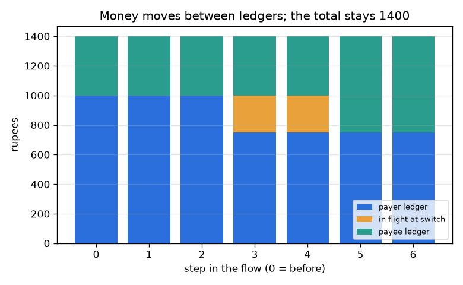
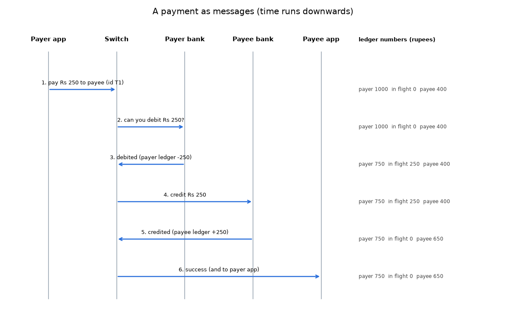

# സെഷൻ 1: ഒരു പേയ്‌മെന്റിലെ കഥാപാത്രങ്ങളും അതിന്റെ സന്ദേശ പ്രവാഹവും

[Session 1 — हिन्दी](README.hi.md)

*ലെവൽ 1 (ആശയപരമായ ഇന്ററാക്ടീവ് മോഡൽ) · ഏകദേശം 60 മിനിറ്റ് · openupi*

> ഇത് ലളിതമാക്കിയ ഒരു വിദ്യാഭ്യാസ മോഡൽ ആണ്. ഇത് സാധൂകരിച്ച (validated) ഡിസൈൻ ഉപകരണമല്ല; യഥാർത്ഥ നിർമിതികൾ, വൈദ്യുത ഇൻസ്റ്റലേഷനുകൾ, വാഹനങ്ങൾ, വ്യാവസായിക പ്രക്രിയകൾ അല്ലെങ്കിൽ വൈദ്യശാസ്ത്ര തീരുമാനങ്ങൾ എന്നിവയ്ക്ക് ഇത് ഉപയോഗിക്കരുത്.

**മുൻകൂട്ടി അറിയേണ്ടവ (Prerequisites)**

- പൂർണ്ണസംഖ്യകൾ കൂട്ടലും കുറയ്ക്കലും; ബാർ ചാർട്ട് വായിക്കൽ.
- നിങ്ങൾ PRIMER.md വായിച്ചിട്ടുണ്ട്, `python start.py 1` ഒരിക്കൽ റൺ ചെയ്തിട്ടുണ്ട്.

**പഠന ലക്ഷ്യങ്ങൾ (Learning objectives).** ഈ സെഷനു ശേഷം നിങ്ങൾക്ക്:

- ഒരു ഡിജിറ്റൽ പേയ്‌മെന്റിലെ അഞ്ച് കഥാപാത്രങ്ങളുടെ (actors) പേരുകൾ പറയാം, ഓരോരുത്തരും എന്ത് ചെയ്യുന്നു, എന്ത് കൈവശം വയ്ക്കുന്നു, എന്ത് വയ്ക്കുന്നില്ല എന്ന് പറയാം.
- ഒരു സീക്വൻസ് ഡയഗ്രം (sequence diagram) വായിക്കാം: സമയം താഴേക്ക് ഒഴുകുന്നു, ഓരോ അമ്പും ഒരു സന്ദേശമാണ്.
- പണം നാണയങ്ങളായല്ല, ലെഡ്ജറുകളിലെ (ledger) സംഖ്യകളുടെ മാറ്റമായാണ് നീങ്ങുന്നതെന്ന് വിശദീകരിക്കാം.
- ഒരു പേയ്‌മെന്റിനിടെ എല്ലാ ലെഡ്ജറുകളിലെയും യാത്രയിലുള്ള (in-flight) പെട്ടിയിലെയും ആകെത്തുക ഒരിക്കലും മാറുന്നില്ലെന്ന് പരിശോധിക്കാം.

## A. യഥാർത്ഥ ലോക പ്രശ്നം
നിങ്ങൾ ഒരു കടയിൽ കോഡ് സ്കാൻ ചെയ്യുന്നു, PIN ടൈപ്പ് ചെയ്യുന്നു, ഒരു നിമിഷം കഴിഞ്ഞ് രണ്ട് ഫോണുകളും വിജയം പറയുന്നു. ഭൗതികമായി ഒന്നും നീങ്ങിയില്ല. അപ്പോൾ യഥാർത്ഥത്തിൽ എന്താണ് സംഭവിച്ചത്, ആരാണ് ആരോട് സംസാരിച്ചത്, സ്ക്രീൻ കറങ്ങുമ്പോൾ നിങ്ങളുടെ പണം എവിടെയായിരുന്നു? ഈ സെഷൻ അത്തരം സംവിധാനങ്ങൾ എങ്ങനെ ക്രമീകരിച്ചിരിക്കുന്നു എന്നതിനെക്കുറിച്ചുള്ള പൊതു വിദ്യാഭ്യാസമാണ്, ഏതെങ്കിലും യഥാർത്ഥ ആപ്പ്, ബാങ്ക് അല്ലെങ്കിൽ അക്കൗണ്ട് സംബന്ധിച്ച ഉപദേശമല്ല, അത് ലളിതമാക്കിയ ഒരു ചിത്രമാണ് ഉപയോഗിക്കുന്നത്.

## B. ആശയവും സിദ്ധാന്തവും
ഒരു പേയ്‌മെന്റിൽ ഒരു കൂട്ടം കഥാപാത്രങ്ങളുണ്ട്. പണം നൽകുന്നയാളുടെ ആപ്പും (payer app) സ്വീകരിക്കുന്നയാളുടെ ആപ്പും (payee app) ഫോണുകളിലെ ജാലകങ്ങൾ മാത്രമാണ്: അവ സന്ദേശങ്ങൾ അയയ്ക്കുകയും കാണിക്കുകയും ചെയ്യുന്നു, പണം കൈവശം വയ്ക്കുന്നില്ല. ഓരോ ഉപഭോക്താവിന്റെയും പണം ആ ഉപഭോക്താവിന്റെ ബാങ്ക് സൂക്ഷിക്കുന്ന ഒരു ലെഡ്ജറിലെ സംഖ്യയാണ്. നടുവിലുള്ള ഒരു സ്വിച്ച് (switch) ആപ്പുകൾക്കും ബാങ്കുകൾക്കും ഇടയിൽ സന്ദേശങ്ങൾ കൈമാറുകയും പേയ്‌മെന്റിനെ അതിന്റെ യാത്രയിൽ പിന്തുടരുകയും ചെയ്യുന്നു. പേയർ ആപ്പ് X രൂപ അടയ്ക്കാൻ സ്വിച്ചിനോട് ആവശ്യപ്പെടുന്നു; സ്വിച്ച് X ഡെബിറ്റ് ചെയ്യാൻ പേയർ ബാങ്കിനോട് ആവശ്യപ്പെടുന്നു; പേയർ ബാങ്ക് പേയറുടെ ലെഡ്ജർ സംഖ്യ കുറച്ച് അത് അറിയിക്കുന്നു; സ്വിച്ച് X ക്രെഡിറ്റ് ചെയ്യാൻ പേയി ബാങ്കിനോട് ആവശ്യപ്പെടുന്നു; പേയി ബാങ്ക് പേയിയുടെ ലെഡ്ജർ സംഖ്യ കൂട്ടി അത് അറിയിക്കുന്നു; സ്വിച്ച് രണ്ട് ആപ്പുകളോടും പറയുന്നു. ഡെബിറ്റിനും ക്രെഡിറ്റിനും ഇടയിൽ X രൂപ യാത്രയിലാണ് (in flight): എല്ലാ രൂപയ്ക്കും എപ്പോഴും കൃത്യം ഒരു വീട് ഉണ്ടാകാൻ നാം അതിനെ സ്വിച്ചിലെ ഒരു പെട്ടിയിൽ എണ്ണുന്നു. പേയറുടെ ബാലൻസ് X-ൽ കുറവാണെങ്കിൽ പേയർ ബാങ്ക് നിരസിക്കുന്നു, ഒന്നും നീങ്ങുന്നില്ല.

| ചിഹ്നം | അർത്ഥം | യൂണിറ്റ് |
|---|---|---|
| X | പേയ്‌മെന്റ് തുക | രൂപ |
| P | പേയർ ബാങ്കിലെ പേയറുടെ ലെഡ്ജർ ബാലൻസ് | രൂപ |
| Q | പേയി ബാങ്കിലെ പേയിയുടെ ലെഡ്ജർ ബാലൻസ് | രൂപ |
| F | സ്വിച്ചിൽ യാത്രയിലുള്ള പണം | രൂപ |
| T | മൂന്ന് പെട്ടികളുടെയും ആകെത്തുക | രൂപ |
| k | സന്ദേശ പ്രവാഹത്തിലെ ഘട്ടം (0 മുതൽ 6 വരെ) | എണ്ണം |

**അനുമാനങ്ങൾ (Assumptions)**

- ഒരു സമയം ഒരു പേയ്‌മെന്റ്, പരാജയങ്ങളില്ല: എല്ലാ സന്ദേശങ്ങളും എത്തുന്നു.
- ബാങ്കുകളും സ്വിച്ചും സത്യസന്ധവും ശരിയുമാണ്.
- തുകകൾ പൂർണ്ണ രൂപയും പോസിറ്റീവും ആണ്.
- ഇത് ഒരു പഠന ചിത്രമാണ്, ഏതെങ്കിലും യഥാർത്ഥ പേയ്‌മെന്റ് നെറ്റ്‌വർക്കിന്റെ ഡിസൈൻ അല്ല.

$$ P' = P - X,\qquad Q' = Q + X\qquad (X \le P) $$

$$ T = P + F + Q $$

$$ T_{\text{after}} = T_{\text{before}}\quad\text{(no money is created or lost)} $$

## C. ദൃശ്യ വിശദീകരണം
ആദ്യ ചിത്രം ഒരു സീക്വൻസ് ഡയഗ്രം ആണ്: കഥാപാത്രങ്ങൾക്കായി അഞ്ച് ലംബ രേഖകൾ, സമയം താഴേക്ക്, ഓരോ സന്ദേശത്തിനും ഒരു അമ്പ്, ഓരോ അമ്പിന്റെയും അരികിൽ മൂന്ന് ലെഡ്ജർ സംഖ്യകൾ. രണ്ടാമത്തെ ചിത്രം ഏഴ് ഘട്ടങ്ങളിൽ ഓരോന്നിലും മൂന്ന് പെട്ടികൾ (പേയർ ലെഡ്ജർ, യാത്രയിൽ, പേയി ലെഡ്ജർ) അടുക്കി വയ്ക്കുന്നു. അടുക്കിന്റെ ഉയരം താഴേക്ക് മുഴുവൻ 1400 ആയി തുടരുന്നു, നിറങ്ങൾ മാത്രം നീങ്ങുന്നു: ഘട്ടം 3-ൽ നീല ചുരുങ്ങുന്നു, ഘട്ടം 3-ലും 4-ലും ഓറഞ്ച് യാത്രയിലുള്ള ബ്ലോക്ക് പ്രത്യക്ഷപ്പെടുന്നു, ഘട്ടം 5-ൽ പച്ച വളരുന്നു.

*ഓരോ ഘട്ടത്തിലും പേയർ ലെഡ്ജർ, യാത്രയിലുള്ള പണം, പേയി ലെഡ്ജർ: ആകെ 1400 രൂപ ആയി തുടരുന്നു.*

*ആറ് സന്ദേശങ്ങളായി ഒരു പേയ്‌മെന്റ്; മൂന്ന് ലെഡ്ജർ സംഖ്യകൾ ഓരോ അമ്പിന്റെയും അരികിൽ അച്ചടിച്ചിരിക്കുന്നു.*

## D. ഇന്ററാക്ടീവ് സിമുലേഷൻ
പാഠം റൺ ചെയ്യുക (`python start.py 1`), തുടർന്ന് ലൈവ് ആപ്പ് തുറക്കുക: [സെഷൻ 1: ഒരു പേയ്‌മെന്റിനെ പിന്തുടരുക](https://krunalpanchal1995.github.io/pan-iit-oss/openupi/session-01/) (അല്ലെങ്കിൽ ഈ ഫോൾഡറിലെ `app.html`). ഘട്ട നിയന്ത്രണം 0 മുതൽ 6 വരെ സ്ലൈഡ് ചെയ്ത് ലെഡ്ജർ പെട്ടികൾ ഘട്ടം 3-ലും 5-ലും മാത്രം മാറുന്നത് നിരീക്ഷിക്കുക; തുടർന്ന് തുക മാറ്റി, തുകയ്ക്കെതിരായ അന്തിമ ബാലൻസുകൾ കാണാൻ ഗ്രാഫ് കാഴ്ച തുറക്കുക.

**വെല്ലുവിളി.** അവസാന സന്ദേശത്തിന് ശേഷം പേയിക്ക് കൃത്യം Rs 900 ഉണ്ടാകുന്ന തരത്തിൽ ആക്കുക.

## E. ഉദാഹരണവും പരീക്ഷണവും
**പ്രശ്നം.** പേയറുടെ കൈവശം Rs 1000, പേയിയുടെ കൈവശം Rs 400 ഉണ്ട്. പേയർ Rs 250 അടയ്ക്കുന്നു. ഓരോ ഘട്ടത്തിനും ശേഷമുള്ള മൂന്ന് സംഖ്യകൾ കണ്ടെത്തി ആകെത്തുക പരിശോധിക്കുക.

1. ഘട്ടം 3-ന് മുമ്പ് ഒന്നും നീങ്ങിയിട്ടില്ല: പേയർ 1000, യാത്രയിൽ 0, പേയി 400, ആകെ 1400.
2. ഘട്ടം 3 (പേയർ ബാങ്ക് ഡെബിറ്റ് ചെയ്യുന്നു): പേയർ = 1000 - 250 = 750, യാത്രയിൽ = 250. ആകെ = 750 + 250 + 400 = 1400.
3. ഘട്ടം 4 (സ്വിച്ച് പേയി ബാങ്കിനോട് ആവശ്യപ്പെടുന്നു): ഇതുവരെ ഒന്നും മാറുന്നില്ല.
4. ഘട്ടം 5 (പേയി ബാങ്ക് ക്രെഡിറ്റ് ചെയ്യുന്നു): യാത്രയിൽ = 0, പേയി = 400 + 250 = 650. ആകെ = 750 + 0 + 650 = 1400.
5. പരിശോധന: പേയർക്ക് 250 നഷ്ടമായി, പേയിക്ക് 250 കിട്ടി, അതിനാൽ ആകെത്തുക മാറിയില്ല.

**ഉത്തരം.** അവസാന സന്ദേശത്തിന് ശേഷം പേയറുടെ കൈവശം Rs 750, പേയിയുടെ കൈവശം Rs 650, യാത്രയിൽ ഒന്നുമില്ല, ആകെത്തുക ഇപ്പോഴും Rs 1400 ആണ്.

**പരീക്ഷണം.** സുഹൃത്തുക്കളോടൊപ്പം പേപ്പർ ഉപയോഗിച്ച് കഥാപാത്രങ്ങളെ അഭിനയിക്കുക. ഒരാൾ ഓരോ ബാങ്കും ആയി പേപ്പറിൽ ഒരു ലെഡ്ജർ സൂക്ഷിക്കുന്നു; ഒരാൾ സ്വിച്ച് ആയി 'യാത്രയിൽ' എന്ന് അടയാളപ്പെടുത്തിയ ചീട്ടുകൾ കൈവശം വയ്ക്കുന്നു; രണ്ടുപേർ ആപ്പുകളായി സന്ദേശങ്ങൾ മാത്രം കൊണ്ടുപോകുന്നു. Rs 250 പേയ്‌മെന്റ് റൺ ചെയ്യുക, പിന്നെ പേയറുടെ കൈവശം വളരെ കുറച്ച് മാത്രമുള്ള ഒന്ന് റൺ ചെയ്യുക. പേപ്പർ ലെഡ്ജറുകളെ ആപ്പിന്റെ റീഡൗട്ടുമായി താരതമ്യം ചെയ്യുക. മോഡലും യാഥാർത്ഥ്യവും: പേപ്പർ പതിപ്പിൽ നഷ്ടപ്പെടുന്ന സന്ദേശങ്ങളോ വഞ്ചനയോ ഇല്ല, യഥാർത്ഥ ബാങ്കുകൾ ലോഗുകൾ, ഫീസ്, പരിധികൾ, നിയമപരമായ രേഖകൾ എന്നിവയും സൂക്ഷിക്കുന്നു, ഈ ചിത്രം അവ ഒഴിവാക്കുന്നു.

## F. വിലയിരുത്തലും ഡിസൈൻ വെല്ലുവിളിയും
**ചോദ്യ തരം A: ആശയപരം.** പേയർ ആപ്പും പേയി ആപ്പും പണം കൈവശം വയ്ക്കാത്തത് എന്തുകൊണ്ട്, സ്വിച്ചിലെ യാത്രയിലുള്ള പെട്ടി നമുക്ക് എന്തിന് വേണം?

സൂചന

ലെഡ്ജർ സംഖ്യകൾ എവിടെയാണ് ഉള്ളത്, 3-നും 5-നും ഇടയിലുള്ള ഘട്ടങ്ങളിൽ പണം എവിടെയാണ്?

ഘട്ടം ഘട്ടമായുള്ള പരിഹാരം

ആപ്പുകൾ സന്ദേശങ്ങൾ അയയ്ക്കുകയും കാണിക്കുകയും ചെയ്യുന്ന ജാലകങ്ങൾ മാത്രമാണ്. ലെഡ്ജർ സംഖ്യകൾ ബാങ്കുകളിലാണ്. ഡെബിറ്റിനും (ഘട്ടം 3) ക്രെഡിറ്റിനും (ഘട്ടം 5) ഇടയിൽ പേയറുടെ ലെഡ്ജർ ഇതിനകം കുറഞ്ഞിരിക്കുന്നു, പക്ഷേ പേയിയുടേത് ഇതുവരെ കൂടിയിട്ടില്ല. പണത്തെ യാത്രയിലുള്ള പെട്ടിയിൽ എണ്ണുന്നത് ഓരോ നിമിഷവും ഓരോ രൂപയ്ക്കും കൃത്യം ഒരു വീട് നൽകുന്നു, അതിനാൽ ആകെത്തുക അതേപടി തുടരുന്നു, നമുക്ക് അത് പരിശോധിക്കാനും കഴിയും.

**ചോദ്യ തരം B: സംഖ്യാപരം.** പേയറുടെ കൈവശം Rs 2000, പേയിയുടെ കൈവശം Rs 150 ഉണ്ട്. പേയർ Rs 600 അടയ്ക്കുന്നു. ഘട്ടം 3-ന് ശേഷവും ഘട്ടം 6-ന് ശേഷവുമുള്ള മൂന്ന് സംഖ്യകളും ഓരോ തവണയും ആകെത്തുകയും നൽകുക.

സൂചന

ഘട്ടം 3 തുകയെ യാത്രയിലേക്ക് മാറ്റുന്നു; ഘട്ടം 5 അതിനെ പേയി ലെഡ്ജറിലേക്ക് മാറ്റുന്നു.

ഘട്ടം ഘട്ടമായുള്ള പരിഹാരം

ഘട്ടം 3-ന് ശേഷം: പേയർ 2000 - 600 = 1400, യാത്രയിൽ 600, പേയി 150, ആകെ 2150. ഘട്ടം 6-ന് ശേഷം: പേയർ 1400, യാത്രയിൽ 0, പേയി 150 + 600 = 750, ആകെ 1400 + 0 + 750 = 2150. യൂണിറ്റ്: രൂപ. ആകെത്തുക അതേപടിയാണ്, അങ്ങനെ ആയിരിക്കണം.

**ചോദ്യ തരം C: ഗ്രാഫും സിമുലേഷനും വ്യാഖ്യാനിക്കൽ.** അടുക്കിയ ബാർ ചിത്രത്തിൽ, ഏത് ഘട്ടങ്ങളിലാണ് ഓറഞ്ച് യാത്രയിലുള്ള ബ്ലോക്ക് ഉള്ളത്, ആകെ ഉയരത്തിന് എന്ത് സംഭവിക്കുന്നു?

സൂചന

ഡെബിറ്റ് നടന്നിട്ടും ക്രെഡിറ്റ് നടക്കാത്ത ഘട്ടങ്ങൾ കണ്ടെത്തുക.

ഘട്ടം ഘട്ടമായുള്ള പരിഹാരം

ഓറഞ്ച് ബ്ലോക്ക് ഘട്ടം 3-നും 4-നും ശേഷം മാത്രമേ ഉള്ളൂ: ഡെബിറ്റ് നടന്നു, ക്രെഡിറ്റ് നടന്നിട്ടില്ല. ആകെ ഉയരം എല്ലാ ഘട്ടത്തിലും 1400 രൂപയാണ്, കാരണം നീല ബ്ലോക്ക് നഷ്ടപ്പെടുന്നത് ഓറഞ്ച് ബ്ലോക്ക് കൃത്യമായി നേടുന്നു, ഓറഞ്ച് ബ്ലോക്ക് നഷ്ടപ്പെടുന്നത് പച്ച ബ്ലോക്ക് കൃത്യമായി നേടുന്നു.

**ചോദ്യ തരം D: ഡിസൈനും ഒപ്റ്റിമൈസേഷനും വെല്ലുവിളി.** ഡിസൈൻ: ഘട്ടം 3-ന് ശേഷം സ്വിച്ച് ക്രാഷ് ചെയ്യുന്നു, ഘട്ടം 4 ഒരിക്കലും അയയ്ക്കുന്നില്ല. പേയർക്ക് Rs 250 നഷ്ടമായി, പേയിക്ക് ഒന്നും കിട്ടിയില്ല. സിസ്റ്റത്തിന് വീണ്ടെടുക്കാവുന്ന രണ്ട് യുക്തിസഹമായ വഴികൾ വിവരിക്കുക, ഓരോന്നിനും എന്ത് ഓർമ്മിക്കേണ്ടി വരും എന്നും.

സൂചന

ഒന്നുകിൽ പേയ്‌മെന്റ് പൂർത്തിയാക്കുക അല്ലെങ്കിൽ അത് റദ്ദാക്കുക. തീരുമാനിക്കാൻ ഏത് രേഖ നിങ്ങളെ സഹായിക്കും?

ഘട്ടം ഘട്ടമായുള്ള പരിഹാരം

ഓപ്ഷൻ 1, പൂർത്തിയാക്കുക: സ്വിച്ച് (അല്ലെങ്കിൽ ഒരു റീസ്റ്റാർട്ട് നടപടിക്രമം) അതേ ട്രാൻസാക്ഷൻ ഐഡി ഉപയോഗിച്ച് പേയി ബാങ്കിലേക്ക് ക്രെഡിറ്റ് വീണ്ടും അയയ്ക്കുന്നു, അതിനാൽ ആവർത്തിച്ചുള്ള ക്രെഡിറ്റ് രണ്ടുതവണ ബാധകമാകില്ല. ഓപ്ഷൻ 2, തിരിച്ചാക്കുക: പേയർ ബാങ്ക് Rs 250 പേയർക്ക് തിരികെ ക്രെഡിറ്റ് ചെയ്യുകയും പേയ്‌മെന്റ് പരാജയപ്പെട്ടതായി രേഖപ്പെടുത്തുകയും ചെയ്യുന്നു. ഏത് വഴിയായാലും സിസ്റ്റം ട്രാൻസാക്ഷൻ ഐഡി, തുക, രണ്ട് അക്കൗണ്ടുകൾ, എത്ര ദൂരം എത്തി എന്നിവ സ്ഥിരമായി ഓർമ്മിക്കണം. വിട്ടുവീഴ്ച (trade-off): പൂർത്തിയാക്കുന്നത് കടയ്ക്ക് നല്ലതാണ്, പക്ഷേ പേയി ബാങ്ക് ലഭ്യമായിരിക്കണം; തിരിച്ചാക്കുന്നത് ലളിതമാണ്, പക്ഷേ ഉപഭോക്താവ് വീണ്ടും ശ്രമിക്കണം. ഒരു ലെഡ്ജർ ഇത് എങ്ങനെ എല്ലാം-അല്ലെങ്കിൽ-ഒന്നുമില്ല (all-or-nothing) ആക്കുന്നു എന്ന് സെഷൻ 2 കാണിക്കുന്നു.

[RUBRIC.md](../../RUBRIC.md) ഉപയോഗിച്ച് സ്വയം സ്കോർ ചെയ്യുക. പേപ്പറിൽ ചെയ്യാൻ [ആക്ടിവിറ്റി ഷീറ്റ്](activity_sheet.md) പ്രിന്റ് ചെയ്യുക.

## സാധാരണ തെറ്റിദ്ധാരണകൾ
| സാധാരണ തെറ്റിദ്ധാരണ | യഥാർത്ഥത്തിൽ ശരിയായത് |
|---|---|
| പണം എന്റെ ഫോണിൽ നിന്ന് കടയുടെ ഫോണിലേക്ക് യാത്ര ചെയ്യുന്നു. | ഫോണുകൾ പണം കൈവശം വയ്ക്കുന്നില്ല. ബാങ്കുകളിലെ രണ്ട് ലെഡ്ജർ സംഖ്യകൾ മാറുന്നു; എപ്പോൾ മാറണമെന്ന് സന്ദേശ പ്രവാഹം ബാങ്കുകളോട് പറയുന്നു. |
| എന്റെ സ്ക്രീൻ വിജയം പറയുന്ന നിമിഷം പേയ്‌മെന്റ് പൂർത്തിയാകുന്നു. | സ്ക്രീൻ ഒരു സന്ദേശം കാണിക്കുന്നു. രണ്ട് ലെഡ്ജറുകളും പുതുക്കിയതിന് ശേഷം മാത്രമേ പേയ്‌മെന്റ് യഥാർത്ഥമാകൂ. |
| സ്വിച്ച് എല്ലാവരുടെയും പണം കൈവശം വയ്ക്കുന്നു. | ഈ ചിത്രത്തിൽ സ്വിച്ച് ഒരു പേയ്‌മെന്റിന്റെ തുക യാത്രയിലുള്ളതായി ഹ്രസ്വമായി മാത്രം കൈവശം വയ്ക്കുന്നു. ബാങ്കുകളാണ് ലെഡ്ജറുകൾ സൂക്ഷിക്കുന്നത്. |

## പദാവലി (Glossary)
- **ലെഡ്ജർ (ledger)**: അക്കൗണ്ടുകളുടെയും ബാങ്ക് ഓരോന്നിനും നൽകാൻ ബാധ്യസ്ഥമായ രൂപയുടെയും പട്ടിക
- **സ്വിച്ച് (switch)**: ആപ്പുകൾക്കും ബാങ്കുകൾക്കും ഇടയിൽ സന്ദേശങ്ങൾ കൈമാറുന്ന പങ്കിട്ട നടുവിലെ പെട്ടി
- **സീക്വൻസ് ഡയഗ്രം (sequence diagram)**: ഓരോ കഥാപാത്രത്തിനും ഒരു ലംബ രേഖയും ഓരോ സന്ദേശത്തിനും ഒരു അമ്പും ഉള്ള, സമയം താഴേക്ക് പോകുന്ന ചിത്രം
- **യാത്രയിൽ (in flight)**: ഒരു ലെഡ്ജർ വിട്ട് മറ്റൊന്നിൽ ഇതുവരെ എത്താത്ത പണം
- **ഡെബിറ്റ് / ക്രെഡിറ്റ് (debit / credit)**: ഒരു ഉപഭോക്താവിന്റെ അക്കൗണ്ടിൽ നിന്ന് പണം എടുക്കൽ / അക്കൗണ്ടിലേക്ക് പണം ഇടൽ

## പൂർത്തിയാക്കുക
1. [exercises.md](exercises.md)-ലെ മൂന്ന് കോഡിംഗ് ടാസ്കുകൾ ചെയ്യുക.
2. നിങ്ങളുടെ മാറ്റങ്ങൾക്ക് ശേഷം `python start.py 1` വീണ്ടും റൺ ചെയ്യുക. അത് ചെക്ക്‌പോയിന്റോടെ അവസാനിക്കുന്നു; അത് `PASS` പ്രിന്റ് ചെയ്യുമ്പോൾ നിങ്ങൾ പൂർത്തിയാക്കി. (ചെക്ക്‌പോയിന്റ് മാത്രം: `python start.py check 1`.)

അടുത്തത്: [സെഷൻ 2](../session-02/README.md)
