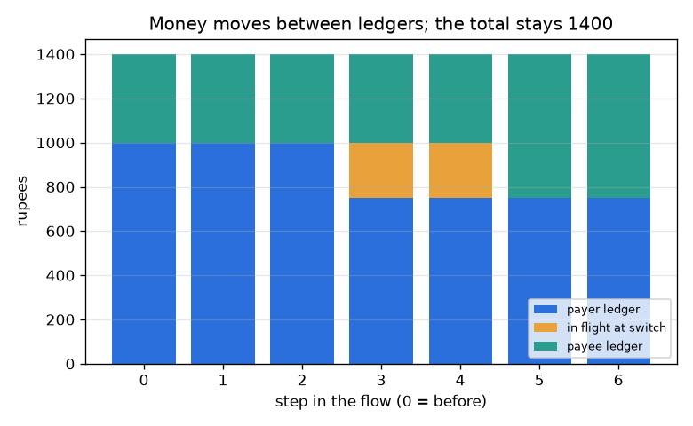
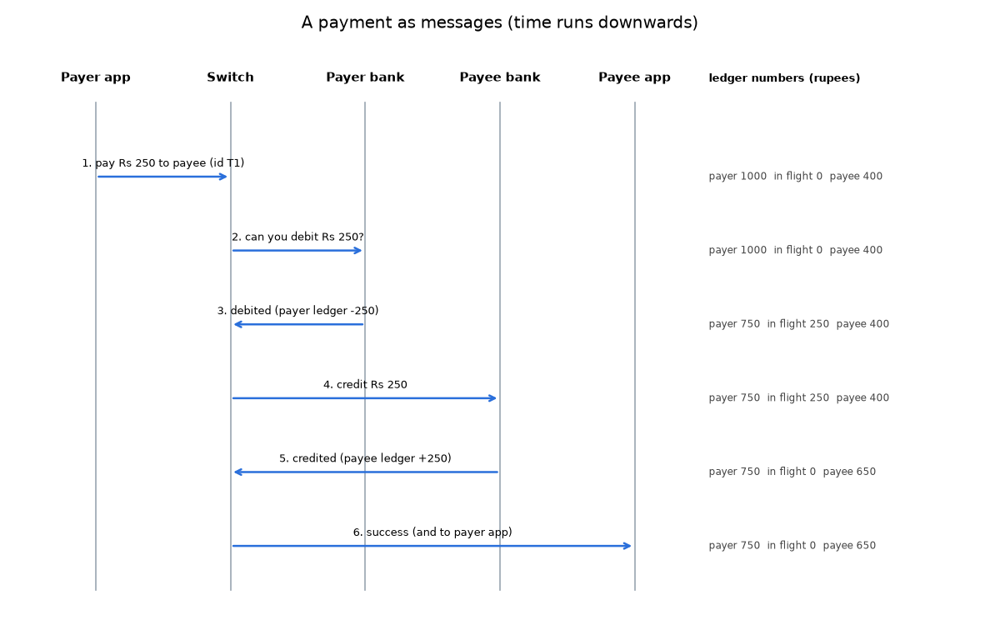

# அமர்வு 1: ஒரு பணப்பரிமாற்றத்தின் கதாபாத்திரங்களும் அதன் செய்தி ஓட்டமும்

[Session 1 — हिन्दी](README.hi.md)

*நிலை 1 (கருத்தியல் ஊடாடும் மாதிரி) · சுமார் 60 நிமிடங்கள் · openupi*

> இது எளிமைப்படுத்தப்பட்ட ஒரு கல்வி மாதிரி. இது சரிபார்க்கப்பட்ட (validated) வடிவமைப்புக் கருவி அல்ல; உண்மையான கட்டமைப்புகள், மின் நிறுவல்கள், வாகனங்கள், தொழிற்சாலை செயல்முறைகள் அல்லது மருத்துவ முடிவுகளுக்கு இதைப் பயன்படுத்தக் கூடாது.

**முன்தேவைகள் (Prerequisites)**

- முழு எண்களைக் கூட்டுதல் மற்றும் கழித்தல்; பட்டை வரைபடத்தைப் படித்தல்.
- நீங்கள் PRIMER.md படித்து, `python start.py 1` ஒருமுறை இயக்கியுள்ளீர்கள்.

**கற்றல் நோக்கங்கள் (Learning objectives).** இந்த அமர்வுக்குப் பிறகு நீங்கள்:

- ஒரு டிஜிட்டல் பணப்பரிமாற்றத்தில் உள்ள ஐந்து பங்கேற்பாளர்களின் (actors) பெயர்களைக் கூறி, ஒவ்வொருவரும் என்ன செய்கிறார், எதை வைத்திருக்கிறார், எதை வைத்திருப்பதில்லை என்று சொல்லலாம்.
- ஒரு தொடர்வரிசை வரைபடத்தை (sequence diagram) படிக்கலாம்: நேரம் கீழ்நோக்கி ஓடுகிறது, ஒவ்வொரு அம்புக்குறியும் ஒரு செய்தி.
- பணம் நாணயங்களாக அல்ல, பேரேடுகளில் (ledger) உள்ள எண்களின் மாற்றமாக நகர்கிறது என்று விளக்கலாம்.
- ஒரு பணப்பரிமாற்றத்தின்போது எல்லாப் பேரேடுகள் மற்றும் பயணத்திலுள்ள (in-flight) பெட்டியின் மொத்தம் ஒருபோதும் மாறுவதில்லை என்பதைச் சரிபார்க்கலாம்.

## A. நிஜ உலகப் பிரச்சினை
நீங்கள் ஒரு கடையில் குறியீட்டை ஸ்கேன் செய்கிறீர்கள், PIN தட்டச்சு செய்கிறீர்கள், ஒரு கணம் கழித்து இரண்டு தொலைபேசிகளும் வெற்றி என்கின்றன. உடல்ரீதியாக எதுவும் நகரவில்லை. அப்படியானால் உண்மையில் என்ன நடந்தது, யார் யாருடன் பேசினார்கள், திரை சுழன்றுகொண்டிருந்தபோது உங்கள் பணம் எங்கே இருந்தது? இந்த அமர்வு அத்தகைய அமைப்புகள் எவ்வாறு ஒழுங்கமைக்கப்பட்டுள்ளன என்பது பற்றிய பொதுக் கல்வி, எந்த உண்மையான செயலி, வங்கி அல்லது கணக்கு பற்றிய ஆலோசனை அல்ல, மேலும் அது எளிமைப்படுத்தப்பட்ட ஒரு படத்தைப் பயன்படுத்துகிறது.

## B. கருத்தும் கோட்பாடும்
ஒரு பணப்பரிமாற்றத்தில் ஒரு கதாபாத்திரக் குழு உள்ளது. பணம் செலுத்துபவர் செயலியும் (payer app) பணம் பெறுபவர் செயலியும் (payee app) தொலைபேசிகளில் உள்ள சாளரங்கள் மட்டுமே: அவை செய்திகளை அனுப்பிக் காட்டுகின்றன, பணம் வைத்திருப்பதில்லை. ஒவ்வொரு வாடிக்கையாளரின் பணமும் அந்த வாடிக்கையாளரின் வங்கி பராமரிக்கும் ஒரு பேரேட்டில் உள்ள ஒரு எண். நடுவில் உள்ள ஒரு சுவிட்ச் (switch) செயலிகளுக்கும் வங்கிகளுக்கும் இடையே செய்திகளைக் கடத்தி, பணப்பரிமாற்றத்தை அதன் பயணத்தில் கண்காணிக்கிறது. பணம் செலுத்துபவர் செயலி X ரூபாய் செலுத்துமாறு சுவிட்சைக் கேட்கிறது; சுவிட்ச் X ஐ பற்று (debit) வைக்குமாறு செலுத்துபவர் வங்கியைக் கேட்கிறது; செலுத்துபவர் வங்கி செலுத்துபவரின் பேரேட்டு எண்ணைக் குறைத்து அதைத் தெரிவிக்கிறது; சுவிட்ச் X ஐ வரவு (credit) வைக்குமாறு பெறுபவர் வங்கியைக் கேட்கிறது; பெறுபவர் வங்கி பெறுபவரின் பேரேட்டு எண்ணைக் கூட்டி அதைத் தெரிவிக்கிறது; சுவிட்ச் இரு செயலிகளிடமும் கூறுகிறது. பற்றுக்கும் வரவுக்கும் இடையில் X ரூபாய் பயணத்தில் (in flight) உள்ளது: ஒவ்வொரு ரூபாய்க்கும் எப்போதும் சரியாக ஒரு வீடு இருக்கும்படி அதைச் சுவிட்சிலுள்ள ஒரு பெட்டியில் எண்ணுகிறோம். செலுத்துபவரின் இருப்பு X ஐ விடக் குறைவாக இருந்தால், செலுத்துபவர் வங்கி மறுக்கிறது, எதுவும் நகர்வதில்லை.

| குறியீடு | பொருள் | அலகு |
|---|---|---|
| X | பணப்பரிமாற்றத் தொகை | ரூபாய் |
| P | செலுத்துபவர் வங்கியில் செலுத்துபவரின் பேரேட்டு இருப்பு | ரூபாய் |
| Q | பெறுபவர் வங்கியில் பெறுபவரின் பேரேட்டு இருப்பு | ரூபாய் |
| F | சுவிட்சில் பயணத்திலுள்ள பணம் | ரூபாய் |
| T | மூன்று பெட்டிகளின் மொத்தம் | ரூபாய் |
| k | செய்தி ஓட்டத்தில் படி (0 முதல் 6 வரை) | எண்ணிக்கை |

**அனுமானங்கள் (Assumptions)**

- ஒரு நேரத்தில் ஒரு பணப்பரிமாற்றம், தோல்விகள் இல்லை: எல்லாச் செய்திகளும் வந்து சேர்கின்றன.
- வங்கிகளும் சுவிட்சும் நேர்மையானவை, சரியானவை.
- தொகைகள் முழு ரூபாய்கள் மற்றும் நேர்மறை.
- இது ஒரு கற்பித்தல் படம், எந்த உண்மையான பணப்பரிமாற்ற வலையமைப்பின் வடிவமைப்பும் அல்ல.

$$ P' = P - X,\qquad Q' = Q + X\qquad (X \le P) $$

$$ T = P + F + Q $$

$$ T_{\text{after}} = T_{\text{before}}\quad\text{(no money is created or lost)} $$

## C. காட்சி விளக்கம்
முதல் படம் ஒரு தொடர்வரிசை வரைபடம்: பங்கேற்பாளர்களுக்கு ஐந்து செங்குத்துக் கோடுகள், நேரம் கீழ்நோக்கி, ஒவ்வொரு செய்திக்கும் ஓர் அம்பு, ஒவ்வோர் அம்புக்கும் அருகில் மூன்று பேரேட்டு எண்கள். இரண்டாவது படம் ஏழு படிகளிலும் மூன்று பெட்டிகளை (செலுத்துபவர் பேரேடு, பயணத்தில், பெறுபவர் பேரேடு) அடுக்குகிறது. அடுக்கின் உயரம் கீழ்வரை 1400 ஆகவே இருக்கிறது, நிறங்கள் மட்டும் நகர்கின்றன: படி 3 இல் நீலம் சுருங்குகிறது, படி 3 மற்றும் 4 இல் ஆரஞ்சு பயணத்திலுள்ள தொகுதி தோன்றுகிறது, படி 5 இல் பச்சை வளர்கிறது.

*ஒவ்வொரு படியிலும் செலுத்துபவர் பேரேடு, பயணத்திலுள்ள பணம், பெறுபவர் பேரேடு: மொத்தம் 1400 ரூபாயாகவே இருக்கிறது.*

*ஆறு செய்திகளாக ஒரு பணப்பரிமாற்றம்; மூன்று பேரேட்டு எண்கள் ஒவ்வோர் அம்புக்கும் அருகில் அச்சிடப்பட்டுள்ளன.*

## D. ஊடாடும் உருவகப்படுத்தல் (Interactive simulation)
பாடத்தை இயக்கவும் (`python start.py 1`), பின்னர் நேரடிச் செயலியைத் திறக்கவும்: [அமர்வு 1: ஒரு பணப்பரிமாற்றத்தைப் பின்தொடருங்கள்](https://krunalpanchal1995.github.io/pan-iit-oss/openupi/session-01/) (அல்லது இந்தக் கோப்புறையிலுள்ள `app.html`). படிக் கட்டுப்பாட்டை 0 முதல் 6 வரை நகர்த்தி பேரேட்டுப் பெட்டிகள் படி 3 மற்றும் 5 இல் மட்டுமே மாறுவதைப் பாருங்கள்; பின்னர் தொகையை மாற்றி, தொகைக்கு எதிரான இறுதி இருப்புகளைக் காண வரைபடக் காட்சியைத் திறங்கள்.

**சவால்.** கடைசிச் செய்திக்குப் பிறகு பெறுபவரிடம் சரியாக Rs 900 இருக்கும்படி செய்யுங்கள்.

## E. தீர்க்கப்பட்ட எடுத்துக்காட்டும் சோதனையும்
**பிரச்சினை.** செலுத்துபவரிடம் Rs 1000, பெறுபவரிடம் Rs 400 உள்ளது. செலுத்துபவர் Rs 250 செலுத்துகிறார். ஒவ்வொரு படிக்குப் பிறகும் மூன்று எண்களைக் கண்டு மொத்தத்தைச் சரிபாருங்கள்.

1. படி 3 க்கு முன் எதுவும் நகரவில்லை: செலுத்துபவர் 1000, பயணத்தில் 0, பெறுபவர் 400, மொத்தம் 1400.
2. படி 3 (செலுத்துபவர் வங்கி பற்று வைக்கிறது): செலுத்துபவர் = 1000 - 250 = 750, பயணத்தில் = 250. மொத்தம் = 750 + 250 + 400 = 1400.
3. படி 4 (சுவிட்ச் பெறுபவர் வங்கியைக் கேட்கிறது): இன்னும் எதுவும் மாறவில்லை.
4. படி 5 (பெறுபவர் வங்கி வரவு வைக்கிறது): பயணத்தில் = 0, பெறுபவர் = 400 + 250 = 650. மொத்தம் = 750 + 0 + 650 = 1400.
5. சரிபார்ப்பு: செலுத்துபவர் 250 இழந்தார், பெறுபவர் 250 பெற்றார், எனவே மொத்தம் மாறவில்லை.

**விடை.** கடைசிச் செய்திக்குப் பிறகு செலுத்துபவரிடம் Rs 750, பெறுபவரிடம் Rs 650, பயணத்தில் எதுவும் இல்லை, மொத்தம் இன்னும் Rs 1400.

**சோதனை.** நண்பர்களுடனும் தாளுடனும் கதாபாத்திரங்களை நடித்துப் பாருங்கள். ஒருவர் ஒவ்வொரு வங்கியாகத் தாளில் ஒரு பேரேட்டை வைத்திருக்கிறார்; ஒருவர் சுவிட்சாக 'பயணத்தில்' என்று குறிக்கப்பட்ட சீட்டுகளை வைத்திருக்கிறார்; இருவர் செயலிகளாகச் செய்திகளை மட்டுமே சுமக்கலாம். Rs 250 பணப்பரிமாற்றத்தை ஓட்டுங்கள், பின்னர் செலுத்துபவரிடம் மிகக் குறைவாக உள்ள ஒன்றை ஓட்டுங்கள். தாள் பேரேடுகளைச் செயலியின் வாசிப்புடன் ஒப்பிடுங்கள். மாதிரியும் நிஜமும்: தாள் பதிப்பில் தொலைந்த செய்திகளோ ஏமாற்றமோ இல்லை, உண்மை வங்கிகள் பதிவுகள், கட்டணங்கள், வரம்புகள், சட்டப் பதிவுகளையும் வைத்திருக்கின்றன, இந்தப் படம் அவற்றை விட்டுவிடுகிறது.

## F. மதிப்பீடும் வடிவமைப்புச் சவாலும்
**கேள்வி வகை A: கருத்தியல்.** செலுத்துபவர் செயலியும் பெறுபவர் செயலியும் ஏன் பணம் வைத்திருப்பதில்லை, சுவிட்சிலுள்ள பயணத்திலுள்ள பெட்டி நமக்கு ஏன் தேவை?

குறிப்பு

பேரேட்டு எண்கள் எங்கே உள்ளன, படி 3 க்கும் 5 க்கும் இடையில் பணம் எங்கே உள்ளது?

படிப்படியான தீர்வு

செயலிகள் செய்திகளை அனுப்பிக் காட்டும் சாளரங்கள் மட்டுமே. பேரேட்டு எண்கள் வங்கிகளில் உள்ளன. பற்றுக்கும் (படி 3) வரவுக்கும் (படி 5) இடையில் செலுத்துபவரின் பேரேடு ஏற்கெனவே குறைந்துவிட்டது, ஆனால் பெறுபவரின் பேரேடு இன்னும் கூடவில்லை. பணத்தைப் பயணத்திலுள்ள பெட்டியில் எண்ணுவது ஒவ்வொரு கணமும் ஒவ்வொரு ரூபாய்க்கும் சரியாக ஒரு வீட்டைத் தருகிறது, எனவே மொத்தம் அப்படியே இருக்கிறது, அதை நாம் சரிபார்க்கவும் முடிகிறது.

**கேள்வி வகை B: எண்ணியல்.** செலுத்துபவரிடம் Rs 2000, பெறுபவரிடம் Rs 150 உள்ளது. செலுத்துபவர் Rs 600 செலுத்துகிறார். படி 3 க்குப் பிறகும் படி 6 க்குப் பிறகும் மூன்று எண்களையும் ஒவ்வொரு முறையும் மொத்தத்தையும் தருக.

குறிப்பு

படி 3 தொகையைப் பயணத்தில் நகர்த்துகிறது; படி 5 அதைப் பெறுபவர் பேரேட்டில் நகர்த்துகிறது.

படிப்படியான தீர்வு

படி 3 க்குப் பிறகு: செலுத்துபவர் 2000 - 600 = 1400, பயணத்தில் 600, பெறுபவர் 150, மொத்தம் 2150. படி 6 க்குப் பிறகு: செலுத்துபவர் 1400, பயணத்தில் 0, பெறுபவர் 150 + 600 = 750, மொத்தம் 1400 + 0 + 750 = 2150. அலகு: ரூபாய். மொத்தம் அப்படியே இருக்கிறது, இருக்க வேண்டியபடி.

**கேள்வி வகை C: வரைபடம் மற்றும் உருவகப்படுத்தல் விளக்கம்.** அடுக்குப் பட்டைப் படத்தில், எந்தப் படிகளில் ஆரஞ்சு பயணத்திலுள்ள தொகுதி உள்ளது, மொத்த உயரத்துக்கு என்ன நடக்கிறது?

குறிப்பு

பற்று நடந்து வரவு நடக்காத படிகளைக் கண்டறியுங்கள்.

படிப்படியான தீர்வு

ஆரஞ்சு தொகுதி படி 3 மற்றும் 4 க்குப் பிறகு மட்டுமே உள்ளது: பற்று நடந்துவிட்டது, வரவு நடக்கவில்லை. மொத்த உயரம் ஒவ்வொரு படியிலும் 1400 ரூபாய், ஏனெனில் நீலத் தொகுதி இழப்பதை ஆரஞ்சுத் தொகுதி சரியாகப் பெறுகிறது, ஆரஞ்சுத் தொகுதி இழப்பதைப் பச்சைத் தொகுதி சரியாகப் பெறுகிறது.

**கேள்வி வகை D: வடிவமைப்பு மற்றும் உகப்பாக்கச் (optimisation) சவால்.** வடிவமைப்பு: படி 3 க்குப் பிறகு சுவிட்ச் செயலிழக்கிறது, படி 4 ஐ ஒருபோதும் அனுப்பவில்லை. செலுத்துபவர் Rs 250 இழந்துவிட்டார், பெறுபவர் எதுவும் பெறவில்லை. அமைப்பு மீளக்கூடிய இரண்டு நியாயமான வழிகளையும், ஒவ்வொன்றும் எதை நினைவில் வைத்திருக்க வேண்டும் என்பதையும் விவரிக்கவும்.

குறிப்பு

ஒன்று பணப்பரிமாற்றத்தை முடிக்கவும் அல்லது அதை ரத்து செய்யவும். முடிவு செய்ய எந்தப் பதிவு உதவும்?

படிப்படியான தீர்வு

விருப்பம் 1, முடித்தல்: சுவிட்ச் (அல்லது மறுதொடக்க நடைமுறை) அதே பரிவர்த்தனை அடையாளத்துடன் வரவை பெறுபவர் வங்கிக்கு மீண்டும் அனுப்புகிறது, எனவே மீண்டும் வரும் வரவு இரு முறை பயன்படுத்தப்பட முடியாது. விருப்பம் 2, திருப்புதல்: செலுத்துபவர் வங்கி Rs 250 ஐ செலுத்துபவருக்குத் திருப்பி வரவு வைத்து பணப்பரிமாற்றத்தைத் தோல்வி எனப் பதிவு செய்கிறது. எப்படியிருந்தாலும் அமைப்பு பரிவர்த்தனை அடையாளம், தொகை, இரு கணக்குகள், எவ்வளவு தூரம் சென்றது என்பவற்றை நிலையாக நினைவில் வைத்திருக்க வேண்டும். சமரசம் (trade-off): முடிப்பது கடைக்கு நல்லது ஆனால் பெறுபவர் வங்கி அணுகக்கூடியதாக இருக்க வேண்டும்; திருப்புவது எளிது ஆனால் வாடிக்கையாளர் மீண்டும் முயல வேண்டும். ஒரு பேரேடு இதை எவ்வாறு எல்லாம்-அல்லது-ஒன்றுமில்லை (all-or-nothing) ஆக்குகிறது என்பதை அமர்வு 2 காட்டுகிறது.

[RUBRIC.md](../../RUBRIC.md) மூலம் உங்களை நீங்களே மதிப்பிடுங்கள். தாளில் செய்ய [செயல்பாட்டுத் தாளை](activity_sheet.md) அச்சிடவும்.

## பொதுவான தவறான கருத்துகள்
| பொதுவான தவறான கருத்து | உண்மையில் சரியானது |
|---|---|
| பணம் என் தொலைபேசியிலிருந்து கடையின் தொலைபேசிக்குப் பயணம் செய்கிறது. | தொலைபேசிகள் பணம் வைத்திருப்பதில்லை. வங்கிகளில் உள்ள இரண்டு பேரேட்டு எண்கள் மாறுகின்றன; எப்போது மாற வேண்டும் என்பதை செய்தி ஓட்டம் வங்கிகளுக்குச் சொல்கிறது. |
| என் திரை வெற்றி என்று சொல்லும் கணத்திலேயே பணப்பரிமாற்றம் முடிந்துவிட்டது. | திரை ஒரு செய்தியைக் காட்டுகிறது. இரு பேரேடுகளும் புதுப்பிக்கப்பட்ட பிறகே பணப்பரிமாற்றம் உண்மையாகிறது. |
| சுவிட்ச் எல்லோருடைய பணத்தையும் வைத்திருக்கிறது. | இந்தப் படத்தில் சுவிட்ச் ஒரு பணப்பரிமாற்றத்தின் தொகையைப் பயணத்தில் உள்ளதாகச் சிறிது நேரம் மட்டுமே வைத்திருக்கிறது. பேரேடுகளை வங்கிகளே வைத்திருக்கின்றன. |

## சொற்களஞ்சியம் (Glossary)
- **பேரேடு (ledger)**: கணக்குகளின் பட்டியலும், வங்கி ஒவ்வொன்றுக்கும் தர வேண்டிய ரூபாய்களின் எண்ணிக்கையும்
- **சுவிட்ச் (switch)**: செயலிகளுக்கும் வங்கிகளுக்கும் இடையே செய்திகளைக் கடத்தும் பகிரப்பட்ட நடுப் பெட்டி
- **தொடர்வரிசை வரைபடம் (sequence diagram)**: ஒவ்வொரு பங்கேற்பாளருக்கும் ஒரு செங்குத்துக் கோடும் ஒவ்வொரு செய்திக்கும் ஓர் அம்பும் கொண்ட, நேரம் கீழ்நோக்கிச் செல்லும் படம்
- **பயணத்தில் (in flight)**: ஒரு பேரேட்டை விட்டு வெளியேறி மற்றொன்றை இன்னும் அடையாத பணம்
- **பற்று / வரவு (debit / credit)**: ஒரு வாடிக்கையாளர் கணக்கிலிருந்து பணத்தை எடுத்தல் / கணக்கில் பணத்தைச் சேர்த்தல்

## நிறைவு
1. [exercises.md](exercises.md)-இல் உள்ள மூன்று நிரலாக்கப் பணிகளைச் செய்யவும்.
2. உங்கள் மாற்றங்களுக்குப் பிறகு `python start.py 1` மீண்டும் இயக்கவும். அது சோதனைச் சாவடியுடன் (checkpoint) முடிகிறது; அது `PASS` அச்சிடும்போது நீங்கள் முடித்துவிட்டீர்கள். (சோதனைச் சாவடி மட்டும்: `python start.py check 1`.)

அடுத்து: [அமர்வு 2](../session-02/README.md)
