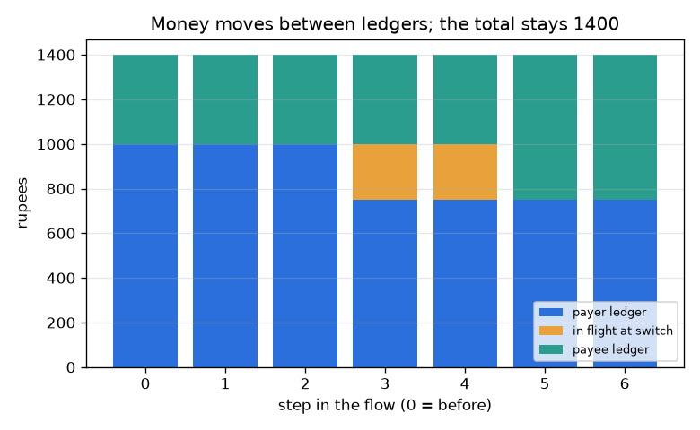
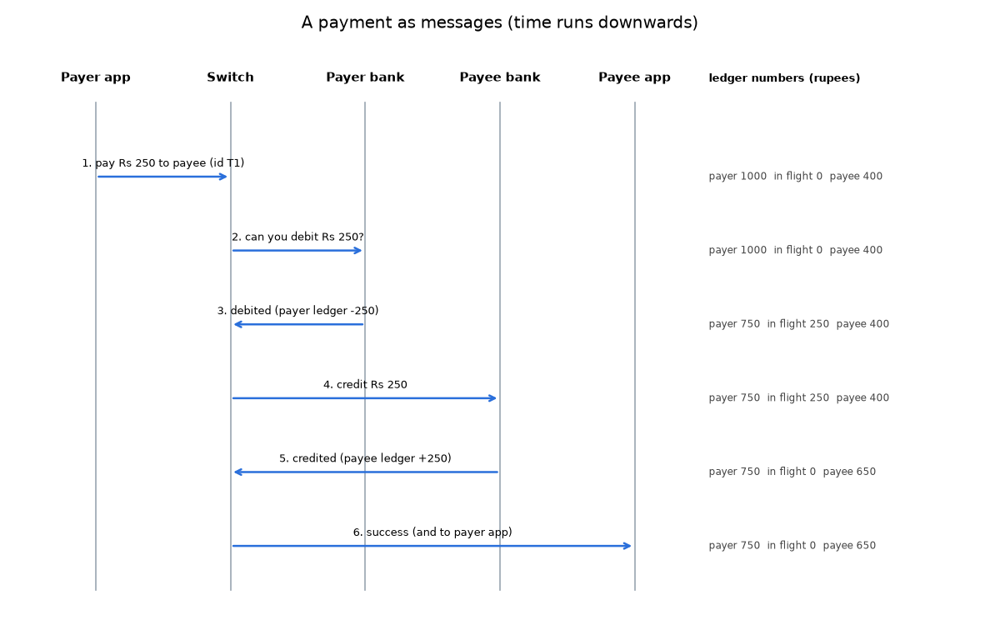

# సెషన్ 1: ఒక చెల్లింపు పాత్రధారులు మరియు దాని సందేశ ప్రవాహం

[Session 1 — हिन्दी](README.hi.md)

*స్థాయి 1 (భావనాత్మక ఇంటరాక్టివ్ నమూనా) · సుమారు 60 నిమిషాలు · openupi*

> ఇది సరళీకరించిన విద్యా నమూనా. ఇది ధృవీకరించబడిన (validated) డిజైన్ సాధనం కాదు; నిజమైన నిర్మాణాలు, విద్యుత్ ఇన్‌స్టలేషన్లు, వాహనాలు, పారిశ్రామిక ప్రక్రియలు లేదా వైద్య నిర్ణయాల కోసం దీనిని ఉపయోగించకూడదు.

**ముందస్తు అవసరాలు (Prerequisites)**

- పూర్ణ సంఖ్యలను కూడటం మరియు తీయడం; బార్ చార్ట్ చదవడం.
- మీరు PRIMER.md చదివి, `python start.py 1` ఒకసారి రన్ చేశారు.

**అభ్యసన లక్ష్యాలు (Learning objectives).** ఈ సెషన్ తర్వాత మీరు:

- డిజిటల్ చెల్లింపులోని ఐదు పాత్రధారుల (actors) పేర్లు చెప్పి, ప్రతి ఒక్కరూ ఏమి చేస్తారో, ఏమి కలిగి ఉంటారో, ఏమి ఉండదో చెప్పగలరు.
- సీక్వెన్స్ డయాగ్రామ్‌ను (sequence diagram) చదవగలరు: కాలం క్రిందికి సాగుతుంది, ప్రతి బాణం ఒక సందేశం.
- డబ్బు నాణేలుగా కాక, లెడ్జర్లలోని (ledger) సంఖ్యల మార్పుగా కదులుతుందని వివరించగలరు.
- చెల్లింపు సమయంలో అన్ని లెడ్జర్లు మరియు ప్రయాణంలోని (in-flight) పెట్టె మొత్తం ఎప్పుడూ మారదని తనిఖీ చేయగలరు.

## A. వాస్తవ ప్రపంచ సమస్య
మీరు ఒక దుకాణంలో కోడ్‌ను స్కాన్ చేస్తారు, PIN టైప్ చేస్తారు, ఒక క్షణం తర్వాత రెండు ఫోన్లూ విజయం అంటాయి. భౌతికంగా ఏదీ కదలలేదు. అయితే వాస్తవంగా ఏమి జరిగింది, ఎవరు ఎవరితో మాట్లాడారు, స్క్రీన్ తిరుగుతుండగా మీ డబ్బు ఎక్కడ ఉంది? ఈ సెషన్ అలాంటి వ్యవస్థలు ఎలా ఏర్పాటు చేయబడతాయనే దాని గురించి సాధారణ విద్య, ఏదైనా నిజమైన యాప్, బ్యాంక్ లేదా ఖాతా గురించిన సలహా కాదు, మరియు ఇది సరళీకరించిన చిత్రాన్ని ఉపయోగిస్తుంది.

## B. భావన మరియు సిద్ధాంతం
ఒక చెల్లింపులో పాత్రధారుల బృందం ఉంటుంది. చెల్లించేవారి యాప్ (payer app) మరియు స్వీకరించేవారి యాప్ (payee app) ఫోన్లలోని కిటికీలు మాత్రమే: అవి సందేశాలను పంపి చూపిస్తాయి, డబ్బు కలిగి ఉండవు. ప్రతి కస్టమర్ డబ్బు ఆ కస్టమర్ బ్యాంక్ ఉంచే లెడ్జర్‌లోని ఒక సంఖ్య. మధ్యలో ఉన్న స్విచ్ (switch) యాప్‌లు మరియు బ్యాంకుల మధ్య సందేశాలను చేరవేసి చెల్లింపును దాని దారిలో ట్రాక్ చేస్తుంది. చెల్లించేవారి యాప్ X రూపాయలు చెల్లించమని స్విచ్‌ను అడుగుతుంది; స్విచ్ X ను డెబిట్ చేయమని చెల్లించేవారి బ్యాంక్‌ను అడుగుతుంది; చెల్లించేవారి బ్యాంక్ చెల్లించేవారి లెడ్జర్ సంఖ్యను తగ్గించి చెబుతుంది; స్విచ్ X ను క్రెడిట్ చేయమని స్వీకరించేవారి బ్యాంక్‌ను అడుగుతుంది; స్వీకరించేవారి బ్యాంక్ స్వీకరించేవారి లెడ్జర్ సంఖ్యను పెంచి చెబుతుంది; స్విచ్ రెండు యాప్‌లకూ చెబుతుంది. డెబిట్ మరియు క్రెడిట్ మధ్య X రూపాయలు ప్రయాణంలో (in flight) ఉన్నాయి: ప్రతి రూపాయికీ ఎల్లప్పుడూ సరిగ్గా ఒక ఇల్లు ఉండేలా మనం వాటిని స్విచ్ వద్ద ఒక పెట్టెలో లెక్కిస్తాము. చెల్లించేవారి బ్యాలెన్స్ X కంటే తక్కువగా ఉంటే, చెల్లించేవారి బ్యాంక్ తిరస్కరిస్తుంది, ఏదీ కదలదు.

| గుర్తు | అర్థం | ప్రమాణం |
|---|---|---|
| X | చెల్లింపు మొత్తం | రూపాయలు |
| P | చెల్లించేవారి బ్యాంక్‌లో చెల్లించేవారి లెడ్జర్ బ్యాలెన్స్ | రూపాయలు |
| Q | స్వీకరించేవారి బ్యాంక్‌లో స్వీకరించేవారి లెడ్జర్ బ్యాలెన్స్ | రూపాయలు |
| F | స్విచ్ వద్ద ప్రయాణంలో ఉన్న డబ్బు | రూపాయలు |
| T | మూడు పెట్టెల మొత్తం | రూపాయలు |
| k | సందేశ ప్రవాహంలో దశ (0 నుండి 6) | లెక్క |

**ఊహలు (Assumptions)**

- ఒకేసారి ఒక చెల్లింపు, వైఫల్యాలు లేవు: ప్రతి సందేశం చేరుతుంది.
- బ్యాంకులు మరియు స్విచ్ నిజాయితీగా, సరిగ్గా ఉన్నాయి.
- మొత్తాలు పూర్ణ రూపాయలు మరియు ధనాత్మకం.
- ఇది బోధనా చిత్రం, ఏ నిజమైన చెల్లింపు నెట్‌వర్క్ డిజైన్ కాదు.

$$ P' = P - X,\qquad Q' = Q + X\qquad (X \le P) $$

$$ T = P + F + Q $$

$$ T_{\text{after}} = T_{\text{before}}\quad\text{(no money is created or lost)} $$

## C. దృశ్య వివరణ
మొదటి చిత్రం సీక్వెన్స్ డయాగ్రామ్: పాత్రధారులకు ఐదు నిలువు రేఖలు, కాలం క్రిందికి, ప్రతి సందేశానికి ఒక బాణం, ప్రతి బాణం పక్కన మూడు లెడ్జర్ సంఖ్యలు. రెండవ చిత్రం ఏడు దశల్లో ప్రతిదానిలో మూడు పెట్టెలను (చెల్లించేవారి లెడ్జర్, ప్రయాణంలో, స్వీకరించేవారి లెడ్జర్) పేర్చుతుంది. పేర్చిన ఎత్తు క్రిందికి అంతా 1400 గానే ఉంటుంది, రంగులు మాత్రమే కదులుతాయి: దశ 3 వద్ద నీలం తగ్గుతుంది, దశ 3 మరియు 4 వద్ద నారింజ ప్రయాణంలోని బ్లాక్ కనిపిస్తుంది, దశ 5 వద్ద ఆకుపచ్చ పెరుగుతుంది.

*ప్రతి దశలో చెల్లించేవారి లెడ్జర్, ప్రయాణంలోని డబ్బు, స్వీకరించేవారి లెడ్జర్: మొత్తం 1400 రూపాయలుగానే ఉంటుంది.*

*ఆరు సందేశాలుగా ఒక చెల్లింపు; మూడు లెడ్జర్ సంఖ్యలు ప్రతి బాణం పక్కన ముద్రించబడ్డాయి.*

## D. ఇంటరాక్టివ్ సిమ్యులేషన్
పాఠాన్ని రన్ చేయండి (`python start.py 1`), తర్వాత లైవ్ యాప్‌ను తెరవండి: [సెషన్ 1: ఒక చెల్లింపును అనుసరించండి](https://krunalpanchal1995.github.io/pan-iit-oss/openupi/session-01/) (లేదా ఈ ఫోల్డర్‌లోని `app.html`). దశ నియంత్రణను 0 నుండి 6 వరకు జరిపి లెడ్జర్ పెట్టెలు దశ 3 మరియు 5 వద్ద మాత్రమే మారడం గమనించండి; తర్వాత మొత్తాన్ని మార్చి, మొత్తానికి వ్యతిరేకంగా చివరి బ్యాలెన్స్‌లను చూడటానికి గ్రాఫ్ వీక్షణను తెరవండి.

**సవాలు.** చివరి సందేశం తర్వాత స్వీకరించేవారి వద్ద సరిగ్గా Rs 900 ఉండేలా చేయండి.

## E. సాధించిన ఉదాహరణ మరియు ప్రయోగం
**సమస్య.** చెల్లించేవారి వద్ద Rs 1000, స్వీకరించేవారి వద్ద Rs 400 ఉంది. చెల్లించేవారు Rs 250 చెల్లిస్తారు. ప్రతి దశ తర్వాత మూడు సంఖ్యలను కనుగొని మొత్తాన్ని తనిఖీ చేయండి.

1. దశ 3 కు ముందు ఏదీ కదల్లేదు: చెల్లించేవారు 1000, ప్రయాణంలో 0, స్వీకరించేవారు 400, మొత్తం 1400.
2. దశ 3 (చెల్లించేవారి బ్యాంక్ డెబిట్ చేస్తుంది): చెల్లించేవారు = 1000 - 250 = 750, ప్రయాణంలో = 250. మొత్తం = 750 + 250 + 400 = 1400.
3. దశ 4 (స్విచ్ స్వీకరించేవారి బ్యాంక్‌ను అడుగుతుంది): ఇంకా ఏదీ మారదు.
4. దశ 5 (స్వీకరించేవారి బ్యాంక్ క్రెడిట్ చేస్తుంది): ప్రయాణంలో = 0, స్వీకరించేవారు = 400 + 250 = 650. మొత్తం = 750 + 0 + 650 = 1400.
5. తనిఖీ: చెల్లించేవారు 250 కోల్పోయారు, స్వీకరించేవారు 250 పొందారు, కాబట్టి మొత్తం మారలేదు.

**సమాధానం.** చివరి సందేశం తర్వాత చెల్లించేవారి వద్ద Rs 750, స్వీకరించేవారి వద్ద Rs 650, ప్రయాణంలో ఏదీ లేదు, మొత్తం ఇంకా Rs 1400.

**ప్రయోగం.** స్నేహితులతో మరియు కాగితంతో పాత్రధారులను నటించండి. ఒకరు ప్రతి బ్యాంక్‌గా కాగితంపై లెడ్జర్ ఉంచుతారు; ఒకరు స్విచ్‌గా 'ప్రయాణంలో' అని గుర్తించిన చీటీలను పట్టుకుంటారు; ఇద్దరు యాప్‌లుగా సందేశాలను మాత్రమే మోయవచ్చు. Rs 250 చెల్లింపును రన్ చేయండి, తర్వాత చెల్లించేవారి వద్ద చాలా తక్కువ ఉన్నదాన్ని రన్ చేయండి. కాగితపు లెడ్జర్లను యాప్ రీడౌట్‌తో పోల్చండి. నమూనా మరియు వాస్తవం: కాగితపు వెర్షన్‌లో పోయిన సందేశాలు లేదా మోసం లేవు, నిజమైన బ్యాంకులు లాగ్‌లు, రుసుములు, పరిమితులు మరియు చట్టపరమైన రికార్డులను కూడా ఉంచుతాయి, ఈ చిత్రం వాటిని వదిలేస్తుంది.

## F. మూల్యాంకనం మరియు డిజైన్ సవాలు
**ప్రశ్న రకం A: భావనాత్మక.** చెల్లించేవారి యాప్ మరియు స్వీకరించేవారి యాప్ డబ్బు ఎందుకు కలిగి ఉండవు, స్విచ్ వద్ద ప్రయాణంలోని పెట్టె మనకు ఎందుకు అవసరం?

సూచన

లెడ్జర్ సంఖ్యలు ఎక్కడ ఉన్నాయి, దశ 3 మరియు 5 మధ్య డబ్బు ఎక్కడ ఉంది?

దశలవారీ పరిష్కారం

యాప్‌లు సందేశాలను పంపి చూపించే కిటికీలు మాత్రమే. లెడ్జర్ సంఖ్యలు బ్యాంకుల వద్ద ఉన్నాయి. డెబిట్ (దశ 3) మరియు క్రెడిట్ (దశ 5) మధ్య చెల్లించేవారి లెడ్జర్ ఇప్పటికే తగ్గింది కానీ స్వీకరించేవారిది ఇంకా పెరగలేదు. డబ్బును ప్రయాణంలోని పెట్టెలో లెక్కించడం ప్రతి క్షణం ప్రతి రూపాయికీ సరిగ్గా ఒక ఇల్లు ఇస్తుంది, కాబట్టి మొత్తం అలాగే ఉంటుంది మరియు మనం దాన్ని తనిఖీ చేయగలం.

**ప్రశ్న రకం B: సంఖ్యాత్మక.** చెల్లించేవారి వద్ద Rs 2000, స్వీకరించేవారి వద్ద Rs 150 ఉంది. చెల్లించేవారు Rs 600 చెల్లిస్తారు. దశ 3 తర్వాత మరియు దశ 6 తర్వాత మూడు సంఖ్యలను, ప్రతిసారీ మొత్తాన్ని ఇవ్వండి.

సూచన

దశ 3 మొత్తాన్ని ప్రయాణంలోకి కదుపుతుంది; దశ 5 దాన్ని స్వీకరించేవారి లెడ్జర్‌లోకి కదుపుతుంది.

దశలవారీ పరిష్కారం

దశ 3 తర్వాత: చెల్లించేవారు 2000 - 600 = 1400, ప్రయాణంలో 600, స్వీకరించేవారు 150, మొత్తం 2150. దశ 6 తర్వాత: చెల్లించేవారు 1400, ప్రయాణంలో 0, స్వీకరించేవారు 150 + 600 = 750, మొత్తం 1400 + 0 + 750 = 2150. ప్రమాణం: రూపాయలు. మొత్తం అలాగే ఉంది, ఉండాల్సినట్లే.

**ప్రశ్న రకం C: గ్రాఫ్ మరియు సిమ్యులేషన్ వ్యాఖ్యానం.** పేర్చిన బార్ చిత్రంలో, ఏ దశల్లో నారింజ ప్రయాణంలోని బ్లాక్ ఉంది, మొత్తం ఎత్తుకు ఏమవుతుంది?

సూచన

డెబిట్ జరిగి క్రెడిట్ జరగని దశలను కనుగొనండి.

దశలవారీ పరిష్కారం

నారింజ బ్లాక్ దశ 3 మరియు 4 తర్వాత మాత్రమే ఉంటుంది: డెబిట్ జరిగింది, క్రెడిట్ జరగలేదు. మొత్తం ఎత్తు ప్రతి దశలో 1400 రూపాయలు, ఎందుకంటే నీలం బ్లాక్ కోల్పోయినదాన్ని నారింజ బ్లాక్ సరిగ్గా పొందుతుంది, నారింజ బ్లాక్ కోల్పోయినదాన్ని ఆకుపచ్చ బ్లాక్ సరిగ్గా పొందుతుంది.

**ప్రశ్న రకం D: డిజైన్ మరియు ఆప్టిమైజేషన్ (optimisation) సవాలు.** డిజైన్: దశ 3 తర్వాత స్విచ్ క్రాష్ అవుతుంది, దశ 4 ను ఎప్పుడూ పంపదు. చెల్లించేవారు Rs 250 కోల్పోయారు, స్వీకరించేవారు ఏమీ పొందలేదు. వ్యవస్థ కోలుకోగల రెండు సమంజసమైన మార్గాలను, ప్రతిదీ ఏమి గుర్తుంచుకోవాలో వివరించండి.

సూచన

ఒకటి చెల్లింపును పూర్తి చేయండి లేదా రద్దు చేయండి. నిర్ణయించడానికి ఏ రికార్డ్ సహాయపడుతుంది?

దశలవారీ పరిష్కారం

ఎంపిక 1, పూర్తి చేయడం: స్విచ్ (లేదా రీస్టార్ట్ విధానం) అదే లావాదేవీ ఐడీతో క్రెడిట్‌ను స్వీకరించేవారి బ్యాంక్‌కు మళ్ళీ పంపుతుంది, కాబట్టి పునరావృత క్రెడిట్ రెండుసార్లు వర్తించదు. ఎంపిక 2, వెనక్కి తిప్పడం: చెల్లించేవారి బ్యాంక్ Rs 250 ను చెల్లించేవారికి తిరిగి క్రెడిట్ చేసి చెల్లింపును విఫలమైనదిగా నమోదు చేస్తుంది. ఏ విధంగానైనా వ్యవస్థ లావాదేవీ ఐడీ, మొత్తం, రెండు ఖాతాలు, ఎంత దూరం వచ్చిందో శాశ్వతంగా గుర్తుంచుకోవాలి. రాజీ (trade-off): పూర్తి చేయడం దుకాణానికి మంచిది కానీ స్వీకరించేవారి బ్యాంక్ అందుబాటులో ఉండాలి; వెనక్కి తిప్పడం సులభం కానీ కస్టమర్ మళ్ళీ ప్రయత్నించాలి. లెడ్జర్ దీన్ని ఎలా అన్నీ-లేదా-ఏదీ లేదు (all-or-nothing) గా చేస్తుందో సెషన్ 2 చూపిస్తుంది.

[RUBRIC.md](../../RUBRIC.md) తో మిమ్మల్ని మీరు స్కోర్ చేసుకోండి. కాగితంపై చేయడానికి [కార్యాచరణ పత్రాన్ని](activity_sheet.md) ప్రింట్ చేయండి.

## సాధారణ అపోహలు
| సాధారణ అపోహ | వాస్తవంగా నిజమైనది |
|---|---|
| డబ్బు నా ఫోన్ నుండి దుకాణం ఫోన్‌కు ప్రయాణిస్తుంది. | ఫోన్లు డబ్బు కలిగి ఉండవు. బ్యాంకుల వద్ద రెండు లెడ్జర్ సంఖ్యలు మారతాయి; ఎప్పుడు మారాలో సందేశ ప్రవాహం బ్యాంకులకు చెబుతుంది. |
| నా స్క్రీన్ విజయం అనే క్షణంలోనే చెల్లింపు పూర్తయింది. | స్క్రీన్ ఒక సందేశాన్ని చూపిస్తుంది. రెండు లెడ్జర్లూ నవీకరించబడిన తర్వాతే చెల్లింపు నిజమవుతుంది. |
| స్విచ్ అందరి డబ్బునూ ఉంచుకుంటుంది. | ఈ చిత్రంలో స్విచ్ ఒక చెల్లింపు మొత్తాన్ని ప్రయాణంలో ఉన్నట్లుగా కొద్దిసేపు మాత్రమే ఉంచుకుంటుంది. లెడ్జర్లను బ్యాంకులు ఉంచుతాయి. |

## పదకోశం (Glossary)
- **లెడ్జర్ (ledger)**: ఖాతాల జాబితా మరియు బ్యాంక్ ప్రతిదానికీ ఇవ్వాల్సిన రూపాయల సంఖ్య
- **స్విచ్ (switch)**: యాప్‌లు మరియు బ్యాంకుల మధ్య సందేశాలను చేరవేసే పంచుకున్న మధ్య పెట్టె
- **సీక్వెన్స్ డయాగ్రామ్ (sequence diagram)**: ప్రతి పాత్రధారికి ఒక నిలువు రేఖ, ప్రతి సందేశానికి ఒక బాణం ఉండి, కాలం క్రిందికి సాగే చిత్రం
- **ప్రయాణంలో (in flight)**: ఒక లెడ్జర్‌ను వదిలి మరొకదాన్ని ఇంకా చేరని డబ్బు
- **డెబిట్ / క్రెడిట్ (debit / credit)**: కస్టమర్ ఖాతా నుండి డబ్బు తీయడం / ఖాతాలో డబ్బు వేయడం

## ముగింపు
1. [exercises.md](exercises.md) లోని మూడు కోడింగ్ పనులను చేయండి.
2. మీ మార్పుల తర్వాత `python start.py 1` మళ్ళీ రన్ చేయండి. అది చెక్‌పాయింట్‌తో ముగుస్తుంది; అది `PASS` ప్రింట్ చేసినప్పుడు మీరు పూర్తి చేశారు. (చెక్‌పాయింట్ మాత్రమే: `python start.py check 1`.)

తర్వాత: [సెషన్ 2](../session-02/README.md)
