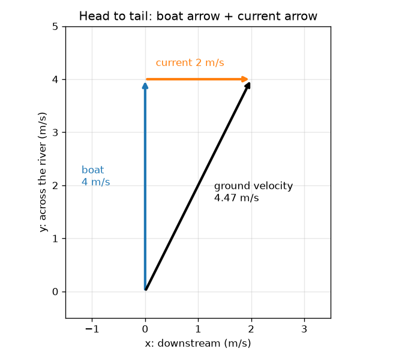
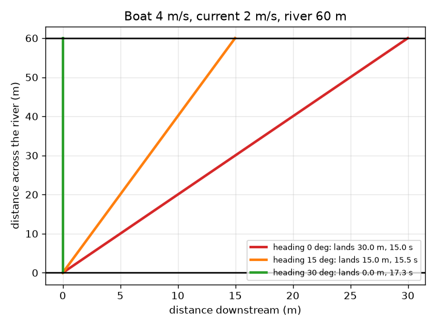

# सत्र 1: जुड़ने वाले तीर

*स्तर 1 (अवधारणात्मक इंटरैक्टिव मॉडल) · लगभग 60 मिनट · openvectors*

> यह एक सरलीकृत शैक्षिक मॉडल है। यह कोई प्रमाणित डिज़ाइन उपकरण नहीं है और इसका उपयोग वास्तविक संरचनाओं, विद्युत संस्थापनों, वाहनों, औद्योगिक प्रक्रियाओं या चिकित्सा निर्णयों के लिए नहीं किया जाना चाहिए।

**पूर्वापेक्षाएँ (Prerequisites)**

- चाल और दिशा का अर्थ जानना।
- आपने PRIMER.md पढ़ लिया है और `python start.py 1` एक बार चला लिया है।

**सीखने के उद्देश्य (Learning objectives)।** इस सत्र के बाद आप:

- वेग (velocity) को एक लंबाई (चाल) और एक दिशा वाले तीर के रूप में वर्णित कर सकेंगे।
- दो तीरों को शीर्ष से पुच्छ (head to tail) जोड़ सकेंगे, चित्र बनाकर और उनकी संख्याएँ जोड़कर।
- अनुमान लगा सकेंगे कि धारा वाली नदी पार करते समय नाव कहाँ उतरती है।
- ऐसी दिशा चुन सकेंगे कि नाव अपनी शुरुआत के ठीक सामने उतरे।

## A. वास्तविक दुनिया की समस्या
आप 60 m चौड़ी नदी के दूसरे किनारे के एक घाट की ओर सीधे 4 m/s से नाव खेते हैं। नदी 2 m/s से बहती है। आप घाट की ओर इशारा करते रहते हैं, पर पानी आपको बग़ल में बहाता रहता है। आप वास्तव में कहाँ उतरते हैं? और नाव को किस ओर रखना चाहिए ताकि आप ठीक सामने उतरें?

## B. अवधारणा और सिद्धांत
वेग एक तीर है: उसकी लंबाई चाल है और उसकी दिशा वह है जिधर वह इंगित करता है। हम धारा की दिशा (नदी के अनुदिश) के लिए x और नदी के आर-पार के लिए y का उपयोग करते हैं, इसलिए एक तीर एक जोड़ी (vx, vy) है। नाव का अपना तीर वह है जो नाव स्थिर पानी में करती; धारा का तीर वह है जो पानी अपने अंदर की हर चीज़ के साथ करता है। ज़मीन के सापेक्ष नाव की वास्तविक गति दोनों का योग है: दूसरे तीर की पुच्छ को पहले के शीर्ष पर रखें और पहली पुच्छ से अंतिम शीर्ष तक तीर खींचें। संख्याओं के साथ, मेल खाती प्रविष्टियाँ जोड़ें। चूँकि ज़मीनी तीर का आर-पार वाला भाग ही नाव को दूसरे किनारे तक ले जाता है, पार करने का समय चौड़ाई भाग उस भाग के बराबर है, और बग़ल का बहाव (drift) नदी-अनुदिश भाग गुणा वह समय है।

| प्रतीक | अर्थ | इकाई |
|---|---|---|
| v | पानी के सापेक्ष नाव की चाल | m/s |
| u | धारा की चाल (धारा की दिशा में) | m/s |
| h | दिशा (heading): सीधे आर-पार से कोण, धारा के विपरीत झुकाव धनात्मक | डिग्री |
| (gx, gy) | ज़मीनी तीर: नदी के अनुदिश और आर-पार | m/s |
| W | नदी की चौड़ाई (60) | m |
| T | पार करने का समय | s |
| drift | नदी के अनुदिश उतरने का बिंदु, धारा की दिशा में धनात्मक | m |

**मान्यताएँ (Assumptions)**

- नदी सीधी है, किनारे समांतर हैं और धारा हर जगह समान (एकसमान) है।
- पानी के सापेक्ष नाव की चाल स्थिर रहती है और नाव तुरंत मुड़ती है।
- सब कुछ एक समतल में होता है: कोई लहर नहीं, कोई हवा नहीं।

$$ \mathbf g=\mathbf b+\mathbf c,\qquad \mathbf b=v(-\sin h,\ \cos h),\quad \mathbf c=(u,\ 0) $$

$$ T=\frac{W}{g_y}=\frac{W}{v\cos h} $$

$$ \text{drift}=g_x\,T=\frac{(u-v\sin h)\,W}{v\cos h} $$

$$ \text{land opposite: } g_x=0\ \Rightarrow\ \sin h=\frac{u}{v} $$

## C. दृश्य व्याख्या
बायाँ चित्र सीधे आर-पार इंगित करने वाली नाव के लिए शीर्ष से पुच्छ जुड़े तीर दिखाता है: नीला नाव तीर 4 m/s लंबा है, नारंगी धारा तीर 2 m/s, और काला ज़मीनी तीर, पहली पुच्छ से अंतिम शीर्ष तक, 4.47 m/s लंबा है और धारा की दिशा में झुका है। दायाँ चित्र 60 m नदी पर तीन नावें दिखाता है: दिशा 0 के साथ नाव 15.0 s बाद 30.0 m धारा की दिशा में उतरती है, 15 डिग्री दिशा के साथ 15.5 s बाद 15.0 m धारा की दिशा में, और 30 डिग्री दिशा के साथ 17.3 s बाद ठीक सामने उतरती है।

*शीर्ष से पुच्छ: नाव का तीर और धारा का तीर मिलकर ज़मीनी तीर बनाते हैं।*

*60 m नदी पर तीन दिशाएँ: 0 डिग्री 30 m धारा की दिशा में उतरती है, 30 डिग्री ठीक सामने।*

## D. इंटरैक्टिव सिमुलेशन
पाठ चलाएँ (`python start.py 1`), फिर लाइव ऐप खोलें: [सत्र 1: नदी पार करती नाव](https://krunalpanchal1995.github.io/pan-iit-oss/openvectors/session-01/) (या इस फ़ोल्डर में `app.html`)। दिशा स्लाइडर खिसकाएँ और काले ज़मीनी तीर को मुड़ते और उतरने के बिंदु को किनारे के साथ खिसकते देखें। तीसरा दृश्य खोलें और हर दिशा के लिए उतरने का बिंदु एक साथ देखें।

**चुनौती।** 2 m/s की धारा में 4 m/s की नाव से शुरुआत के ठीक सामने (1 m के भीतर) उतरें।

## E. हल किया गया उदाहरण और प्रयोग
**समस्या।** 4 m/s की एक नाव 2 m/s धारा वाली 60 m नदी के सीधे आर-पार इंगित करती है। ज़मीनी तीर, पार करने का समय और उतरने का बिंदु ज्ञात कीजिए। फिर वह दिशा ज्ञात कीजिए जो नाव को ठीक सामने उतारे।

1. नाव तीर = (0, 4) m/s (सीधे आर-पार, नदी के अनुदिश कुछ नहीं)। धारा तीर = (2, 0) m/s।
2. ज़मीनी तीर = (0 + 2, 4 + 0) = (2, 4) m/s। इसकी लंबाई sqrt(2^2 + 4^2) = sqrt(20) = 4.47 m/s है।
3. केवल आर-पार वाला भाग नाव को दूसरे किनारे तक ले जाता है: T = 60 / 4 = 15 s।
4. बहाव = 2 m/s * 15 s = 30 m धारा की दिशा में।
5. सामने उतरने के लिए नदी-अनुदिश भाग शून्य होना चाहिए: 2 - 4 sin h = 0, इसलिए sin h = 0.5 और h = 30 डिग्री धारा के विपरीत।
6. तब gy = 4 cos 30 = 3.46 m/s, इसलिए T = 60 / 3.46 = 17.3 s: सुरक्षित उतराई की क़ीमत 2.3 s है।

**उत्तर।** सीधे आर-पार इंगित करने पर: ज़मीनी तीर (2, 4) m/s, 15 s, 30 m धारा की दिशा में उतरना। 30 डिग्री धारा के विपरीत इंगित करने पर: ज़मीनी तीर (0, 3.46) m/s, 17.3 s, ठीक सामने उतरना।

**प्रयोग।** स्कूल के मैदान में स्थिर गति से पार चलें जबकि एक मित्र आपको लुढ़कने वाले प्लेटफ़ॉर्म पर बग़ल में खींचे, या धीमी धारा में खिलौना नाव और स्टॉपवॉच का उपयोग करें: शुरुआत और सामने वाले बिंदु पर निशान लगाएँ, नाव को सीधे आर-पार रखें और बहाव और समय मापें, फिर नाव को धारा के विपरीत झुकाकर दोहराएँ। एक जैसे पैटर्न की अपेक्षा करें, झुकी नाव के लिए कम बहाव, पर एक जैसी संख्याओं की नहीं: वास्तविक धारा किनारों के पास धीमी होती है, नाव पूरी तरह स्थिर चाल नहीं रखती, और खिलौना नाव पानी के साथ मुड़ जाती है। मॉडल अपनी मान्यताओं के लिए सटीक है; धारा एकसमान नहीं है।

## F. मूल्यांकन और डिज़ाइन चुनौती
**प्रश्न प्रकार A: अवधारणात्मक।** अपनी शुरुआत के ठीक सामने उतरने के लिए नाव को धारा के विपरीत क्यों इंगित करना चाहिए? नाव तीर के बग़ल वाले भाग को क्या करना होता है?

संकेत

सामने उतरने का अर्थ है ज़मीनी तीर का नदी-अनुदिश भाग शून्य है।

चरण-दर-चरण हल

ज़मीनी तीर, नाव तीर जमा धारा तीर है। धारा तीर धारा की दिशा में इंगित करता है, इसलिए योग के नदी-अनुदिश भाग को शून्य बनाने के लिए नाव तीर में बराबर और विपरीत, धारा के विपरीत भाग होना चाहिए। यह केवल नाव को धारा के विपरीत झुकाकर संभव है। तब नाव तीर का आर-पार भाग पूरी नाव चाल से थोड़ा छोटा होता है, इसलिए पार करने में अधिक समय लगता है।

**प्रश्न प्रकार B: संख्यात्मक।** 5 m/s की एक नाव 3 m/s धारा वाली 60 m नदी के सीधे आर-पार इंगित करती है। पार करने का समय, उतरने का बिंदु और ज़मीन के सापेक्ष चाल ज्ञात कीजिए।

संकेत

ज़मीनी तीर = (3, 5)। समय = चौड़ाई / आर-पार भाग।

चरण-दर-चरण हल

ज़मीनी तीर = (3, 5) m/s। T = 60 / 5 = 12 s। बहाव = 3 * 12 = 36 m धारा की दिशा में। ज़मीन के सापेक्ष चाल = sqrt(3^2 + 5^2) = sqrt(34) = 5.83 m/s। तर्कसंगतता जाँच: अकेली नाव (5 m/s) से तेज़ क्योंकि धारा नदी के अनुदिश मदद करती है, और 12 s, 5 m/s पर 60 m का समय है।

**प्रश्न प्रकार C: ग्राफ़ और सिमुलेशन की व्याख्या।** उतरने-के-बिंदु ग्राफ़ पर, 4 m/s नाव और 2 m/s धारा के लिए, वक्र शून्य को कहाँ काटता है और दिशा 0 पर उतरने का बिंदु क्या है? ऋणात्मक दिशाओं (धारा की दिशा में झुकाव) के लिए वक्र क्या करता है?

संकेत

दिशा 0 पर वक्र पढ़ें और देखें कि वह 0 पर क्षैतिज रेखा से कहाँ मिलता है।

चरण-दर-चरण हल

दिशा 0 पर वक्र 30 m पर है। यह 30 डिग्री दिशा पर शून्य को काटता है। ऋणात्मक दिशाओं के लिए, जहाँ नाव धारा के साथ धारा की दिशा में झुकती है, उतरने का बिंदु बड़ा होता है: नाव और भी अधिक धारा की दिशा में बहती है।

**प्रश्न प्रकार D: डिज़ाइन और इष्टतमीकरण (optimisation) चुनौती।** डिज़ाइन: घाट शुरुआत के सामने वाले बिंदु से 15 m धारा की दिशा में है। 2 m/s धारा में 4 m/s नाव के लिए ऐसी दिशा चुनें कि वह घाट पर उतरे, और बताएँ कि पार करने में कितना समय लगता है।

संकेत

ऐप में दिशाएँ आज़माएँ जब तक उतरने का बिंदु 15 m न पढ़े, या पाठ के `crossing` से कई दिशाओं के लिए उतरने के बिंदु की गणना करें।

चरण-दर-चरण हल

लगभग 15 डिग्री धारा के विपरीत दिशा 15.0 m धारा की दिशा में उतराई देती है (ठीक 15 डिग्री के लिए 14.98 m) और पार करने का समय लगभग 15.5 s है। मान्यता: स्थिर धारा और नाव चाल। जाँच: दिशा 0 से 30 m और दिशा 30 से 0 m मिलता है, इसलिए बीच की दिशा लगभग बीच में, 15 m के पास उतरती है, क्योंकि वहाँ वक्र लगभग सीधा है।

[RUBRIC.md](../../RUBRIC.md) से स्वयं को अंक दें। काग़ज़ पर काम करने के लिए [गतिविधि पत्रक](activity_sheet.md) प्रिंट करें।

## आम भ्रांतियाँ (Common misconceptions)
| आम भ्रांति | वास्तव में क्या सही है |
|---|---|
| नदी सीधे पार करने के लिए नाव को घाट की ओर इंगित करें। | पार करते समय धारा नाव को बहाती है, इसलिए घाट की ओर इंगित करने से वह धारा की दिशा में उतरती है। आपको धारा के विपरीत झुकना होगा। |
| ज़मीन के सापेक्ष नाव की चाल नाव की चाल के बराबर है। | ज़मीनी तीर नाव तीर और धारा तीर का योग है; उसकी लंबाई आमतौर पर नाव की चाल से भिन्न होती है। |
| तीर उनकी लंबाइयाँ जोड़कर जोड़े जाते हैं। | तीर शीर्ष से पुच्छ या उनकी मेल खाती संख्याएँ जोड़कर जोड़े जाते हैं। लंबाइयाँ तभी जुड़ती हैं जब तीर एक ही दिशा में इंगित करें। |
| बड़ी धारा हमेशा पार करने को धीमा बनाती है। | यदि नाव सीधे आर-पार इंगित करे तो धारा पार करने का समय नहीं बदलती, क्योंकि केवल आर-पार भाग मायने रखता है; वह बदलती है कि आप कहाँ उतरते हैं। |

## शब्दावली (Glossary)
- **सदिश (vector)**: एक आकार और एक दिशा वाली राशि, तीर के रूप में खींची जाती है
- **वेग (velocity)**: दिशा के साथ चाल; m/s में मापा गया एक तीर
- **परिणामी (resultant)**: वह एकल तीर जो तीरों के योग के बराबर है
- **दिशा (heading)**: वह दिशा जिधर नाव इंगित करती है, यहाँ सीधे आर-पार से मापी गई
- **बहाव (drift)**: उतरने तक नाव नदी के अनुदिश कितनी दूर बह जाती है

## समापन
1. [exercises.md](exercises.md) में दिए तीन कोडिंग कार्य करें।
2. अपने बदलावों के बाद `python start.py 1` फिर से चलाएँ। यह चेकपॉइंट के साथ समाप्त होता है; जब यह `PASS` छापे, तो आपका काम पूरा है। (केवल चेकपॉइंट: `python start.py check 1`।)

आगे: [सत्र 2](../session-02/README.md)
