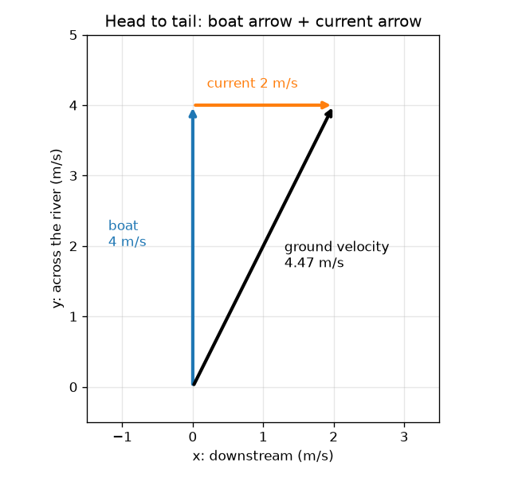
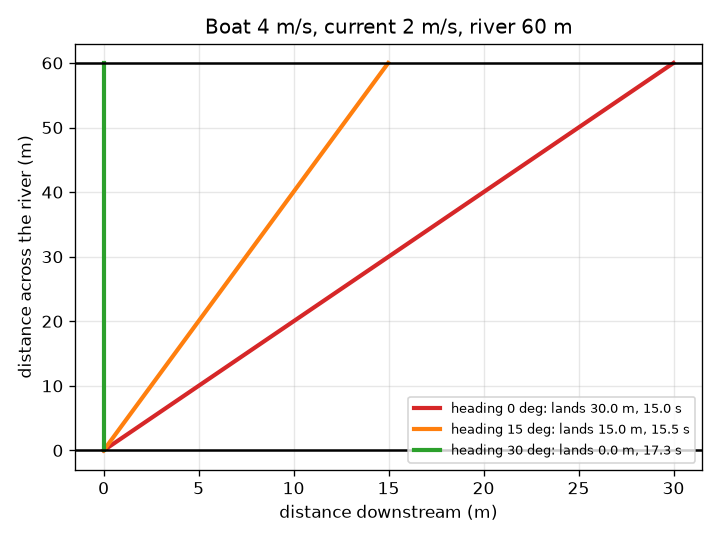

# സെഷൻ 1: കൂട്ടിച്ചേർക്കുന്ന അമ്പുകൾ

[Session 1 — हिन्दी](README.hi.md)

*ലെവൽ 1 (ആശയപരമായ ഇന്ററാക്ടീവ് മോഡൽ) · ഏകദേശം 60 മിനിറ്റ് · openvectors*

> ഇത് ഒരു ലളിതമാക്കിയ വിദ്യാഭ്യാസ മോഡൽ ആണ്. ഇത് സാധൂകരിക്കപ്പെട്ട ഒരു ഡിസൈൻ ഉപകരണമല്ല; യഥാർത്ഥ നിർമ്മിതികൾ, വൈദ്യുത ഇൻസ്റ്റലേഷനുകൾ, വാഹനങ്ങൾ, വ്യാവസായിക പ്രക്രിയകൾ അല്ലെങ്കിൽ വൈദ്യപരമായ തീരുമാനങ്ങൾ എന്നിവയ്ക്ക് ഇത് ഉപയോഗിക്കരുത്.

**മുൻ അറിവ് (Prerequisites)**

- വേഗതയും ദിശയും എന്താണെന്ന് അറിയുക.
- നിങ്ങൾ PRIMER.md വായിക്കുകയും `python start.py 1` ഒരു തവണ റൺ ചെയ്യുകയും ചെയ്തിട്ടുണ്ട്.

**പഠന ലക്ഷ്യങ്ങൾ (Learning objectives).** ഈ സെഷനു ശേഷം നിങ്ങൾക്ക് കഴിയും:

- വേഗവെക്ടറിനെ (velocity) നീളവും (വേഗത) ദിശയുമുള്ള ഒരു അമ്പായി വിവരിക്കാൻ.
- രണ്ട് അമ്പുകളെ തലയോട് വാൽ ചേർത്ത്, വരച്ചും അവയുടെ സംഖ്യകൾ കൂട്ടിയും കൂട്ടിച്ചേർക്കാൻ.
- ഒഴുക്കുള്ള ഒരു നദി കടക്കുമ്പോൾ വള്ളം എവിടെ എത്തിച്ചേരുമെന്ന് പ്രവചിക്കാൻ.
- വള്ളം തുടങ്ങിയ സ്ഥലത്തിന് നേരെ എതിർവശത്ത് എത്താൻ ഒരു ഹെഡിംഗ് (heading) തിരഞ്ഞെടുക്കാൻ.

## A. യഥാർത്ഥ ലോക പ്രശ്നം
60 m വീതിയുള്ള ഒരു നദിയുടെ മറുകരയിലെ കടവിലേക്ക് നേരെ നോക്കി നിങ്ങൾ 4 m/s വേഗതയിൽ വള്ളം തുഴയുന്നു. നദി 2 m/s വേഗതയിൽ ഒഴുകുന്നു. നിങ്ങൾ കടവിലേക്ക് തന്നെ ചൂണ്ടിക്കൊണ്ടിരിക്കുന്നു, പക്ഷേ വെള്ളം നിങ്ങളെ വശത്തേക്ക് കൊണ്ടുപോകുന്നു. യഥാർത്ഥത്തിൽ നിങ്ങൾ എവിടെ എത്തിച്ചേരും? കൃത്യമായി എതിർവശത്ത് എത്താൻ വള്ളം എങ്ങനെ ചൂണ്ടണം?

## B. ആശയവും സിദ്ധാന്തവും
വേഗവെക്ടർ ഒരു അമ്പാണ്: അതിന്റെ നീളം വേഗതയും ദിശ അത് ചൂണ്ടുന്ന ദിശയുമാണ്. ഒഴുക്കിന്റെ ദിശയിൽ (നദിക്കൊപ്പം) x ഉം നദിക്ക് കുറുകെ y ഉം ഉപയോഗിക്കുന്നു, അതിനാൽ ഒരു അമ്പ് (vx, vy) എന്ന ജോഡിയാണ്. വള്ളത്തിന്റെ സ്വന്തം അമ്പ് നിശ്ചല ജലത്തിൽ വള്ളം ചെയ്യുന്നതാണ്; ഒഴുക്കിന്റെ അമ്പ് വെള്ളം അതിലുള്ള എല്ലാത്തിനോടും ചെയ്യുന്നതാണ്. നിലത്തിന് മേലുള്ള വള്ളത്തിന്റെ യഥാർത്ഥ ചലനം ഇവയുടെ തുകയാണ്: രണ്ടാമത്തെ അമ്പിന്റെ വാൽ ആദ്യത്തേതിന്റെ തലയിൽ വച്ച് ആദ്യത്തെ വാലിൽ നിന്ന് അവസാനത്തെ തലയിലേക്ക് അമ്പ് വരയ്ക്കുക. സംഖ്യകൾ ഉപയോഗിച്ച് പൊരുത്തപ്പെടുന്ന എൻട്രികൾ കൂട്ടുക. ഗ്രൗണ്ട് അമ്പിന്റെ കുറുകെയുള്ള ഭാഗമാണ് വള്ളത്തെ മറുകരയിലേക്ക് നീക്കുന്നത് എന്നതിനാൽ, കടക്കാനുള്ള സമയം വീതിയെ ആ ഭാഗം കൊണ്ട് ഹരിച്ചതാണ്, വശത്തേക്കുള്ള ഒഴുക്ക് (drift) നദിക്കൊപ്പമുള്ള ഭാഗത്തെ ആ സമയം കൊണ്ട് ഗുണിച്ചതാണ്.

| ചിഹ്നം | അർത്ഥം | യൂണിറ്റ് |
|---|---|---|
| v | വെള്ളത്തിലൂടെയുള്ള വള്ളത്തിന്റെ വേഗത | m/s |
| u | ഒഴുക്കിന്റെ വേഗത (താഴേക്ക്) | m/s |
| h | ഹെഡിംഗ്: നേരെ കുറുകെ എന്നതിൽ നിന്നുള്ള കോൺ, മുകളിലേക്ക് ചരിയുമ്പോൾ പോസിറ്റീവ് | ഡിഗ്രി |
| (gx, gy) | ഗ്രൗണ്ട് അമ്പ്: നദിക്കൊപ്പവും കുറുകെയും | m/s |
| W | നദിയുടെ വീതി (60) | m |
| T | കടക്കാനുള്ള സമയം | s |
| drift | നദിക്കൊപ്പം എത്തിച്ചേരുന്ന സ്ഥാനം, താഴേക്ക് പോസിറ്റീവ് | m |

**അനുമാനങ്ങൾ (Assumptions)**

- നദി സമാന്തര കരകളോടെ നേരെയുള്ളതാണ്, ഒഴുക്ക് എല്ലായിടത്തും ഒരുപോലെയാണ് (ഏകരൂപം).
- വെള്ളത്തിലൂടെയുള്ള വള്ളത്തിന്റെ വേഗത സ്ഥിരമായി നിൽക്കുന്നു, വള്ളം തൽക്ഷണം തിരിയുന്നു.
- എല്ലാം ഒരു പരന്ന തലത്തിലാണ് നടക്കുന്നത്: തിരമാലകളോ കാറ്റോ ഇല്ല.

$$ \mathbf g=\mathbf b+\mathbf c,\qquad \mathbf b=v(-\sin h,\ \cos h),\quad \mathbf c=(u,\ 0) $$

$$ T=\frac{W}{g_y}=\frac{W}{v\cos h} $$

$$ \text{drift}=g_x\,T=\frac{(u-v\sin h)\,W}{v\cos h} $$

$$ \text{land opposite: } g_x=0\ \Rightarrow\ \sin h=\frac{u}{v} $$

## C. ദൃശ്യ വിശദീകരണം
ഇടത് ചിത്രം നേരെ കുറുകെ ചൂണ്ടുന്ന വള്ളത്തിന് അമ്പുകൾ തലയോട് വാൽ ചേർത്ത് കാണിക്കുന്നു: നീല വള്ളം അമ്പിന് 4 m/s നീളം, ഓറഞ്ച് ഒഴുക്ക് അമ്പിന് 2 m/s, ആദ്യ വാലിൽ നിന്ന് അവസാന തലയിലേക്കുള്ള കറുത്ത ഗ്രൗണ്ട് അമ്പിന് 4.47 m/s നീളം, അത് താഴേക്ക് ചരിഞ്ഞിരിക്കുന്നു. വലത് ചിത്രം 60 m നദിയിലെ മൂന്ന് വള്ളങ്ങൾ കാണിക്കുന്നു: ഹെഡിംഗ് 0 ൽ വള്ളം 15.0 s ന് ശേഷം 30.0 m താഴെ എത്തുന്നു, ഹെഡിംഗ് 15 ഡിഗ്രിയിൽ 15.5 s ന് ശേഷം 15.0 m താഴെ എത്തുന്നു, ഹെഡിംഗ് 30 ഡിഗ്രിയിൽ 17.3 s ന് ശേഷം കൃത്യമായി എതിർവശത്ത് എത്തുന്നു.

*തലയോട് വാൽ: വള്ളം അമ്പും ഒഴുക്ക് അമ്പും കൂടി ഗ്രൗണ്ട് അമ്പാകുന്നു.*

*60 m നദിയിൽ മൂന്ന് ഹെഡിംഗുകൾ: 0 ഡിഗ്രി 30 m താഴെ എത്തുന്നു, 30 ഡിഗ്രി എതിർവശത്ത് എത്തുന്നു.*

## D. ഇന്ററാക്ടീവ് സിമുലേഷൻ
പാഠം റൺ ചെയ്യുക (`python start.py 1`), തുടർന്ന് ലൈവ് ആപ്പ് തുറക്കുക: [സെഷൻ 1: നദി കടക്കുന്ന വള്ളം](https://krunalpanchal1995.github.io/pan-iit-oss/openvectors/session-01/) (അല്ലെങ്കിൽ ഈ ഫോൾഡറിലെ `app.html`). ഹെഡിംഗ് സ്ലൈഡർ നീക്കി കറുത്ത ഗ്രൗണ്ട് അമ്പ് തിരിയുന്നതും എത്തിച്ചേരുന്ന സ്ഥാനം കരയിലൂടെ നീങ്ങുന്നതും നോക്കുക. മൂന്നാമത്തെ കാഴ്ച തുറന്ന് എല്ലാ ഹെഡിംഗുകൾക്കുമുള്ള എത്തിച്ചേരൽ സ്ഥാനം ഒരേസമയം കാണുക.

**വെല്ലുവിളി (Challenge).** 2 m/s ഒഴുക്കിൽ 4 m/s വള്ളം ഉപയോഗിച്ച് തുടക്കത്തിന് കൃത്യമായി എതിർവശത്ത് (1 m നുള്ളിൽ) എത്തുക.

## E. ഉദാഹരണ പ്രശ്നവും പരീക്ഷണവും
**പ്രശ്നം.** 4 m/s വള്ളം 2 m/s ഒഴുക്കുള്ള 60 m നദിക്ക് നേരെ കുറുകെ ചൂണ്ടുന്നു. ഗ്രൗണ്ട് അമ്പ്, കടക്കാനുള്ള സമയം, എത്തിച്ചേരുന്ന സ്ഥാനം എന്നിവ കണ്ടെത്തുക. തുടർന്ന് വള്ളത്തെ കൃത്യമായി എതിർവശത്ത് എത്തിക്കുന്ന ഹെഡിംഗ് കണ്ടെത്തുക.

1. വള്ളം അമ്പ് = (0, 4) m/s (നേരെ കുറുകെ, നദിക്കൊപ്പം ഒന്നുമില്ല). ഒഴുക്ക് അമ്പ് = (2, 0) m/s.
2. ഗ്രൗണ്ട് അമ്പ് = (0 + 2, 4 + 0) = (2, 4) m/s. അതിന്റെ നീളം sqrt(2^2 + 4^2) = sqrt(20) = 4.47 m/s.
3. കുറുകെയുള്ള ഭാഗം മാത്രമേ വള്ളത്തെ മറുകരയിലേക്ക് നീക്കുന്നുള്ളൂ: T = 60 / 4 = 15 s.
4. ഡ്രിഫ്റ്റ് = 2 m/s * 15 s = 30 m താഴേക്ക്.
5. എതിർവശത്ത് എത്താൻ നദിക്കൊപ്പമുള്ള ഭാഗം പൂജ്യമാകണം: 2 - 4 sin h = 0, അതിനാൽ sin h = 0.5, h = 30 ഡിഗ്രി മുകളിലേക്ക്.
6. അപ്പോൾ gy = 4 cos 30 = 3.46 m/s, അതിനാൽ T = 60 / 3.46 = 17.3 s: സുരക്ഷിതമായ എത്തിച്ചേരലിന് 2.3 s കൂടുതൽ വേണം.

**ഉത്തരം.** നേരെ കുറുകെ ചൂണ്ടുമ്പോൾ: ഗ്രൗണ്ട് അമ്പ് (2, 4) m/s, 15 s, 30 m താഴെ എത്തുന്നു. 30 ഡിഗ്രി മുകളിലേക്ക് ചൂണ്ടുമ്പോൾ: ഗ്രൗണ്ട് അമ്പ് (0, 3.46) m/s, 17.3 s, കൃത്യമായി എതിർവശത്ത് എത്തുന്നു.

**പരീക്ഷണം.** ഒരു സ്കൂൾ മൈതാനത്തിലൂടെ സ്ഥിരമായ വേഗത്തിൽ നടക്കുമ്പോൾ ഒരു സുഹൃത്ത് ഉരുളുന്ന പ്ലാറ്റ്ഫോമിൽ നിങ്ങളെ വശത്തേക്ക് വലിക്കുക, അല്ലെങ്കിൽ പതുക്കെ ഒഴുകുന്ന അരുവിയിൽ ഒരു കളിപ്പാട്ട വള്ളവും സ്റ്റോപ്പ് വാച്ചും ഉപയോഗിക്കുക: തുടക്കവും എതിർവശത്തെ ബിന്ദുവും അടയാളപ്പെടുത്തി, വള്ളം നേരെ കുറുകെ ചൂണ്ടി ഡ്രിഫ്റ്റും സമയവും അളക്കുക, തുടർന്ന് വള്ളം മുകളിലേക്ക് ചരിച്ച് ആവർത്തിക്കുക. ചരിച്ച വള്ളത്തിന് ചെറിയ ഡ്രിഫ്റ്റ് എന്ന അതേ രീതി പ്രതീക്ഷിക്കുക, പക്ഷേ അതേ സംഖ്യകളല്ല: യഥാർത്ഥ ഒഴുക്ക് കരകൾക്കടുത്ത് പതുക്കെയാണ്, വള്ളം തികച്ചും സ്ഥിരമായ വേഗത നിലനിർത്തുന്നില്ല, കളിപ്പാട്ട വള്ളം വെള്ളത്തോടൊപ്പം തിരിയുന്നു. മോഡൽ അതിന്റെ അനുമാനങ്ങൾക്ക് കൃത്യമാണ്; അരുവി ഏകരൂപമല്ല.

## F. വിലയിരുത്തലും ഡിസൈൻ വെല്ലുവിളിയും
**ചോദ്യ തരം A: ആശയപരം.** തുടങ്ങിയ സ്ഥലത്തിന് കൃത്യമായി എതിർവശത്ത് എത്താൻ വള്ളം മുകളിലേക്ക് ചൂണ്ടേണ്ടത് എന്തുകൊണ്ട്? വള്ളം അമ്പിന്റെ വശത്തേക്കുള്ള ഭാഗം എന്ത് ചെയ്യണം?

സൂചന

എതിർവശത്ത് എത്തുക എന്നാൽ ഗ്രൗണ്ട് അമ്പിന്റെ നദിക്കൊപ്പമുള്ള ഭാഗം പൂജ്യമാണ്.

ഘട്ടം ഘട്ടമായുള്ള പരിഹാരം

ഗ്രൗണ്ട് അമ്പ് എന്നത് വള്ളം അമ്പും ഒഴുക്ക് അമ്പും ചേർന്നതാണ്. ഒഴുക്ക് അമ്പ് താഴേക്ക് ചൂണ്ടുന്നു, അതിനാൽ തുകയുടെ നദിക്കൊപ്പമുള്ള ഭാഗം പൂജ്യമാക്കാൻ വള്ളം അമ്പിന് തുല്യവും വിപരീതവുമായ മുകളിലേക്കുള്ള ഭാഗം വേണം. വള്ളം മുകളിലേക്ക് ചരിച്ചാൽ മാത്രമേ അത് സാധ്യമാകൂ. അപ്പോൾ വള്ളം അമ്പിന്റെ കുറുകെയുള്ള ഭാഗം പൂർണ്ണ വള്ളം വേഗതയേക്കാൾ അല്പം ചെറുതാണ്, അതിനാൽ കടക്കാൻ കൂടുതൽ സമയമെടുക്കും.

**ചോദ്യ തരം B: സംഖ്യാപരം.** 5 m/s വള്ളം 3 m/s ഒഴുക്കുള്ള 60 m നദിക്ക് നേരെ കുറുകെ ചൂണ്ടുന്നു. കടക്കാനുള്ള സമയം, എത്തിച്ചേരുന്ന സ്ഥാനം, നിലത്തിന് മേലുള്ള വേഗത എന്നിവ കണ്ടെത്തുക.

സൂചന

ഗ്രൗണ്ട് അമ്പ് = (3, 5). സമയം = വീതി / കുറുകെയുള്ള ഭാഗം.

ഘട്ടം ഘട്ടമായുള്ള പരിഹാരം

ഗ്രൗണ്ട് അമ്പ് = (3, 5) m/s. T = 60 / 5 = 12 s. ഡ്രിഫ്റ്റ് = 3 * 12 = 36 m താഴേക്ക്. നിലത്തിന് മേലുള്ള വേഗത = sqrt(3^2 + 5^2) = sqrt(34) = 5.83 m/s. യുക്തി പരിശോധന: വള്ളത്തിന്റെ മാത്രം വേഗതയേക്കാൾ (5 m/s) വേഗതയേറിയതാണ്, കാരണം ഒഴുക്ക് നദിക്കൊപ്പം സഹായിക്കുന്നു, 12 s എന്നത് 5 m/s ൽ 60 m നുള്ള സമയമാണ്.

**ചോദ്യ തരം C: ഗ്രാഫ്, സിമുലേഷൻ വ്യാഖ്യാനം.** എത്തിച്ചേരൽ-സ്ഥാന ഗ്രാഫിൽ, 4 m/s വള്ളത്തിനും 2 m/s ഒഴുക്കിനും വക്രം പൂജ്യം കടക്കുന്നത് എവിടെ, ഹെഡിംഗ് 0 ൽ എത്തിച്ചേരുന്ന സ്ഥാനം എന്താണ്? നെഗറ്റീവ് ഹെഡിംഗുകൾക്ക് (താഴേക്ക് ചരിയുമ്പോൾ) വക്രം എന്ത് ചെയ്യുന്നു?

സൂചന

ഹെഡിംഗ് 0 ൽ വക്രം വായിക്കുക, 0 ലെ തിരശ്ചീന രേഖയെ അത് സന്ധിക്കുന്നിടവും.

ഘട്ടം ഘട്ടമായുള്ള പരിഹാരം

ഹെഡിംഗ് 0 ൽ വക്രം 30 m ൽ ആണ്. ഹെഡിംഗ് 30 ഡിഗ്രിയിൽ അത് പൂജ്യം കടക്കുന്നു. നെഗറ്റീവ് ഹെഡിംഗുകൾക്ക്, വള്ളം ഒഴുക്കിനൊപ്പം താഴേക്ക് ചരിയുമ്പോൾ, എത്തിച്ചേരുന്ന സ്ഥാനം കൂടുതലാണ്: വള്ളം കൂടുതൽ താഴേക്ക് ഒഴുകിപ്പോകുന്നു.

**ചോദ്യ തരം D: ഡിസൈൻ, ഒപ്റ്റിമൈസേഷൻ വെല്ലുവിളി.** ഡിസൈൻ: തുടക്കത്തിന് എതിർവശത്തെ ബിന്ദുവിൽ നിന്ന് 15 m താഴെയാണ് കടവ്. 2 m/s ഒഴുക്കിൽ 4 m/s വള്ളം കടവിൽ എത്താൻ ഒരു ഹെഡിംഗ് തിരഞ്ഞെടുക്കുക, കടക്കാൻ എത്ര സമയമെടുക്കുമെന്ന് പറയുക.

സൂചന

എത്തിച്ചേരൽ സ്ഥാനം 15 m എന്ന് വായിക്കുന്നതുവരെ ആപ്പിൽ ഹെഡിംഗുകൾ പരീക്ഷിക്കുക, അല്ലെങ്കിൽ പാഠത്തിലെ `crossing` ഉപയോഗിച്ച് പല ഹെഡിംഗുകൾക്ക് എത്തിച്ചേരൽ സ്ഥാനം കണക്കാക്കുക.

ഘട്ടം ഘട്ടമായുള്ള പരിഹാരം

ഏകദേശം 15 ഡിഗ്രി മുകളിലേക്കുള്ള ഹെഡിംഗ് 15.0 m താഴെ എത്തിച്ചേരൽ (കൃത്യം 15 ഡിഗ്രിക്ക് 14.98 m) ഉം ഏകദേശം 15.5 s കടക്കൽ സമയവും നൽകുന്നു. അനുമാനം: സ്ഥിര ഒഴുക്കും വള്ളം വേഗതയും. പരിശോധന: ഹെഡിംഗ് 0 30 m ഉം ഹെഡിംഗ് 30 0 m ഉം നൽകുന്നു, അതിനാൽ ഇടയിലെ പകുതി ഹെഡിംഗ് ഏകദേശം പകുതി വഴിയിൽ, 15 m ന് അടുത്ത്, എത്തുന്നു, കാരണം അവിടെ വക്രം ഏതാണ്ട് നേർരേഖയാണ്.

[RUBRIC.md](../../RUBRIC.md) ഉപയോഗിച്ച് സ്വയം സ്കോർ ചെയ്യുക. പേപ്പറിൽ ചെയ്യാൻ [ആക്ടിവിറ്റി ഷീറ്റ്](activity_sheet.md) പ്രിന്റ് ചെയ്യുക.

## സാധാരണ തെറ്റിദ്ധാരണകൾ
| സാധാരണ തെറ്റിദ്ധാരണ | യഥാർത്ഥത്തിൽ ശരിയായത് |
|---|---|
| നദി നേരെ കടക്കാൻ വള്ളം കടവിലേക്ക് ചൂണ്ടുക. | കടക്കുമ്പോൾ ഒഴുക്ക് വള്ളത്തെ കൊണ്ടുപോകുന്നു, അതിനാൽ കടവിലേക്ക് ചൂണ്ടിയാൽ അത് താഴെ എത്തും. നിങ്ങൾ മുകളിലേക്ക് ചരിക്കണം. |
| നിലത്തിന് മേലുള്ള വള്ളത്തിന്റെ വേഗത വള്ളം വേഗതയ്ക്ക് തുല്യമാണ്. | ഗ്രൗണ്ട് അമ്പ് വള്ളം അമ്പിന്റെയും ഒഴുക്ക് അമ്പിന്റെയും തുകയാണ്; അതിന്റെ നീളം സാധാരണയായി വള്ളം വേഗതയിൽ നിന്ന് വ്യത്യസ്തമാണ്. |
| അമ്പുകളെ അവയുടെ നീളങ്ങൾ കൂട്ടി ചേർക്കുന്നു. | അമ്പുകൾ തലയോട് വാൽ ചേർത്തോ പൊരുത്തപ്പെടുന്ന സംഖ്യകൾ കൂട്ടിയോ ആണ് കൂട്ടുന്നത്. അമ്പുകൾ ഒരേ ദിശയിൽ ചൂണ്ടുമ്പോൾ മാത്രമേ നീളങ്ങൾ കൂടൂ. |
| വലിയ ഒഴുക്ക് എപ്പോഴും കടക്കൽ മന്ദഗതിയിലാക്കുന്നു. | വള്ളം നേരെ കുറുകെ ചൂണ്ടുന്നെങ്കിൽ ഒഴുക്ക് കടക്കൽ സമയം മാറ്റുന്നില്ല, കാരണം കുറുകെയുള്ള ഭാഗം മാത്രമാണ് പ്രധാനം; അത് എത്തിച്ചേരുന്ന സ്ഥലത്തെയാണ് മാറ്റുന്നത്. |

## പദാവലി (Glossary)
- **വെക്ടർ (vector)**: വലിപ്പവും ദിശയുമുള്ള അളവ്, അമ്പായി വരയ്ക്കുന്നു
- **പ്രവേഗം (velocity)**: ദിശയോടൊപ്പമുള്ള വേഗത; m/s ൽ അളക്കുന്ന അമ്പ്
- **ഫലിതം (resultant)**: അമ്പുകളുടെ തുകയ്ക്ക് തുല്യമായ ഒറ്റ അമ്പ്
- **ഹെഡിംഗ് (heading)**: വള്ളം ചൂണ്ടുന്ന ദിശ, ഇവിടെ നേരെ കുറുകെ എന്നതിൽ നിന്ന് അളക്കുന്നു
- **ഡ്രിഫ്റ്റ് (drift)**: വള്ളം എത്തുമ്പോഴേക്കും നദിക്കൊപ്പം എത്ര ദൂരം കൊണ്ടുപോകപ്പെട്ടു

## പൂർത്തിയാക്കുക
1. [exercises.md](exercises.md) ലെ മൂന്ന് കോഡിംഗ് ടാസ്കുകൾ ചെയ്യുക.
2. നിങ്ങളുടെ മാറ്റങ്ങൾക്കു ശേഷം `python start.py 1` വീണ്ടും റൺ ചെയ്യുക. ഇത് ചെക്ക്‌പോയിന്റോടെ അവസാനിക്കുന്നു; അത് `PASS` എന്ന് പ്രിന്റ് ചെയ്യുമ്പോൾ നിങ്ങൾ പൂർത്തിയാക്കി. (ചെക്ക്‌പോയിന്റ് മാത്രം: `python start.py check 1`.)

അടുത്തത്: [സെഷൻ 2](../session-02/README.md)
