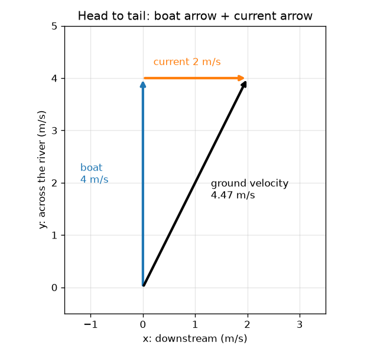
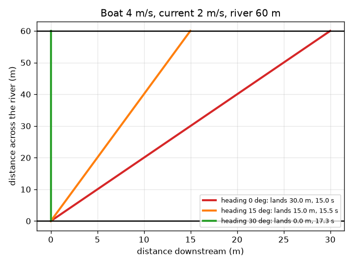

# அமர்வு 1: கூட்டிக்கொள்ளும் அம்புகள்

[Session 1 — हिन्दी](README.hi.md) · [Session 1 — മലയാളം](README.ml.md)

*நிலை 1 (கருத்தியல் ஊடாடும் மாதிரி) · சுமார் 60 நிமிடங்கள் · openvectors*

> இது ஒரு எளிமைப்படுத்தப்பட்ட கல்வி மாதிரி. இது சரிபார்க்கப்பட்ட வடிவமைப்புக் கருவி அல்ல; உண்மையான கட்டமைப்புகள், மின் நிறுவல்கள், வாகனங்கள், தொழில்துறை செயல்முறைகள் அல்லது மருத்துவ முடிவுகளுக்கு இதைப் பயன்படுத்தக் கூடாது.

**முன்தேவைகள் (Prerequisites)**

- வேகமும் திசையும் என்றால் என்ன என்று அறிந்திருத்தல்.
- நீங்கள் PRIMER.md ஐப் படித்து, `python start.py 1` ஐ ஒரு முறை இயக்கியிருக்கிறீர்கள்.

**கற்றல் நோக்கங்கள் (Learning objectives).** இந்த அமர்வுக்குப் பிறகு உங்களால் முடியும்:

- திசைவேகத்தை (velocity) நீளமும் (வேகம்) திசையும் கொண்ட அம்பாக விவரிக்க.
- இரண்டு அம்புகளை தலையுடன் வால் சேர்த்து, வரைந்தும் அவற்றின் எண்களைக் கூட்டியும் கூட்ட.
- நீரோட்டம் உள்ள ஆற்றைக் கடக்கும்போது படகு எங்கு இறங்கும் என்று முன்னறிவிக்க.
- படகு தொடங்கிய இடத்துக்கு நேர் எதிரே இறங்கும்படி ஒரு தலைப்பு திசையை (heading) தேர்ந்தெடுக்க.

## A. நிஜ உலகப் பிரச்சினை
60 m அகலமுள்ள ஆற்றின் மறுகரையில் உள்ள துறையை நோக்கி நேராக 4 m/s வேகத்தில் படகைத் துடுப்புப் போடுகிறீர்கள். ஆறு 2 m/s வேகத்தில் ஓடுகிறது. நீங்கள் துறையை நோக்கியே படகைக் காட்டிக்கொண்டிருக்கிறீர்கள், ஆனால் நீர் உங்களைப் பக்கவாட்டில் இழுத்துச் செல்கிறது. நீங்கள் உண்மையில் எங்கு இறங்குவீர்கள்? சரியாக எதிரே இறங்க படகை எப்படிக் காட்ட வேண்டும்?

## B. கருத்தும் கோட்பாடும்
திசைவேகம் ஒரு அம்பு: அதன் நீளம் வேகம், திசை அது சுட்டும் திசை. ஆற்றோட்டத் திசையில் (ஆற்றோடு) x ஐயும் ஆற்றின் குறுக்கே y ஐயும் பயன்படுத்துகிறோம், எனவே ஒரு அம்பு (vx, vy) என்ற ஜோடி. படகின் சொந்த அம்பு தேங்கிய நீரில் படகு செய்வது; நீரோட்டத்தின் அம்பு நீர் அதிலுள்ள அனைத்துக்கும் செய்வது. தரையின் மேல் படகின் உண்மையான இயக்கம் இவ்விரண்டின் கூட்டுத்தொகை: இரண்டாவது அம்பின் வாலை முதலாவதின் தலையில் வைத்து, முதல் வாலிலிருந்து கடைசித் தலை வரை அம்பை வரையுங்கள். எண்களுடன், பொருந்தும் உள்ளீடுகளைக் கூட்டுங்கள். தரை அம்பின் குறுக்குப் பகுதிதான் படகை மறுகரைக்கு நகர்த்துகிறது என்பதால், கடக்கும் நேரம் அகலத்தை அந்தப் பகுதியால் வகுத்தது, பக்கவாட்டுக் கடத்தல் (drift) என்பது ஆற்றோடு பகுதியை அந்த நேரத்தால் பெருக்கியது.

| குறியீடு | பொருள் | அலகு |
|---|---|---|
| v | நீர் வழியே படகின் வேகம் | m/s |
| u | நீரோட்ட வேகம் (கீழ்நோக்கி) | m/s |
| h | தலைப்பு திசை: நேர் குறுக்கிலிருந்து கோணம், மேல்நோக்கிச் சாய்ந்தால் நேர்மறை | டிகிரி |
| (gx, gy) | தரை அம்பு: ஆற்றோடும் குறுக்கேயும் | m/s |
| W | ஆற்றின் அகலம் (60) | m |
| T | கடக்கும் நேரம் | s |
| drift | ஆற்றோடு இறங்கும் இடம், கீழ்நோக்கி நேர்மறை | m |

**அனுமானங்கள் (Assumptions)**

- ஆறு இணைக் கரைகளுடன் நேராக உள்ளது, நீரோட்டம் எங்கும் ஒன்றே (சீரானது).
- நீர் வழியே படகின் வேகம் மாறாமல் இருக்கும், படகு உடனடியாகத் திரும்புகிறது.
- எல்லாம் ஒரு தட்டையான தளத்தில் நடக்கிறது: அலைகளும் காற்றும் இல்லை.

$$ \mathbf g=\mathbf b+\mathbf c,\qquad \mathbf b=v(-\sin h,\ \cos h),\quad \mathbf c=(u,\ 0) $$

$$ T=\frac{W}{g_y}=\frac{W}{v\cos h} $$

$$ \text{drift}=g_x\,T=\frac{(u-v\sin h)\,W}{v\cos h} $$

$$ \text{land opposite: } g_x=0\ \Rightarrow\ \sin h=\frac{u}{v} $$

## C. காட்சி விளக்கம்
இடப்புறப் படம் நேராகக் குறுக்கே சுட்டும் படகுக்கு அம்புகளைத் தலையுடன் வால் சேர்த்துக் காட்டுகிறது: நீலப் படகு அம்பு 4 m/s நீளம், ஆரஞ்சு நீரோட்ட அம்பு 2 m/s, முதல் வாலிலிருந்து கடைசித் தலை வரையிலான கருப்புத் தரை அம்பு 4.47 m/s நீளம், அது கீழ்நோக்கிச் சாய்ந்துள்ளது. வலப்புறப் படம் 60 m ஆற்றில் மூன்று படகுகளைக் காட்டுகிறது: தலைப்பு திசை 0 இல் படகு 15.0 s க்குப் பிறகு 30.0 m கீழே இறங்குகிறது, 15 டிகிரியில் 15.5 s க்குப் பிறகு 15.0 m கீழே இறங்குகிறது, 30 டிகிரியில் 17.3 s க்குப் பிறகு சரியாக எதிரே இறங்குகிறது.

*தலையுடன் வால்: படகு அம்பும் நீரோட்ட அம்பும் சேர்ந்து தரை அம்பாகின்றன.*

*60 m ஆற்றில் மூன்று தலைப்பு திசைகள்: 0 டிகிரி 30 m கீழே இறங்குகிறது, 30 டிகிரி எதிரே இறங்குகிறது.*

## D. ஊடாடும் உருவகப்படுத்துதல்
பாடத்தை இயக்கவும் (`python start.py 1`), பின்னர் நேரடிச் செயலியைத் திறக்கவும்: [அமர்வு 1: ஆற்றைக் கடக்கும் படகு](https://krunalpanchal1995.github.io/pan-iit-oss/openvectors/session-01/) (அல்லது இந்தக் கோப்புறையில் உள்ள `app.html`). தலைப்பு திசை ஸ்லைடரை நகர்த்தி கருப்புத் தரை அம்பு திரும்புவதையும் இறங்கும் இடம் கரையோரம் நகர்வதையும் பாருங்கள். மூன்றாவது காட்சியைத் திறந்து ஒவ்வொரு தலைப்பு திசைக்கான இறங்கும் இடத்தையும் ஒரே நேரத்தில் பாருங்கள்.

**சவால் (Challenge).** 2 m/s நீரோட்டத்தில் 4 m/s படகுடன் தொடக்கத்துக்குச் சரியாக எதிரே (1 m க்குள்) இறங்குங்கள்.

## E. தீர்க்கப்பட்ட எடுத்துக்காட்டும் சோதனையும்
**பிரச்சினை.** 4 m/s படகு 2 m/s நீரோட்டம் உள்ள 60 m ஆற்றுக்கு நேராகக் குறுக்கே சுட்டுகிறது. தரை அம்பு, கடக்கும் நேரம், இறங்கும் இடம் ஆகியவற்றைக் கண்டறியுங்கள். பிறகு படகைச் சரியாக எதிரே இறக்கும் தலைப்பு திசையைக் கண்டறியுங்கள்.

1. படகு அம்பு = (0, 4) m/s (நேராகக் குறுக்கே, ஆற்றோடு எதுவும் இல்லை). நீரோட்ட அம்பு = (2, 0) m/s.
2. தரை அம்பு = (0 + 2, 4 + 0) = (2, 4) m/s. அதன் நீளம் sqrt(2^2 + 4^2) = sqrt(20) = 4.47 m/s.
3. குறுக்குப் பகுதி மட்டுமே படகை மறுகரைக்கு நகர்த்துகிறது: T = 60 / 4 = 15 s.
4. கடத்தல் = 2 m/s * 15 s = 30 m கீழ்நோக்கி.
5. எதிரே இறங்க ஆற்றோடு பகுதி பூஜ்ஜியமாக வேண்டும்: 2 - 4 sin h = 0, எனவே sin h = 0.5 மற்றும் h = 30 டிகிரி மேல்நோக்கி.
6. அப்போது gy = 4 cos 30 = 3.46 m/s, எனவே T = 60 / 3.46 = 17.3 s: பாதுகாப்பான இறக்கத்துக்கு 2.3 s கூடுதல் ஆகிறது.

**விடை.** நேராகக் குறுக்கே சுட்டினால்: தரை அம்பு (2, 4) m/s, 15 s, 30 m கீழே இறங்கும். 30 டிகிரி மேல்நோக்கிச் சுட்டினால்: தரை அம்பு (0, 3.46) m/s, 17.3 s, சரியாக எதிரே இறங்கும்.

**சோதனை.** பள்ளி மைதானத்தில் சீரான வேகத்தில் நடக்கும்போது நண்பர் உருளும் மேடையில் உங்களைப் பக்கவாட்டில் இழுக்கட்டும், அல்லது மெதுவான ஓடையில் பொம்மைப் படகும் நிறுத்தக் கடிகாரமும் பயன்படுத்துங்கள்: தொடக்கத்தையும் எதிர்ப்புள்ளியையும் குறியிட்டு, படகை நேராகக் குறுக்கே சுட்டி கடத்தலையும் நேரத்தையும் அளந்து, பிறகு படகை மேல்நோக்கிச் சாய்த்து மீண்டும் செய்யுங்கள். சாய்த்த படகுக்குச் சிறிய கடத்தல் என்ற அதே முறை எதிர்பார்க்கலாம், ஆனால் அதே எண்கள் அல்ல: உண்மையான நீரோட்டம் கரைகளுக்கு அருகே மெதுவாக உள்ளது, படகு முற்றிலும் மாறா வேகத்தை வைத்திருப்பதில்லை, பொம்மைப் படகு நீருடன் சேர்ந்து திரும்புகிறது. மாதிரி அதன் அனுமானங்களுக்குச் சரியானது; ஓடை சீரானதல்ல.

## F. மதிப்பீடும் வடிவமைப்புச் சவாலும்
**கேள்வி வகை A: கருத்தியல்.** தொடங்கிய இடத்துக்குச் சரியாக எதிரே இறங்க படகு ஏன் மேல்நோக்கிச் சுட்ட வேண்டும்? படகு அம்பின் பக்கவாட்டுப் பகுதி என்ன செய்ய வேண்டும்?

குறிப்பு

எதிரே இறங்குதல் என்றால் தரை அம்பின் ஆற்றோடு பகுதி பூஜ்ஜியம்.

படிப்படியான தீர்வு

தரை அம்பு என்பது படகு அம்பும் நீரோட்ட அம்பும் சேர்ந்தது. நீரோட்ட அம்பு கீழ்நோக்கிச் சுட்டுகிறது, எனவே கூட்டுத்தொகையின் ஆற்றோடு பகுதியைப் பூஜ்ஜியமாக்க படகு அம்புக்குச் சமமான எதிர்த் திசை மேல்நோக்கிய பகுதி வேண்டும். படகை மேல்நோக்கிச் சாய்ப்பதன் மூலம் மட்டுமே அது சாத்தியம். அப்போது படகு அம்பின் குறுக்குப் பகுதி முழுப் படகு வேகத்தை விடச் சற்றுச் சிறியது, எனவே கடக்க அதிக நேரம் ஆகிறது.

**கேள்வி வகை B: எண்ணியல்.** 5 m/s படகு 3 m/s நீரோட்டம் உள்ள 60 m ஆற்றுக்கு நேராகக் குறுக்கே சுட்டுகிறது. கடக்கும் நேரம், இறங்கும் இடம், தரையின் மேல் வேகம் ஆகியவற்றைக் கண்டறியுங்கள்.

குறிப்பு

தரை அம்பு = (3, 5). நேரம் = அகலம் / குறுக்குப் பகுதி.

படிப்படியான தீர்வு

தரை அம்பு = (3, 5) m/s. T = 60 / 5 = 12 s. கடத்தல் = 3 * 12 = 36 m கீழ்நோக்கி. தரையின் மேல் வேகம் = sqrt(3^2 + 5^2) = sqrt(34) = 5.83 m/s. பொருத்தச் சோதனை: படகின் தனி வேகத்தை (5 m/s) விட வேகமானது, ஏனெனில் நீரோட்டம் ஆற்றோடு உதவுகிறது, 12 s என்பது 5 m/s இல் 60 m க்கான நேரம்.

**கேள்வி வகை C: வரைபடம் மற்றும் உருவகப்படுத்துதல் விளக்கம்.** இறங்கும் இட வரைபடத்தில், 4 m/s படகுக்கும் 2 m/s நீரோட்டத்துக்கும் வளைவு பூஜ்ஜியத்தைக் கடப்பது எங்கே, தலைப்பு திசை 0 இல் இறங்கும் இடம் என்ன? எதிர்மறைத் தலைப்பு திசைகளுக்கு (கீழ்நோக்கிச் சாய்ந்தால்) வளைவு என்ன செய்கிறது?

குறிப்பு

தலைப்பு திசை 0 இல் வளைவைப் படியுங்கள், 0 இல் உள்ள கிடைக்கோட்டை அது சந்திக்கும் இடத்தையும்.

படிப்படியான தீர்வு

தலைப்பு திசை 0 இல் வளைவு 30 m இல் உள்ளது. 30 டிகிரியில் அது பூஜ்ஜியத்தைக் கடக்கிறது. எதிர்மறைத் தலைப்பு திசைகளுக்கு, படகு நீரோட்டத்துடன் கீழ்நோக்கிச் சாயும்போது, இறங்கும் இடம் பெரிதாகிறது: படகு இன்னும் அதிகம் கீழ்நோக்கிக் கடத்தப்படுகிறது.

**கேள்வி வகை D: வடிவமைப்பு மற்றும் உகப்பாக்கச் சவால்.** வடிவமைப்பு: தொடக்கத்தின் எதிர்ப்புள்ளியிலிருந்து 15 m கீழே துறை உள்ளது. 2 m/s நீரோட்டத்தில் 4 m/s படகு துறையில் இறங்க ஒரு தலைப்பு திசையைத் தேர்ந்தெடுத்து, கடக்க எவ்வளவு நேரம் ஆகும் என்று கூறுங்கள்.

குறிப்பு

இறங்கும் இடம் 15 m எனக் காட்டும் வரை செயலியில் தலைப்பு திசைகளை முயலுங்கள், அல்லது பாடத்தில் உள்ள `crossing` ஐப் பயன்படுத்தி பல தலைப்பு திசைகளுக்கு இறங்கும் இடத்தைக் கணக்கிடுங்கள்.

படிப்படியான தீர்வு

சுமார் 15 டிகிரி மேல்நோக்கிய தலைப்பு திசை 15.0 m கீழே இறக்கத்தையும் (சரியாக 15 டிகிரிக்கு 14.98 m) சுமார் 15.5 s கடக்கும் நேரத்தையும் தருகிறது. அனுமானம்: மாறா நீரோட்டமும் படகு வேகமும். சரிபார்ப்பு: தலைப்பு திசை 0 30 m ஐயும் தலைப்பு திசை 30 0 m ஐயும் தருகிறது, எனவே இடையிலான பாதித் தலைப்பு திசை ஏறக்குறைய பாதி வழியில், 15 m அருகே, இறங்கும், ஏனெனில் அங்கே வளைவு கிட்டத்தட்ட நேர்கோடு.

[RUBRIC.md](../../RUBRIC.md) மூலம் உங்களை நீங்களே மதிப்பிடுங்கள். காகிதத்தில் செய்ய [செயல்பாட்டுத் தாளை](activity_sheet.md) அச்சிடுங்கள்.

## பொதுவான தவறான கருத்துகள்
| பொதுவான தவறான கருத்து | உண்மையில் சரியானது |
|---|---|
| ஆற்றை நேராகக் கடக்க படகை துறையை நோக்கிச் சுட்டுங்கள். | கடக்கும்போது நீரோட்டம் படகைக் கொண்டு செல்கிறது, எனவே துறையை நோக்கிச் சுட்டினால் அது கீழே இறங்கும். நீங்கள் மேல்நோக்கிச் சாய்க்க வேண்டும். |
| தரையின் மேல் படகின் வேகம் படகு வேகத்துக்குச் சமம். | தரை அம்பு படகு அம்பு மற்றும் நீரோட்ட அம்பின் கூட்டுத்தொகை; அதன் நீளம் பொதுவாகப் படகு வேகத்திலிருந்து வேறுபடுகிறது. |
| அம்புகளை அவற்றின் நீளங்களைக் கூட்டிக் கூட்டுகிறோம். | அம்புகள் தலையுடன் வால் சேர்த்து அல்லது பொருந்தும் எண்களைக் கூட்டிக் கூட்டப்படுகின்றன. அம்புகள் ஒரே திசையில் சுட்டும்போது மட்டுமே நீளங்கள் கூடும். |
| பெரிய நீரோட்டம் எப்போதும் கடப்பதை மெதுவாக்குகிறது. | படகு நேராகக் குறுக்கே சுட்டினால் நீரோட்டம் கடக்கும் நேரத்தை மாற்றுவதில்லை, ஏனெனில் குறுக்குப் பகுதி மட்டுமே முக்கியம்; அது எங்கு இறங்குகிறீர்கள் என்பதையே மாற்றுகிறது. |

## சொற்களஞ்சியம் (Glossary)
- **காவி (vector)**: அளவும் திசையும் கொண்ட அளவு, அம்பாக வரையப்படுகிறது
- **திசைவேகம் (velocity)**: திசையுடன் கூடிய வேகம்; m/s இல் அளக்கப்படும் அம்பு
- **விளைவு (resultant)**: அம்புகளின் கூட்டுத்தொகைக்குச் சமமான ஒற்றை அம்பு
- **தலைப்பு திசை (heading)**: படகு சுட்டும் திசை, இங்கே நேர் குறுக்கிலிருந்து அளக்கப்படுகிறது
- **கடத்தல் (drift)**: படகு இறங்குவதற்குள் ஆற்றோடு எவ்வளவு தூரம் கொண்டு செல்லப்பட்டது

## முடிக்கவும்
1. [exercises.md](exercises.md) இல் உள்ள மூன்று நிரலாக்கப் பணிகளைச் செய்யுங்கள்.
2. உங்கள் மாற்றங்களுக்குப் பிறகு `python start.py 1` ஐ மீண்டும் இயக்குங்கள். இது சோதனைச்சாவடியுடன் (checkpoint) முடிகிறது; அது `PASS` என்று அச்சிடும்போது நீங்கள் முடித்துவிட்டீர்கள். (சோதனைச்சாவடி மட்டும்: `python start.py check 1`.)

அடுத்து: [அமர்வு 2](../session-02/README.md)
