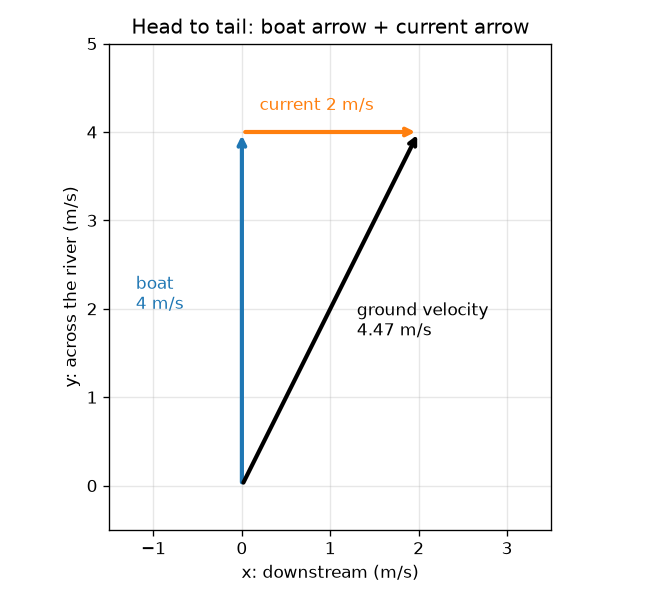
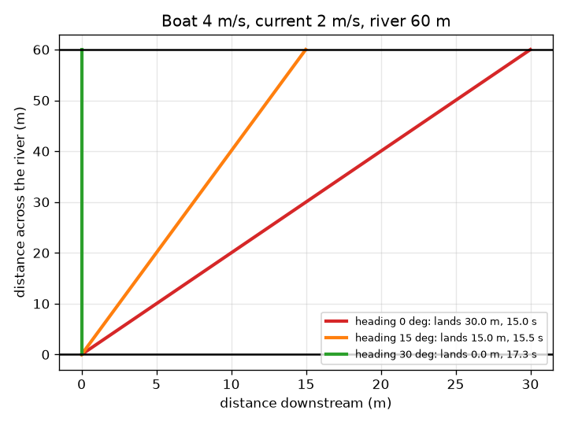

# సెషన్ 1: కలిసిపోయే బాణాలు

[Session 1 — हिन्दी](README.hi.md) · [Session 1 — മലയാളം](README.ml.md) · [Session 1 — தமிழ்](README.ta.md)

*స్థాయి 1 (భావనాత్మక ఇంటరాక్టివ్ నమూనా) · సుమారు 60 నిమిషాలు · openvectors*

> ఇది ఒక సరళీకృత విద్యా నమూనా. ఇది ధృవీకరించబడిన డిజైన్ సాధనం కాదు; నిజమైన నిర్మాణాలు, విద్యుత్ ఇన్‌స్టలేషన్లు, వాహనాలు, పారిశ్రామిక ప్రక్రియలు లేదా వైద్య నిర్ణయాల కోసం దీనిని ఉపయోగించకూడదు.

**ముందస్తు అవసరాలు (Prerequisites)**

- వేగం మరియు దిశ అంటే ఏమిటో తెలుసుకోవడం.
- మీరు PRIMER.md చదివి, `python start.py 1` ను ఒకసారి రన్ చేశారు.

**అభ్యసన లక్ష్యాలు (Learning objectives).** ఈ సెషన్ తర్వాత మీరు చేయగలరు:

- సదిశ వేగాన్ని (velocity) పొడవు (వేగం) మరియు దిశ ఉన్న బాణంగా వర్ణించడం.
- రెండు బాణాలను తల వద్ద తోక కలిపి, గీయడం ద్వారా మరియు వాటి సంఖ్యలను కూడడం ద్వారా కూడడం.
- ప్రవాహం ఉన్న నదిని దాటినప్పుడు పడవ ఎక్కడ దిగుతుందో అంచనా వేయడం.
- పడవ బయలుదేరిన చోటుకు ఖచ్చితంగా ఎదురుగా దిగేలా ఒక హెడింగ్ (heading) ఎంచుకోవడం.

## A. వాస్తవ ప్రపంచ సమస్య
60 m వెడల్పు ఉన్న నదికి అవతలి ఒడ్డున ఉన్న రేవు వైపు నేరుగా చూస్తూ మీరు 4 m/s వేగంతో పడవను తెడ్డు వేస్తున్నారు. నది 2 m/s వేగంతో ప్రవహిస్తోంది. మీరు రేవు వైపే చూపిస్తూ ఉంటారు, కానీ నీరు మిమ్మల్ని పక్కకు మోసుకెళ్తూ ఉంటుంది. మీరు నిజంగా ఎక్కడ దిగుతారు? సరిగ్గా ఎదురుగా దిగడానికి పడవను ఎలా చూపాలి?

## B. భావన మరియు సిద్ధాంతం
సదిశ వేగం ఒక బాణం: దాని పొడవు వేగం, దిశ అది చూపే వైపు. ప్రవాహ దిశలో (నది వెంట) x ను, నదికి అడ్డంగా y ను ఉపయోగిస్తాం, కాబట్టి ఒక బాణం (vx, vy) అనే జంట. పడవ సొంత బాణం నిశ్చల నీటిలో పడవ చేసేది; ప్రవాహ బాణం నీరు దానిలోని ప్రతిదానికీ చేసేది. నేలపై పడవ నిజమైన కదలిక ఈ రెండింటి మొత్తం: రెండవ బాణం తోకను మొదటిదాని తల వద్ద ఉంచి, మొదటి తోక నుండి చివరి తల వరకు బాణం గీయండి. సంఖ్యలతో, సరిపోలే అంశాలను కూడండి. నేల బాణం యొక్క అడ్డు భాగమే పడవను అవతలి ఒడ్డుకు కదిలిస్తుంది కాబట్టి, దాటే సమయం వెడల్పును ఆ భాగంతో భాగించినది, పక్కకు కొట్టుకుపోవడం (drift) అనేది నది వెంట భాగాన్ని ఆ సమయంతో గుణించినది.

| గుర్తు | అర్థం | యూనిట్ |
|---|---|---|
| v | నీటి ద్వారా పడవ వేగం | m/s |
| u | ప్రవాహ వేగం (దిగువకు) | m/s |
| h | హెడింగ్: నేరుగా అడ్డం నుండి కోణం, ఎగువకు వాలితే ధనాత్మకం | డిగ్రీలు |
| (gx, gy) | నేల బాణం: నది వెంట మరియు అడ్డంగా | m/s |
| W | నది వెడల్పు (60) | m |
| T | దాటే సమయం | s |
| drift | నది వెంట దిగే స్థానం, దిగువకు ధనాత్మకం | m |

**ఊహలు (Assumptions)**

- నది సమాంతర ఒడ్డులతో నేరుగా ఉంది, ప్రవాహం అంతటా ఒకటే (ఏకరీతి).
- నీటి ద్వారా పడవ వేగం స్థిరంగా ఉంటుంది, పడవ తక్షణం తిరుగుతుంది.
- అంతా చదునైన తలంలో జరుగుతుంది: అలలు లేవు, గాలి లేదు.

$$ \mathbf g=\mathbf b+\mathbf c,\qquad \mathbf b=v(-\sin h,\ \cos h),\quad \mathbf c=(u,\ 0) $$

$$ T=\frac{W}{g_y}=\frac{W}{v\cos h} $$

$$ \text{drift}=g_x\,T=\frac{(u-v\sin h)\,W}{v\cos h} $$

$$ \text{land opposite: } g_x=0\ \Rightarrow\ \sin h=\frac{u}{v} $$

## C. దృశ్య వివరణ
ఎడమ చిత్రం నేరుగా అడ్డంగా చూపే పడవకు బాణాలను తల వద్ద తోక కలిపి చూపిస్తుంది: నీలి పడవ బాణం 4 m/s పొడవు, నారింజ ప్రవాహ బాణం 2 m/s, మొదటి తోక నుండి చివరి తల వరకు నల్లని నేల బాణం 4.47 m/s పొడవు, అది దిగువకు వాలి ఉంది. కుడి చిత్రం 60 m నదిపై మూడు పడవలను చూపిస్తుంది: హెడింగ్ 0 వద్ద పడవ 15.0 s తర్వాత 30.0 m దిగువన దిగుతుంది, 15 డిగ్రీల వద్ద 15.5 s తర్వాత 15.0 m దిగువన దిగుతుంది, 30 డిగ్రీల వద్ద 17.3 s తర్వాత సరిగ్గా ఎదురుగా దిగుతుంది.

*తల వద్ద తోక: పడవ బాణం మరియు ప్రవాహ బాణం కలిసి నేల బాణం అవుతాయి.*

*60 m నదిపై మూడు హెడింగ్‌లు: 0 డిగ్రీలు 30 m దిగువన దిగుతుంది, 30 డిగ్రీలు ఎదురుగా దిగుతుంది.*

## D. ఇంటరాక్టివ్ సిమ్యులేషన్
పాఠాన్ని రన్ చేయండి (`python start.py 1`), తర్వాత లైవ్ యాప్‌ను తెరవండి: [సెషన్ 1: నదిని దాటే పడవ](https://krunalpanchal1995.github.io/pan-iit-oss/openvectors/session-01/) (లేదా ఈ ఫోల్డర్‌లోని `app.html`). హెడింగ్ స్లైడర్‌ను కదిపి నల్లని నేల బాణం తిరగడం మరియు దిగే స్థానం ఒడ్డు వెంట జరగడం చూడండి. మూడవ వీక్షణను తెరిచి ప్రతి హెడింగ్‌కు దిగే స్థానాన్ని ఒకేసారి చూడండి.

**సవాలు (Challenge).** 2 m/s ప్రవాహంలో 4 m/s పడవతో ప్రారంభానికి ఖచ్చితంగా ఎదురుగా (1 m లోపు) దిగండి.

## E. సాధించిన ఉదాహరణ మరియు ప్రయోగం
**సమస్య.** 4 m/s పడవ 2 m/s ప్రవాహం ఉన్న 60 m నది వైపు నేరుగా అడ్డంగా చూపుతోంది. నేల బాణం, దాటే సమయం, దిగే స్థానం కనుగొనండి. తర్వాత పడవను ఖచ్చితంగా ఎదురుగా దించే హెడింగ్‌ను కనుగొనండి.

1. పడవ బాణం = (0, 4) m/s (నేరుగా అడ్డంగా, నది వెంట ఏమీ లేదు). ప్రవాహ బాణం = (2, 0) m/s.
2. నేల బాణం = (0 + 2, 4 + 0) = (2, 4) m/s. దాని పొడవు sqrt(2^2 + 4^2) = sqrt(20) = 4.47 m/s.
3. అడ్డు భాగం మాత్రమే పడవను అవతలి ఒడ్డుకు కదిలిస్తుంది: T = 60 / 4 = 15 s.
4. కొట్టుకుపోవడం = 2 m/s * 15 s = 30 m దిగువకు.
5. ఎదురుగా దిగడానికి నది వెంట భాగం సున్నా కావాలి: 2 - 4 sin h = 0, కాబట్టి sin h = 0.5 మరియు h = 30 డిగ్రీలు ఎగువకు.
6. అప్పుడు gy = 4 cos 30 = 3.46 m/s, కాబట్టి T = 60 / 3.46 = 17.3 s: సురక్షితమైన దిగడానికి 2.3 s ఎక్కువ పడుతుంది.

**సమాధానం.** నేరుగా అడ్డంగా చూపితే: నేల బాణం (2, 4) m/s, 15 s, 30 m దిగువన దిగుతుంది. 30 డిగ్రీలు ఎగువకు చూపితే: నేల బాణం (0, 3.46) m/s, 17.3 s, ఖచ్చితంగా ఎదురుగా దిగుతుంది.

**ప్రయోగం.** పాఠశాల మైదానంలో స్థిర వేగంతో నడుస్తూ ఉండగా స్నేహితుడు దొర్లే వేదికపై మిమ్మల్ని పక్కకు లాగనివ్వండి, లేదా నెమ్మదిగా ప్రవహించే వాగులో బొమ్మ పడవ మరియు స్టాప్‌వాచ్ ఉపయోగించండి: ప్రారంభాన్ని మరియు ఎదురు బిందువును గుర్తించి, పడవను నేరుగా అడ్డంగా చూపి కొట్టుకుపోవడాన్ని మరియు సమయాన్ని కొలవండి, తర్వాత పడవను ఎగువకు వాల్చి మళ్ళీ చేయండి. వాల్చిన పడవకు తక్కువ కొట్టుకుపోవడం అనే అదే తీరును ఆశించండి, కానీ అదే సంఖ్యలు కాదు: నిజమైన ప్రవాహం ఒడ్డుల దగ్గర నెమ్మదిగా ఉంటుంది, పడవ పూర్తిగా స్థిర వేగాన్ని నిలుపుకోదు, బొమ్మ పడవ నీటితో పాటు తిరుగుతుంది. నమూనా దాని ఊహలకు ఖచ్చితమైనది; వాగు ఏకరీతి కాదు.

## F. మూల్యాంకనం మరియు డిజైన్ సవాలు
**ప్రశ్న రకం A: భావనాత్మక.** బయలుదేరిన చోటుకు ఖచ్చితంగా ఎదురుగా దిగడానికి పడవ ఎగువకు ఎందుకు చూపాలి? పడవ బాణం యొక్క పక్క భాగం ఏమి చేయాలి?

సూచన

ఎదురుగా దిగడం అంటే నేల బాణం యొక్క నది వెంట భాగం సున్నా.

దశలవారీ పరిష్కారం

నేల బాణం అంటే పడవ బాణం ప్లస్ ప్రవాహ బాణం. ప్రవాహ బాణం దిగువకు చూపుతుంది, కాబట్టి మొత్తం యొక్క నది వెంట భాగాన్ని సున్నా చేయడానికి పడవ బాణానికి సమానమైన, వ్యతిరేకమైన ఎగువ భాగం ఉండాలి. పడవను ఎగువకు వాల్చడం ద్వారా మాత్రమే అది సాధ్యం. అప్పుడు పడవ బాణం యొక్క అడ్డు భాగం పూర్తి పడవ వేగం కంటే కొంచెం చిన్నది, కాబట్టి దాటడానికి ఎక్కువ సమయం పడుతుంది.

**ప్రశ్న రకం B: సంఖ్యాత్మక.** 5 m/s పడవ 3 m/s ప్రవాహం ఉన్న 60 m నది వైపు నేరుగా అడ్డంగా చూపుతోంది. దాటే సమయం, దిగే స్థానం, నేలపై వేగం కనుగొనండి.

సూచన

నేల బాణం = (3, 5). సమయం = వెడల్పు / అడ్డు భాగం.

దశలవారీ పరిష్కారం

నేల బాణం = (3, 5) m/s. T = 60 / 5 = 12 s. కొట్టుకుపోవడం = 3 * 12 = 36 m దిగువకు. నేలపై వేగం = sqrt(3^2 + 5^2) = sqrt(34) = 5.83 m/s. సహేతుకత పరీక్ష: పడవ ఒక్కటే వేగం (5 m/s) కంటే వేగవంతమైనది, ఎందుకంటే ప్రవాహం నది వెంట సహాయపడుతుంది, 12 s అనేది 5 m/s వద్ద 60 m కు సమయం.

**ప్రశ్న రకం C: గ్రాఫ్ మరియు సిమ్యులేషన్ వ్యాఖ్యానం.** దిగే-స్థాన గ్రాఫ్‌లో, 4 m/s పడవ మరియు 2 m/s ప్రవాహానికి వక్రం సున్నాను ఎక్కడ దాటుతుంది, హెడింగ్ 0 వద్ద దిగే స్థానం ఎంత? ప్రతికూల హెడింగ్‌లకు (దిగువకు వాలితే) వక్రం ఏమి చేస్తుంది?

సూచన

హెడింగ్ 0 వద్ద వక్రాన్ని చదవండి, 0 వద్ద ఉన్న క్షితిజ రేఖను అది కలిసే చోటును కూడా.

దశలవారీ పరిష్కారం

హెడింగ్ 0 వద్ద వక్రం 30 m వద్ద ఉంది. హెడింగ్ 30 డిగ్రీల వద్ద అది సున్నాను దాటుతుంది. ప్రతికూల హెడింగ్‌లకు, పడవ ప్రవాహంతో పాటు దిగువకు వాలినప్పుడు, దిగే స్థానం పెద్దది: పడవ ఇంకా ఎక్కువ దిగువకు కొట్టుకుపోతుంది.

**ప్రశ్న రకం D: డిజైన్ మరియు ఆప్టిమైజేషన్ సవాలు.** డిజైన్: ప్రారంభానికి ఎదురు బిందువు నుండి 15 m దిగువన రేవు ఉంది. 2 m/s ప్రవాహంలో 4 m/s పడవ రేవు వద్ద దిగేలా ఒక హెడింగ్ ఎంచుకుని, దాటడానికి ఎంత సమయం పడుతుందో చెప్పండి.

సూచన

దిగే స్థానం 15 m అని చూపే వరకు యాప్‌లో హెడింగ్‌లను ప్రయత్నించండి, లేదా పాఠంలోని `crossing` తో అనేక హెడింగ్‌లకు దిగే స్థానాన్ని లెక్కించండి.

దశలవారీ పరిష్కారం

సుమారు 15 డిగ్రీల ఎగువ హెడింగ్ 15.0 m దిగువన దిగడాన్ని (సరిగ్గా 15 డిగ్రీలకు 14.98 m) మరియు సుమారు 15.5 s దాటే సమయాన్ని ఇస్తుంది. ఊహ: స్థిర ప్రవాహం మరియు పడవ వేగం. పరీక్ష: హెడింగ్ 0 30 m ఇస్తుంది, హెడింగ్ 30 0 m ఇస్తుంది, కాబట్టి మధ్యలోని సగం హెడింగ్ దాదాపు సగం దూరంలో, 15 m దగ్గర, దిగుతుంది, ఎందుకంటే అక్కడ వక్రం దాదాపు సరళరేఖ.

[RUBRIC.md](../../RUBRIC.md) తో మిమ్మల్ని మీరు స్కోర్ చేసుకోండి. కాగితంపై పని చేయడానికి [కార్యాచరణ పత్రాన్ని](activity_sheet.md) ప్రింట్ చేయండి.

## సాధారణ అపోహలు
| సాధారణ అపోహ | నిజానికి సరైనది |
|---|---|
| నదిని నేరుగా దాటడానికి పడవను రేవు వైపు చూపండి. | దాటుతున్నప్పుడు ప్రవాహం పడవను మోసుకెళ్తుంది, కాబట్టి రేవు వైపు చూపితే అది దిగువన దిగుతుంది. మీరు ఎగువకు వాలాలి. |
| నేలపై పడవ వేగం పడవ వేగానికి సమానం. | నేల బాణం పడవ బాణం మరియు ప్రవాహ బాణం మొత్తం; దాని పొడవు సాధారణంగా పడవ వేగం నుండి భిన్నంగా ఉంటుంది. |
| బాణాల పొడవులను కూడి బాణాలను కూడతారు. | బాణాలను తల వద్ద తోక కలిపి లేదా సరిపోలే సంఖ్యలను కూడి కూడతారు. బాణాలు ఒకే దిశలో చూపినప్పుడే పొడవులు కూడతాయి. |
| పెద్ద ప్రవాహం ఎల్లప్పుడూ దాటడాన్ని నెమ్మదిగా చేస్తుంది. | పడవ నేరుగా అడ్డంగా చూపితే ప్రవాహం దాటే సమయాన్ని మార్చదు, ఎందుకంటే అడ్డు భాగం మాత్రమే ముఖ్యం; అది మీరు ఎక్కడ దిగుతారో మారుస్తుంది. |

## పదకోశం (Glossary)
- **సదిశ (vector)**: పరిమాణం మరియు దిశ ఉన్న రాశి, బాణంగా గీస్తారు
- **సదిశ వేగం (velocity)**: దిశతో కూడిన వేగం; m/s లో కొలిచే బాణం
- **ఫలితం (resultant)**: బాణాల మొత్తానికి సమానమైన ఒకే బాణం
- **హెడింగ్ (heading)**: పడవ చూపే దిశ, ఇక్కడ నేరుగా అడ్డం నుండి కొలుస్తారు
- **కొట్టుకుపోవడం (drift)**: పడవ దిగే సమయానికి నది వెంట ఎంత దూరం మోసుకెళ్లబడింది

## ముగించండి
1. [exercises.md](exercises.md) లోని మూడు కోడింగ్ పనులను చేయండి.
2. మీ మార్పుల తర్వాత `python start.py 1` ను మళ్ళీ రన్ చేయండి. ఇది చెక్‌పాయింట్‌తో ముగుస్తుంది; అది `PASS` అని ప్రింట్ చేసినప్పుడు మీరు పూర్తి చేశారు. (చెక్‌పాయింట్ మాత్రమే: `python start.py check 1`.)

తదుపరి: [సెషన్ 2](../session-02/README.md)
