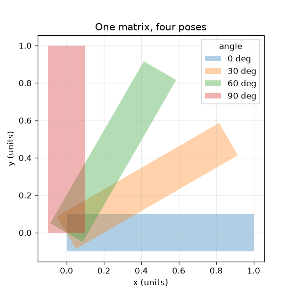
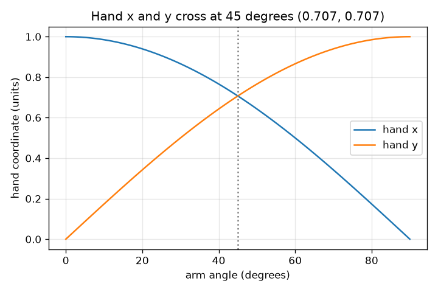

# सत्र 1: एक आव्यूह पूरी भुजा को घुमाता है

*स्तर 1 (वैचारिक इंटरैक्टिव मॉडल) · लगभग 60 मिनट · openvfx*

> यह एक सरलीकृत शैक्षिक मॉडल है। यह कोई प्रमाणित डिज़ाइन टूल नहीं है और इसका उपयोग वास्तविक संरचनाओं, बिजली की वायरिंग (electrical installations), वाहनों, औद्योगिक प्रक्रियाओं या चिकित्सा निर्णयों के लिए नहीं किया जाना चाहिए।

**पूर्व-आवश्यकताएँ (Prerequisites)**

- स्कूल त्रिकोणमिति: ज्या (sine) और कोज्या (cosine)।
- आपने PRIMER.md पढ़ लिया है और एक बार `python start.py 1` चलाया है।

**सीखने के उद्देश्य (Learning objectives).** इस सत्र के बाद आप:

- समझा सकेंगे कि एक घूर्णन आव्यूह (rotation matrix) किसी बिंदु के साथ क्या करता है।
- R @ p का उपयोग करके हाथ से और Python में गणना कर सकेंगे कि कोई बिंदु कहाँ पहुँचता है।
- दिखा सकेंगे कि घूर्णन कभी लंबाई या क्षेत्रफल नहीं बदलता।
- कोण के सापेक्ष हाथ के x और y का ग्राफ़ पढ़ सकेंगे।

## A. वास्तविक दुनिया की समस्या
किसी एनिमेटेड फ़िल्म का हर फ़्रेम एक पात्र पर हज़ारों बिंदुओं को हिलाता है। कोई उन्हें एक-एक करके नहीं हिलाता: एक आव्यूह (matrix) उन सबको एक साथ हिलाता है। जब कोई पात्र हाथ हिलाता है, तो भुजा को बिना खिंचे या सिकुड़े घूमना चाहिए। हम 'हर चीज़ को 30 डिग्री घुमाओ' को इस तरह कैसे लिखें कि कंप्यूटर इसे हर बिंदु के लिए कर सके?

## B. अवधारणा और सिद्धांत
एक बिंदु निर्देशांकों (coordinates) का एक जोड़ा (x, y) है। इसे मूल बिंदु (origin) के चारों ओर कोण theta से वामावर्त (counter-clockwise) घुमाने पर नए निर्देशांक घूर्णन आव्यूह R(theta) से मिलते हैं। किसी आव्यूह को एक बिंदु से गुणा करने का अर्थ है: हर नया निर्देशांक आव्यूह की एक पंक्ति को (x, y) से पद-दर-पद गुणा करके जोड़ने पर मिलता है। R के दोनों स्तंभ इकाई-लंबाई के और परस्पर लंबवत (perpendicular) हैं, इसीलिए R लंबाइयों और कोणों को बनाए रखता है; इसका सारणिक (determinant) 1 बताता है कि क्षेत्रफल भी बना रहता है।

| प्रतीक | अर्थ | इकाई |
|---|---|---|
| theta | घूर्णन कोण, वामावर्त | डिग्री या रेडियन |
| (x, y) | किसी बिंदु के निर्देशांक | इकाइयाँ (लंबाई की कोई भी इकाई) |
| R | घूर्णन आव्यूह | कोई इकाई नहीं |
| L | भुजा की लंबाई (कंधे से हाथ तक की दूरी) | इकाइयाँ |

**मान्यताएँ (Assumptions)**

- भुजा एक दृढ़ (rigid) आकृति है: वह घूम सकती है पर खिंच नहीं सकती।
- कोण x अक्ष से वामावर्त मापे जाते हैं।
- कंधा मूल बिंदु (0, 0) पर है।

$$ R(\theta)=\begin{pmatrix}\cos\theta & -\sin\theta\\ \sin\theta & \cos\theta\end{pmatrix} $$

$$ \begin{pmatrix}x'\\ y'\end{pmatrix}=R(\theta)\begin{pmatrix}x\\ y\end{pmatrix}=\begin{pmatrix}x\cos\theta-y\sin\theta\\ x\sin\theta+y\cos\theta\end{pmatrix} $$

$$ R(\theta)^{\mathsf T}R(\theta)=I\quad\text{(columns are unit length and perpendicular, so lengths are kept)} $$

$$ \det R(\theta)=\cos^2\theta+\sin^2\theta=1\quad\text{(area is kept)} $$

## C. दृश्य व्याख्या
बायाँ चित्र एक ही आव्यूह द्वारा चार कोणों पर घुमाई गई एक भुजा दिखाता है; हर मुद्रा (pose) की लंबाई और मोटाई समान है। दायाँ चित्र दर्शाता है कि कोण बढ़ने पर हाथ कहाँ पहुँचता है: इसका x निर्देशांक कोज्या वक्र का अनुसरण करता है और y निर्देशांक ज्या वक्र का। दोनों वक्र 45 डिग्री पर एक-दूसरे को काटते हैं जहाँ हाथ (0.707, 0.707) पर है।

*एक आव्यूह, चार मुद्राएँ: भुजा अपनी लंबाई और मोटाई बनाए रखती है।*

*कोण के सापेक्ष हाथ का x और y: कोज्या और ज्या वक्र 45 डिग्री पर काटते हैं।*

## D. इंटरैक्टिव सिमुलेशन
पाठ चलाइए (`python start.py 1`), फिर लाइव ऐप खोलिए: [सत्र 1: भुजा को घुमाइए](https://krunalpanchal1995.github.io/pan-iit-oss/openvfx/session-01/) (या इसी फ़ोल्डर में `app.html`)। कोण स्लाइडर खिसकाइए और हाथ को त्रिज्या 1 का धराशायी वृत्त बनाते देखिए, फिर ग्राफ़ व्यू पर जाइए और x तथा y को कोज्या और ज्या का अनुसरण करते देखिए।

**चुनौती।** हाथ को सीधे ऊपर, (0, 1) पर इंगित कराइए।

## E. हल किया गया उदाहरण और प्रयोग
**समस्या।** भुजा (लंबाई 1, x की दिशा में इंगित) को 30 डिग्री घुमाने के बाद हाथ कहाँ पहुँचता है? जाँचिए कि लंबाई अब भी 1 है।

1. हाथ (1, 0) से शुरू होता है। 30 डिग्री के लिए, cos = 0.866 और sin = 0.500।
2. नया x = 0.866 * 1 - 0.500 * 0 = 0.866।
3. नया y = 0.500 * 1 + 0.866 * 0 = 0.500।
4. लंबाई = sqrt(0.866^2 + 0.500^2) = sqrt(0.750 + 0.250) = sqrt(1.000) = 1।

**उत्तर।** हाथ (0.866, 0.500) पर पहुँचता है और लंबाई अब भी 1 है।

**प्रयोग।** वर्गाकार ख़ानों वाले काग़ज़ पर एक इकाई भुजा बनाइए, उसे चाँदे (protractor) से 30 डिग्री घुमाइए और हाथ के निर्देशांक पढ़िए; आपको लगभग (0.87, 0.50) मिलना चाहिए। ऐप के रीडआउट से और checkpoint.py से तुलना कीजिए। कोई भी छोटा अंतर चाँदा पढ़ने से आता है, गणित से नहीं: मॉडल सटीक है, काग़ज़ नहीं।

## F. मूल्यांकन और डिज़ाइन चुनौती
**प्रश्न प्रकार A: वैचारिक।** घूर्णन कभी भुजा को क्यों नहीं खींच सकता? भुजा को खींचने वाला आव्यूह कैसा दिखना चाहिए?

संकेत

R के हर स्तंभ की लंबाई देखिए, और पूछिए कि सारणिक क्या बताता है और क्या नहीं।

चरण-दर-चरण हल

R का हर स्तंभ लंबाई 1 का एक सदिश (vector) है और दोनों स्तंभ परस्पर लंबवत हैं (R^T R = I), इसलिए R लंबाइयों और कोणों को बनाए रखता है। सारणिक cos^2 + sin^2 = 1 केवल यह बताता है कि क्षेत्रफल बना रहता है: [[1, 1], [0, 1]] जैसे अपरूपण (shear) का सारणिक भी 1 है पर वह चीज़ों को खींचता है (यह (1, 1) को (2, 1) पर भेजता है)। भुजा को खींचने वाले आव्यूह, जैसे [[2, 0], [0, 1]] जो x को दोगुना करता है, का एक स्तंभ 1 से लंबा होता है।

**प्रश्न प्रकार B: संख्यात्मक।** बिंदु (2, 0) को 90 डिग्री वामावर्त घुमाइए। वह कहाँ पहुँचता है? मूल बिंदु से उसकी दूरी जाँचिए।

संकेत

90 डिग्री के लिए cos = 0 और sin = 1। नया x = x cos - y sin और नया y = x sin + y cos लागू कीजिए।

चरण-दर-चरण हल

नया x = 2*0 - 0*1 = 0 और नया y = 2*1 + 0*0 = 2, इसलिए बिंदु (0, 2) पर पहुँचता है। दूरी = sqrt(0^2 + 2^2) = 2, पहले जितनी ही। इकाइयाँ: इनपुट वाली ही इकाई।

**प्रश्न प्रकार C: ग्राफ़ और सिमुलेशन की व्याख्या।** कोण के सापेक्ष हाथ के x और y के ग्राफ़ में, दोनों वक्र किस कोण पर काटते हैं, और तब हाथ कहाँ है?

संकेत

वे वहाँ काटते हैं जहाँ cos = sin।

चरण-दर-चरण हल

वे 45 डिग्री पर काटते हैं (और फिर 225 डिग्री पर)। 45 डिग्री पर x = y = 0.707, इसलिए हाथ (0.707, 0.707) पर है। ग्राफ़ पढ़ने पर, वहाँ दोनों वक्रों का मान 0.707 है।

**प्रश्न प्रकार D: डिज़ाइन और अनुकूलन (optimisation) चुनौती।** एक एनिमेशन में हाथ को दाईं ओर इंगित करने से सीधे ऊपर इंगित करने तक ठीक 3 बराबर चरणों (फ़्रेमों) में घूमना है। हर फ़्रेम के लिए कोण चुनिए और हर एक में हाथ की स्थिति सूचीबद्ध कीजिए।

संकेत

कुल घुमाव 90 डिग्री है; इसे तीन बराबर चरणों में बाँटिए और हर संचयी कोण के लिए R का उपयोग कीजिए।

चरण-दर-चरण हल

हर चरण 30 डिग्री है, इसलिए फ़्रेम 30, 60 और 90 डिग्री पर हैं। हाथ की स्थितियाँ: (0.866, 0.500), (0.500, 0.866) और (0.000, 1.000)। मान्यता: स्थिर चाल। एक वास्तविक एनिमेटर गति को धीरे शुरू और धीरे समाप्त (ease in and out) भी करेगा।

[RUBRIC.md](../../RUBRIC.md) से स्वयं को अंक दीजिए। काग़ज़ पर काम करने के लिए [गतिविधि पत्रक (activity sheet)](activity_sheet.md) प्रिंट कीजिए।

## आम भ्रांतियाँ (Common misconceptions)
| आम भ्रांति | वास्तव में क्या सही है |
|---|---|
| किसी बिंदु को घुमाने से वह सीधी रेखा में नई जगह पर जाता है। | वह धुरी (pivot) के चारों ओर एक वृत्त पर चलता है; धुरी से दूरी कभी नहीं बदलती। |
| बड़े कोण का अर्थ हमेशा बड़ा x है। | x, cos(theta) का अनुसरण करता है, जो बढ़ता और घटता है; पहले 90 डिग्री में केवल y = sin(theta) बढ़ता है। |
| आव्यूह बस संख्याओं की एक तालिका है। | आव्यूह एक क्रिया है: उससे गुणा करने पर बिंदु हिलते हैं। संख्याएँ बताती हैं कि कैसे। |
| सारणिक 1 वाला आव्यूह कभी कुछ नहीं खींचता। | अपरूपण का सारणिक 1 है और फिर भी वह लंबाइयाँ खींचता है। सारणिक 1 केवल क्षेत्रफल बनाए रखता है; घूर्णन लंबाइयाँ इसलिए बनाए रखते हैं क्योंकि उनके स्तंभ इकाई लंबाई के और परस्पर लंबवत हैं। |

## शब्दावली (Glossary)
- **घूर्णन आव्यूह (rotation matrix)**: संख्याओं का एक 2x2 ग्रिड जो बिंदुओं को एक कोण से घुमाता है
- **परिवर्त (transpose)**: अपने विकर्ण पर पलटा गया आव्यूह; हमें एक साथ कई बिंदु हिलाने देता है
- **सारणिक (determinant)**: कोई आव्यूह क्षेत्रफल को कितना मापता (scale) है; शुद्ध घूर्णन के लिए ठीक 1
- **रेडियन (radian)**: कोण का माप जिसमें एक पूरा चक्कर 2 pi है; वह इकाई जो NumPy उपयोग करता है

## समापन
1. [exercises.md](exercises.md) में दिए गए तीन कोडिंग कार्य कीजिए।
2. अपने बदलावों के बाद `python start.py 1` फिर से चलाइए। यह चेकपॉइंट (checkpoint) के साथ समाप्त होता है; जब यह `PASS` प्रिंट करे, तो आपका काम पूरा हुआ। (केवल चेकपॉइंट: `python start.py check 1`।)

आगे: [सत्र 2](../session-02/README.md)
