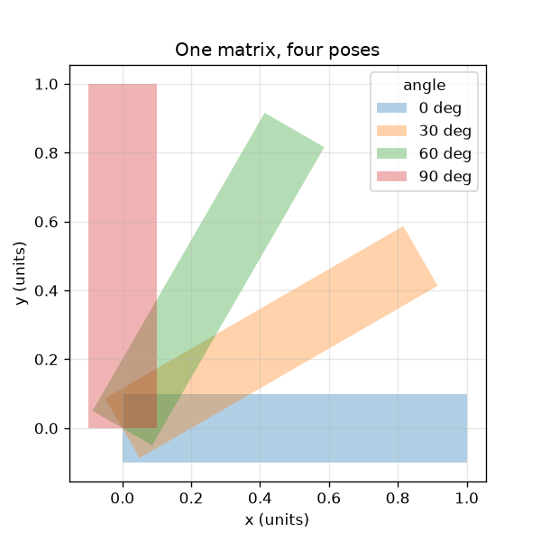
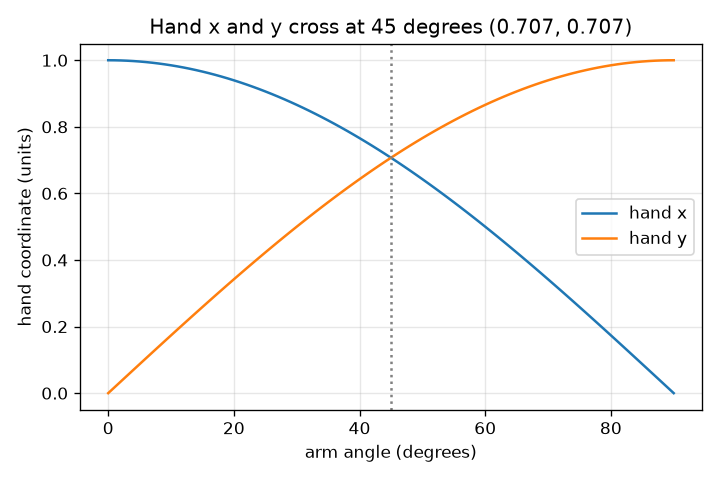

# സെഷൻ 1: ഒരു മാട്രിക്സ് ഒരു കൈ മുഴുവൻ ചലിപ്പിക്കുന്നു

[Session 1 — हिन्दी](README.hi.md)

*ലെവൽ 1 (ആശയപരമായ ഇന്ററാക്ടീവ് മോഡൽ) · ഏകദേശം 60 മിനിറ്റ് · openvfx*

> ഇത് ലളിതമാക്കിയ ഒരു വിദ്യാഭ്യാസ മോഡൽ (educational model) ആണ്. ഇത് സാധൂകരിക്കപ്പെട്ട ഒരു ഡിസൈൻ ഉപകരണമല്ല; യഥാർത്ഥ നിർമ്മിതികൾ, വൈദ്യുത ഇൻസ്റ്റലേഷനുകൾ, വാഹനങ്ങൾ, വ്യാവസായിക പ്രക്രിയകൾ അല്ലെങ്കിൽ വൈദ്യശാസ്ത്ര തീരുമാനങ്ങൾ എന്നിവയ്ക്ക് ഇത് ഉപയോഗിക്കരുത്.

**മുൻ‌അറിവ് (Prerequisites)**

- സ്കൂൾ ത്രികോണമിതി: സൈനും കോസൈനും.
- നിങ്ങൾ PRIMER.md വായിക്കുകയും `python start.py 1` ഒരിക്കൽ റൺ ചെയ്യുകയും ചെയ്തിട്ടുണ്ട്.

**പഠന ലക്ഷ്യങ്ങൾ (Learning objectives).** ഈ സെഷനു ശേഷം നിങ്ങൾക്ക് കഴിയും:

- ഒരു റൊട്ടേഷൻ മാട്രിക്സ് ഒരു ബിന്ദുവിനോട് എന്ത് ചെയ്യുന്നു എന്ന് വിശദീകരിക്കാൻ.
- R @ p ഉപയോഗിച്ച്, കൈകൊണ്ടും Python-ലും, ഒരു ബിന്ദു എവിടെ എത്തുന്നു എന്ന് കണക്കാക്കാൻ.
- ഒരു റൊട്ടേഷൻ നീളമോ വിസ്തീർണ്ണമോ ഒരിക്കലും മാറ്റുന്നില്ല എന്ന് കാണിക്കാൻ.
- കോണിനെതിരെ കൈയുടെ x, y എന്നിവയുടെ ഗ്രാഫ് വായിക്കാൻ.

## A. യഥാർത്ഥ ജീവിതത്തിലെ പ്രശ്നം
ഒരു ആനിമേറ്റഡ് സിനിമയുടെ ഓരോ ഫ്രെയിമും ഒരു കഥാപാത്രത്തിലെ ആയിരക്കണക്കിന് ബിന്ദുക്കളെ ചലിപ്പിക്കുന്നു. ആരും അവയെ ഒന്നൊന്നായി ചലിപ്പിക്കുന്നില്ല: ഒരു മാട്രിക്സ് അവയെ എല്ലാം ഒരേസമയം ചലിപ്പിക്കുന്നു. ഒരു കഥാപാത്രം കൈ വീശുമ്പോൾ കൈ നീളുകയോ ചുരുങ്ങുകയോ ചെയ്യാതെ ചുറ്റി വരണം. 'എല്ലാം 30 ഡിഗ്രി തിരിക്കുക' എന്ന് ഓരോ ബിന്ദുവിനും ഒരു കമ്പ്യൂട്ടറിന് ചെയ്യാൻ കഴിയുന്ന വിധം നമ്മൾ എങ്ങനെ എഴുതും?

## B. ആശയവും സിദ്ധാന്തവും
ഒരു ബിന്ദു എന്നത് (x, y) എന്ന ഒരു ജോടി നിർദ്ദേശാങ്കങ്ങളാണ്. അതിനെ ഉത്ഭവബിന്ദുവിന് ചുറ്റും θ എന്ന കോണിൽ ഘടികാരദിശയ്ക്ക് എതിരായി തിരിക്കുമ്പോൾ റൊട്ടേഷൻ മാട്രിക്സ് R(theta)-ൽ നിന്ന് പുതിയ നിർദ്ദേശാങ്കങ്ങൾ ലഭിക്കുന്നു. ഒരു മാട്രിക്സിനെ ഒരു ബിന്ദു കൊണ്ട് ഗുണിക്കുക എന്നാൽ: ഓരോ പുതിയ നിർദ്ദേശാങ്കവും മാട്രിക്സിന്റെ ഒരു വരിയെ (x, y)-യുമായി പദം പദമായി ഗുണിച്ച് കൂട്ടിയതാണ്. R-ന്റെ രണ്ട് കോളങ്ങളും യൂണിറ്റ് നീളമുള്ളതും പരസ്പരം ലംബവുമാണ്, അതുകൊണ്ടാണ് R നീളങ്ങളും കോണുകളും നിലനിർത്തുന്നത്; അതിന്റെ ഡിറ്റർമിനന്റ് 1 വിസ്തീർണ്ണവും നിലനിർത്തുന്നു എന്ന് പറയുന്നു.

| ചിഹ്നം | അർത്ഥം | യൂണിറ്റ് |
|---|---|---|
| theta | റൊട്ടേഷൻ കോൺ, ഘടികാരദിശയ്ക്ക് എതിരായി | ഡിഗ്രി അല്ലെങ്കിൽ റേഡിയൻ |
| (x, y) | ഒരു ബിന്ദുവിന്റെ നിർദ്ദേശാങ്കങ്ങൾ | യൂണിറ്റുകൾ (ഏതെങ്കിലും നീളം യൂണിറ്റ്) |
| R | റൊട്ടേഷൻ മാട്രിക്സ് | യൂണിറ്റ് ഇല്ല |
| L | കൈയുടെ നീളം (തോളിൽ നിന്ന് കൈപ്പത്തിയിലേക്കുള്ള ദൂരം) | യൂണിറ്റുകൾ |

**അനുമാനങ്ങൾ (Assumptions)**

- കൈ ഒരു ദൃഢ രൂപമാണ്: അതിന് തിരിയാം, പക്ഷേ നീളാൻ കഴിയില്ല.
- കോണുകൾ x അക്ഷത്തിൽ നിന്ന് ഘടികാരദിശയ്ക്ക് എതിരായി അളക്കുന്നു.
- തോൾ ഉത്ഭവബിന്ദുവിൽ (0, 0) ആണ്.

$$ R(\theta)=\begin{pmatrix}\cos\theta & -\sin\theta\\ \sin\theta & \cos\theta\end{pmatrix} $$

$$ \begin{pmatrix}x'\\ y'\end{pmatrix}=R(\theta)\begin{pmatrix}x\\ y\end{pmatrix}=\begin{pmatrix}x\cos\theta-y\sin\theta\\ x\sin\theta+y\cos\theta\end{pmatrix} $$

$$ R(\theta)^{\mathsf T}R(\theta)=I\quad\text{(columns are unit length and perpendicular, so lengths are kept)} $$

$$ \det R(\theta)=\cos^2\theta+\sin^2\theta=1\quad\text{(area is kept)} $$

## C. ദൃശ്യ വിശദീകരണം
ഇടത് ചിത്രം ഒരേ മാട്രിക്സ് ഉപയോഗിച്ച് നാല് കോണുകളിലേക്ക് തിരിച്ച ഒരു കൈ കാണിക്കുന്നു; എല്ലാ പോസുകൾക്കും ഒരേ നീളവും കനവും ഉണ്ട്. വലത് ചിത്രം കോൺ വളരുമ്പോൾ കൈപ്പത്തി എവിടെ എത്തുന്നു എന്ന് വരയ്ക്കുന്നു: അതിന്റെ x നിർദ്ദേശാങ്കം കോസൈൻ വക്രത്തെയും y നിർദ്ദേശാങ്കം സൈൻ വക്രത്തെയും പിന്തുടരുന്നു. കൈപ്പത്തി (0.707, 0.707)-ൽ ആയിരിക്കുന്ന 45 ഡിഗ്രിയിൽ രണ്ട് വക്രങ്ങളും കൂട്ടിമുട്ടുന്നു.

*ഒരു മാട്രിക്സ്, നാല് പോസുകൾ: കൈ അതിന്റെ നീളവും കനവും നിലനിർത്തുന്നു.*

*കോണിനെതിരെ കൈപ്പത്തിയുടെ x, y: കോസൈൻ, സൈൻ വക്രങ്ങൾ 45 ഡിഗ്രിയിൽ കൂട്ടിമുട്ടുന്നു.*

## D. ഇന്ററാക്ടീവ് സിമുലേഷൻ
പാഠം റൺ ചെയ്യുക (`python start.py 1`), എന്നിട്ട് ലൈവ് ആപ്പ് തുറക്കുക: [സെഷൻ 1: കൈ തിരിക്കുക](https://krunalpanchal1995.github.io/pan-iit-oss/openvfx/session-01/) (അല്ലെങ്കിൽ ഈ ഫോൾഡറിലെ `app.html`). കോൺ സ്ലൈഡർ വലിച്ച് കൈപ്പത്തി ആരം 1-ന്റെ ഡാഷ് ചെയ്ത വൃത്തം വരയ്ക്കുന്നത് നിരീക്ഷിക്കുക, പിന്നെ ഗ്രാഫ് കാഴ്ചയിലേക്ക് മാറി x, y എന്നിവ കോസൈനും സൈനും പിന്തുടരുന്നത് കാണുക.

**വെല്ലുവിളി.** കൈപ്പത്തി നേരെ മുകളിലേക്ക്, (0, 1)-ൽ, ചൂണ്ടിക്കുക.

## E. ഉദാഹരണവും പരീക്ഷണവും
**പ്രശ്നം.** കൈ (നീളം 1, x ദിശയിൽ ചൂണ്ടുന്നത്) 30 ഡിഗ്രി തിരിച്ചാൽ കൈപ്പത്തി എവിടെ എത്തും? നീളം ഇപ്പോഴും 1 ആണെന്ന് പരിശോധിക്കുക.

1. കൈപ്പത്തി (1, 0)-ൽ തുടങ്ങുന്നു. 30 ഡിഗ്രിക്ക് cos = 0.866, sin = 0.500.
2. പുതിയ x = 0.866 * 1 - 0.500 * 0 = 0.866.
3. പുതിയ y = 0.500 * 1 + 0.866 * 0 = 0.500.
4. നീളം = sqrt(0.866^2 + 0.500^2) = sqrt(0.750 + 0.250) = sqrt(1.000) = 1.

**ഉത്തരം.** കൈപ്പത്തി (0.866, 0.500)-ൽ എത്തുന്നു, നീളം ഇപ്പോഴും 1 ആണ്.

**പരീക്ഷണം.** ചതുരക്കള്ളികളുള്ള കടലാസിൽ ഒരു യൂണിറ്റ് കൈ വരയ്ക്കുക, പ്രൊട്രാക്ടർ ഉപയോഗിച്ച് 30 ഡിഗ്രി തിരിക്കുക, കൈപ്പത്തിയുടെ നിർദ്ദേശാങ്കങ്ങൾ വായിക്കുക; നിങ്ങൾക്ക് ഏകദേശം (0.87, 0.50) ലഭിക്കണം. ആപ്പ് റീഡൗട്ടുമായും checkpoint.py-യുമായും താരതമ്യം ചെയ്യുക. ചെറിയ വ്യത്യാസങ്ങൾ പ്രൊട്രാക്ടർ വായിക്കുന്നതിൽ നിന്നാണ്, ഗണിതത്തിൽ നിന്നല്ല: മോഡൽ കൃത്യമാണ്, കടലാസ് അങ്ങനെയല്ല.

## F. വിലയിരുത്തലും ഡിസൈൻ വെല്ലുവിളിയും
**ചോദ്യ തരം A: ആശയപരം.** ഒരു റൊട്ടേഷന് കൈയെ ഒരിക്കലും നീട്ടാൻ കഴിയാത്തത് എന്തുകൊണ്ട്? കൈയെ നീട്ടുന്ന ഒരു മാട്രിക്സ് എങ്ങനെയിരിക്കണം?

സൂചന

R-ന്റെ ഓരോ കോളത്തിന്റെയും നീളം നോക്കുക, ഡിറ്റർമിനന്റ് എന്ത് പറയുന്നു, എന്ത് പറയുന്നില്ല എന്ന് ചോദിക്കുക.

ഘട്ടം ഘട്ടമായുള്ള പരിഹാരം

R-ന്റെ ഓരോ കോളവും നീളം 1-ന്റെ ഒരു വെക്ടറാണ്, രണ്ട് കോളങ്ങളും പരസ്പരം ലംബമാണ് (R^T R = I), അതിനാൽ R നീളങ്ങളും കോണുകളും നിലനിർത്തുന്നു. ഡിറ്റർമിനന്റ് cos^2 + sin^2 = 1 വിസ്തീർണ്ണം നിലനിർത്തുന്നു എന്ന് മാത്രമേ പറയുന്നുള്ളൂ: [[1, 1], [0, 1]] പോലുള്ള ഒരു ഷിയറിനും ഡിറ്റർമിനന്റ് 1 ആണ്, എന്നാൽ അത് വസ്തുക്കളെ നീട്ടുന്നു ((1, 1)-നെ (2, 1)-ലേക്ക് അയയ്ക്കുന്നു). x-നെ ഇരട്ടിയാക്കുന്ന [[2, 0], [0, 1]] പോലെ കൈയെ നീട്ടുന്ന ഒരു മാട്രിക്സിന് 1-നേക്കാൾ നീളമുള്ള ഒരു കോളം ഉണ്ടായിരിക്കും.

**ചോദ്യ തരം B: സംഖ്യാപരം.** ബിന്ദു (2, 0)-നെ ഘടികാരദിശയ്ക്ക് എതിരായി 90 ഡിഗ്രി തിരിക്കുക. അത് എവിടെ എത്തുന്നു? ഉത്ഭവബിന്ദുവിൽ നിന്നുള്ള അതിന്റെ ദൂരം പരിശോധിക്കുക.

സൂചന

90 ഡിഗ്രിക്ക് cos = 0, sin = 1. പുതിയ x = x cos - y sin, പുതിയ y = x sin + y cos എന്നിവ പ്രയോഗിക്കുക.

ഘട്ടം ഘട്ടമായുള്ള പരിഹാരം

പുതിയ x = 2*0 - 0*1 = 0, പുതിയ y = 2*1 + 0*0 = 2, അതിനാൽ ബിന്ദു (0, 2)-ൽ എത്തുന്നു. ദൂരം = sqrt(0^2 + 2^2) = 2, മുമ്പത്തേതുപോലെ തന്നെ. യൂണിറ്റുകൾ: ഇൻപുട്ടിന്റെ അതേ യൂണിറ്റ്.

**ചോദ്യ തരം C: ഗ്രാഫും സിമുലേഷനും വ്യാഖ്യാനിക്കൽ.** കോണിനെതിരെ കൈപ്പത്തിയുടെ x, y ഗ്രാഫിൽ ഏത് കോണിലാണ് രണ്ട് വക്രങ്ങളും കൂട്ടിമുട്ടുന്നത്, അപ്പോൾ കൈപ്പത്തി എവിടെയാണ്?

സൂചന

cos = sin ആകുന്നിടത്ത് അവ കൂട്ടിമുട്ടുന്നു.

ഘട്ടം ഘട്ടമായുള്ള പരിഹാരം

അവ 45 ഡിഗ്രിയിലും (വീണ്ടും 225 ഡിഗ്രിയിലും) കൂട്ടിമുട്ടുന്നു. 45 ഡിഗ്രിയിൽ x = y = 0.707, അതിനാൽ കൈപ്പത്തി (0.707, 0.707)-ൽ ആണ്. ഗ്രാഫ് വായിക്കുമ്പോൾ ഇരു വക്രങ്ങൾക്കും അവിടെ 0.707 എന്ന മൂല്യമുണ്ട്.

**ചോദ്യ തരം D: ഡിസൈനും ഒപ്റ്റിമൈസേഷൻ (optimisation) വെല്ലുവിളിയും.** ഒരു ആനിമേഷനിൽ കൈപ്പത്തി വലത്തോട്ട് ചൂണ്ടുന്നതിൽ നിന്ന് നേരെ മുകളിലേക്ക് ചൂണ്ടുന്നതിലേക്ക് കൃത്യമായി 3 തുല്യ ഘട്ടങ്ങളിൽ (ഫ്രെയിമുകൾ) ആടണം. ഓരോ ഫ്രെയിമിനും കോൺ തിരഞ്ഞെടുത്ത് ഓരോന്നിലെയും കൈപ്പത്തിയുടെ സ്ഥാനം പട്ടികപ്പെടുത്തുക.

സൂചന

ആകെ തിരിവ് 90 ഡിഗ്രിയാണ്; അതിനെ മൂന്ന് തുല്യ ഘട്ടങ്ങളായി ഭാഗിക്കുക, ഓരോ ക്യുമുലേറ്റീവ് കോണിനും R ഉപയോഗിക്കുക.

ഘട്ടം ഘട്ടമായുള്ള പരിഹാരം

ഓരോ ഘട്ടവും 30 ഡിഗ്രിയാണ്, അതിനാൽ ഫ്രെയിമുകൾ 30, 60, 90 ഡിഗ്രിയിലാണ്. കൈപ്പത്തി സ്ഥാനങ്ങൾ: (0.866, 0.500), (0.500, 0.866), (0.000, 1.000). അനുമാനം: സ്ഥിര വേഗത. ഒരു യഥാർത്ഥ ആനിമേറ്റർ ഈസ് ഇൻ, ഈസ് ഔട്ട് എന്നിവയും ഉപയോഗിക്കും.

[RUBRIC.md](../../RUBRIC.md) ഉപയോഗിച്ച് സ്വയം സ്കോർ ചെയ്യുക. പേപ്പറിൽ ചെയ്യാൻ [ആക്ടിവിറ്റി ഷീറ്റ്](activity_sheet.md) പ്രിന്റ് ചെയ്യുക.

## സാധാരണ തെറ്റിദ്ധാരണകൾ
| സാധാരണ തെറ്റിദ്ധാരണ | യഥാർത്ഥത്തിൽ ശരിയായത് |
|---|---|
| ഒരു ബിന്ദുവിനെ തിരിക്കുന്നത് അതിനെ നേർരേഖയിലൂടെ പുതിയ സ്ഥാനത്തേക്ക് നീക്കുന്നു. | അത് പിവറ്റിന് ചുറ്റും ഒരു വൃത്തത്തിലൂടെ നീങ്ങുന്നു; പിവറ്റിൽ നിന്നുള്ള ദൂരം ഒരിക്കലും മാറുന്നില്ല. |
| വലിയ കോൺ എപ്പോഴും വലിയ x എന്നാണ് അർത്ഥമാക്കുന്നത്. | x cos(theta)-യെ പിന്തുടരുന്നു, അത് ഉയരുകയും താഴുകയും ചെയ്യുന്നു; ആദ്യ 90 ഡിഗ്രിയിൽ y = sin(theta) മാത്രമേ ഉയരുന്നുള്ളൂ. |
| മാട്രിക്സ് എന്നത് സംഖ്യകളുടെ ഒരു പട്ടിക മാത്രമാണ്. | മാട്രിക്സ് ഒരു പ്രവർത്തനമാണ്: അതുകൊണ്ട് ഗുണിക്കുന്നത് ബിന്ദുക്കളെ ചലിപ്പിക്കുന്നു. സംഖ്യകൾ എങ്ങനെ എന്ന് പറയുന്നു. |
| ഡിറ്റർമിനന്റ് 1 ഉള്ള ഒരു മാട്രിക്സ് ഒന്നിനെയും നീട്ടുന്നില്ല. | ഒരു ഷിയറിന് ഡിറ്റർമിനന്റ് 1 ആണ്, എന്നിട്ടും അത് നീളങ്ങളെ നീട്ടുന്നു. ഡിറ്റർമിനന്റ് 1 വിസ്തീർണ്ണം മാത്രമേ നിലനിർത്തുന്നുള്ളൂ; റൊട്ടേഷനുകളുടെ കോളങ്ങൾ യൂണിറ്റ് നീളമുള്ളതും ലംബവുമായതിനാലാണ് അവ നീളങ്ങൾ നിലനിർത്തുന്നത്. |

## പദാവലി (Glossary)
- **റൊട്ടേഷൻ മാട്രിക്സ് (rotation matrix)**: ബിന്ദുക്കളെ ഒരു കോണിൽ തിരിക്കുന്ന സംഖ്യകളുടെ 2x2 ഗ്രിഡ്
- **ട്രാൻസ്പോസ് (transpose)**: ഡയഗണലിന് കുറുകെ മറിച്ചിട്ട ഒരു മാട്രിക്സ്; ഒരേസമയം പല ബിന്ദുക്കളെ ചലിപ്പിക്കാൻ സഹായിക്കുന്നു
- **ഡിറ്റർമിനന്റ് (determinant)**: ഒരു മാട്രിക്സ് വിസ്തീർണ്ണത്തെ എത്രമാത്രം സ്കെയിൽ ചെയ്യുന്നു; ശുദ്ധമായ റൊട്ടേഷന് കൃത്യമായി 1
- **റേഡിയൻ (radian)**: ഒരു പൂർണ്ണ തിരിവ് 2 pi ആയ കോൺ അളവ്; NumPy ഉപയോഗിക്കുന്ന യൂണിറ്റ്

## പൂർത്തിയാക്കുക
1. [exercises.md](exercises.md)-ലെ മൂന്ന് കോഡിംഗ് ടാസ്കുകൾ ചെയ്യുക.
2. മാറ്റങ്ങൾക്കു ശേഷം `python start.py 1` വീണ്ടും റൺ ചെയ്യുക. അത് ചെക്ക്‌പോയിന്റോടെ (checkpoint) അവസാനിക്കുന്നു; അത് `PASS` എന്ന് പ്രിന്റ് ചെയ്യുമ്പോൾ നിങ്ങൾ പൂർത്തിയാക്കി. (ചെക്ക്‌പോയിന്റ് മാത്രം: `python start.py check 1`.)

അടുത്തത്: [സെഷൻ 2](../session-02/README.md)
