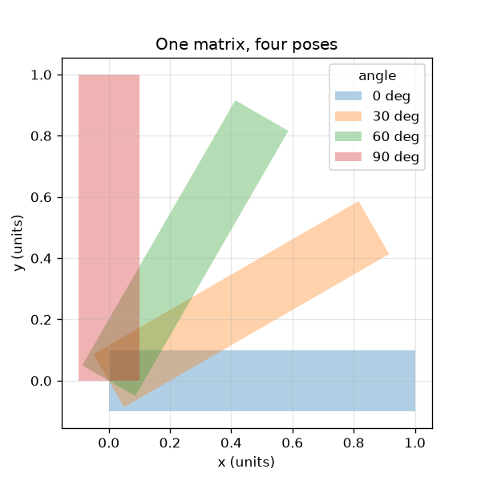
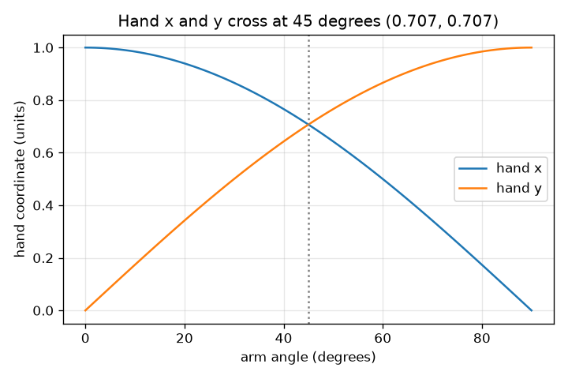

# அமர்வு 1: ஒரு அணி ஒரு முழுக் கையையும் நகர்த்துகிறது

[Session 1 — हिन्दी](README.hi.md)

*நிலை 1 (கருத்தியல் ஊடாடும் மாதிரி) · சுமார் 60 நிமிடங்கள் · openvfx*

> இது எளிமைப்படுத்தப்பட்ட ஒரு கல்வி மாதிரி (educational model). இது சரிபார்க்கப்பட்ட வடிவமைப்புக் கருவி அல்ல; உண்மையான கட்டமைப்புகள், மின் நிறுவல்கள், வாகனங்கள், தொழில்துறை செயல்முறைகள் அல்லது மருத்துவ முடிவுகளுக்கு இதைப் பயன்படுத்தக் கூடாது.

**முன்தேவைகள் (Prerequisites)**

- பள்ளி முக்கோணவியல்: சைன் மற்றும் கொசைன்.
- நீங்கள் PRIMER.md படித்து `python start.py 1` ஒருமுறை இயக்கியிருக்கிறீர்கள்.

**கற்றல் நோக்கங்கள் (Learning objectives).** இந்த அமர்வுக்குப் பிறகு உங்களால் முடியும்:

- சுழற்சி அணி (rotation matrix) ஒரு புள்ளிக்கு என்ன செய்கிறது என்று விளக்க.
- R @ p பயன்படுத்தி, கையாலும் Python-இலும், ஒரு புள்ளி எங்கு சென்றடையும் என்று கணக்கிட.
- சுழற்சி நீளத்தையோ பரப்பையோ ஒருபோதும் மாற்றாது என்று காட்ட.
- கோணத்துக்கு எதிராகக் கையின் x மற்றும் y வரைபடத்தைப் படிக்க.

## A. நிஜ உலகப் பிரச்சினை
ஒரு அனிமேஷன் திரைப்படத்தின் ஒவ்வொரு சட்டமும் ஒரு கதாபாத்திரத்தில் ஆயிரக்கணக்கான புள்ளிகளை நகர்த்துகிறது. யாரும் அவற்றை ஒவ்வொன்றாக நகர்த்துவதில்லை: ஒரு அணி அவை எல்லாவற்றையும் ஒரே நேரத்தில் நகர்த்துகிறது. ஒரு கதாபாத்திரம் கை அசைக்கும்போது கை நீளாமலும் சுருங்காமலும் சுழல வேண்டும். 'எல்லாவற்றையும் 30 டிகிரி திருப்பு' என்பதை ஒவ்வொரு புள்ளிக்கும் கணினி செய்யக்கூடிய வகையில் எப்படி எழுதுவது?

## B. கருத்தும் கோட்பாடும்
ஒரு புள்ளி என்பது ஆயங்களின் (x, y) இணை. அதை ஆதிப்புள்ளியைச் சுற்றி θ கோணத்தில் கடிகார எதிர்த்திசையில் சுழற்றும்போது, சுழற்சி அணி R(theta)-இலிருந்து புதிய ஆயங்கள் கிடைக்கின்றன. ஒரு அணியை ஒரு புள்ளியால் பெருக்குவது என்றால்: ஒவ்வொரு புதிய ஆயமும் அணியின் ஒரு வரிசையை (x, y)-உடன் உறுப்புக்கு உறுப்பு பெருக்கிக் கூட்டியது. R-இன் இரண்டு நெடுவரிசைகளும் அலகு நீளமுள்ளவை, ஒன்றுக்கொன்று செங்குத்தானவை, அதனால்தான் R நீளங்களையும் கோணங்களையும் காக்கிறது; அதன் மதிப்பன் (determinant) 1 என்பது பரப்பும் காக்கப்படுகிறது என்பதைக் கூறுகிறது.

| குறியீடு | பொருள் | அலகு |
|---|---|---|
| theta | சுழற்சிக் கோணம், கடிகார எதிர்த்திசையில் | டிகிரி அல்லது ரேடியன் |
| (x, y) | ஒரு புள்ளியின் ஆயங்கள் | அலகுகள் (ஏதேனும் நீள அலகு) |
| R | சுழற்சி அணி | அலகு இல்லை |
| L | கையின் நீளம் (தோளிலிருந்து கை வரை தூரம்) | அலகுகள் |

**அனுமானங்கள் (Assumptions)**

- கை ஒரு விறைப்பான வடிவம்: அது திரும்பலாம் ஆனால் நீள முடியாது.
- கோணங்கள் x அச்சிலிருந்து கடிகார எதிர்த்திசையில் அளக்கப்படுகின்றன.
- தோள் ஆதிப்புள்ளி (0, 0) இல் உள்ளது.

$$ R(\theta)=\begin{pmatrix}\cos\theta & -\sin\theta\\ \sin\theta & \cos\theta\end{pmatrix} $$

$$ \begin{pmatrix}x'\\ y'\end{pmatrix}=R(\theta)\begin{pmatrix}x\\ y\end{pmatrix}=\begin{pmatrix}x\cos\theta-y\sin\theta\\ x\sin\theta+y\cos\theta\end{pmatrix} $$

$$ R(\theta)^{\mathsf T}R(\theta)=I\quad\text{(columns are unit length and perpendicular, so lengths are kept)} $$

$$ \det R(\theta)=\cos^2\theta+\sin^2\theta=1\quad\text{(area is kept)} $$

## C. காட்சி விளக்கம்
இடப்பக்கப் படம் ஒரே அணியால் நான்கு கோணங்களுக்குத் திருப்பப்பட்ட ஒரு கையைக் காட்டுகிறது; ஒவ்வொரு தோரணைக்கும் ஒரே நீளமும் தடிமனும் உள்ளன. வலப்பக்கப் படம் கோணம் வளரும்போது கை எங்கு சென்றடைகிறது என்று வரைகிறது: அதன் x ஆயம் கொசைன் வளைவையும் y ஆயம் சைன் வளைவையும் பின்பற்றுகின்றன. கை (0.707, 0.707) இல் இருக்கும் 45 டிகிரியில் இரண்டு வளைவுகளும் குறுக்கிடுகின்றன.

*ஒரு அணி, நான்கு தோரணைகள்: கை தன் நீளத்தையும் தடிமனையும் தக்கவைக்கிறது.*

*கோணத்துக்கு எதிராகக் கையின் x மற்றும் y: கொசைன், சைன் வளைவுகள் 45 டிகிரியில் குறுக்கிடுகின்றன.*

## D. ஊடாடும் உருவகப்படுத்தல் (Interactive simulation)
பாடத்தை இயக்குங்கள் (`python start.py 1`), பிறகு நேரடிச் செயலியைத் திறக்கவும்: [அமர்வு 1: கையைச் சுழற்றுங்கள்](https://krunalpanchal1995.github.io/pan-iit-oss/openvfx/session-01/) (அல்லது இந்தக் கோப்புறையில் உள்ள `app.html`). கோண ஸ்லைடரை இழுத்து கை ஆரம் 1 உள்ள கோடிட்ட வட்டத்தை வரைவதைக் கவனியுங்கள், பிறகு வரைபடக் காட்சிக்கு மாறி x மற்றும் y கொசைனையும் சைனையும் பின்பற்றுவதைப் பாருங்கள்.

**சவால்.** கையை நேராக மேலே, (0, 1) இல், சுட்டிக்காட்டுங்கள்.

## E. தீர்க்கப்பட்ட எடுத்துக்காட்டும் சோதனையும்
**கணக்கு.** கையை (நீளம் 1, x திசையில் சுட்டுவது) 30 டிகிரி திருப்பினால் கை எங்கு சென்றடையும்? நீளம் இன்னும் 1 என்று சரிபாருங்கள்.

1. கை (1, 0) இல் தொடங்குகிறது. 30 டிகிரிக்கு cos = 0.866, sin = 0.500.
2. புதிய x = 0.866 * 1 - 0.500 * 0 = 0.866.
3. புதிய y = 0.500 * 1 + 0.866 * 0 = 0.500.
4. நீளம் = sqrt(0.866^2 + 0.500^2) = sqrt(0.750 + 0.250) = sqrt(1.000) = 1.

**விடை.** கை (0.866, 0.500) இல் சென்றடைகிறது, நீளம் இன்னும் 1.

**சோதனை.** சதுரக் கோடிட்ட தாளில் ஒரு அலகுக் கையை வரைந்து, கோணமானியால் 30 டிகிரி திருப்பி, கையின் ஆயங்களைப் படியுங்கள்; சுமார் (0.87, 0.50) கிடைக்க வேண்டும். செயலியின் வாசிப்புடனும் checkpoint.py உடனும் ஒப்பிடுங்கள். சிறிய வேறுபாடு கோணமானியைப் படிப்பதிலிருந்து வருகிறது, கணிதத்திலிருந்து அல்ல: மாதிரி துல்லியமானது, தாள் அப்படி அல்ல.

## F. மதிப்பீடும் வடிவமைப்புச் சவாலும்
**கேள்வி வகை A: கருத்தியல்.** சுழற்சி கையை ஏன் ஒருபோதும் நீட்ட முடியாது? கையை நீட்டும் அணி எப்படி இருக்க வேண்டும்?

குறிப்பு

R-இன் ஒவ்வொரு நெடுவரிசையின் நீளத்தைப் பாருங்கள், மதிப்பன் எதைச் சொல்கிறது எதைச் சொல்லவில்லை என்று கேளுங்கள்.

படிப்படியான தீர்வு

R-இன் ஒவ்வொரு நெடுவரிசையும் நீளம் 1 உள்ள திசையன், இரண்டு நெடுவரிசைகளும் செங்குத்தானவை (R^T R = I), எனவே R நீளங்களையும் கோணங்களையும் காக்கிறது. மதிப்பன் cos^2 + sin^2 = 1 பரப்பு காக்கப்படுகிறது என்பதை மட்டுமே சொல்கிறது: [[1, 1], [0, 1]] போன்ற சறுக்கலுக்கும் (shear) மதிப்பன் 1, ஆனால் அது பொருட்களை நீட்டுகிறது ((1, 1)-ஐ (2, 1)-க்கு அனுப்புகிறது). x-ஐ இரட்டிப்பாக்கும் [[2, 0], [0, 1]] போல கையை நீட்டும் அணிக்கு 1-ஐவிட நீளமான நெடுவரிசை இருக்கும்.

**கேள்வி வகை B: எண்ணியல்.** புள்ளி (2, 0)-ஐக் கடிகார எதிர்த்திசையில் 90 டிகிரி சுழற்றுங்கள். அது எங்கு சென்றடைகிறது? ஆதிப்புள்ளியிலிருந்து அதன் தூரத்தைச் சரிபாருங்கள்.

குறிப்பு

90 டிகிரிக்கு cos = 0, sin = 1. புதிய x = x cos - y sin, புதிய y = x sin + y cos பயன்படுத்துங்கள்.

படிப்படியான தீர்வு

புதிய x = 2*0 - 0*1 = 0, புதிய y = 2*1 + 0*0 = 2, எனவே புள்ளி (0, 2) இல் சென்றடைகிறது. தூரம் = sqrt(0^2 + 2^2) = 2, முன்பிருந்ததே. அலகுகள்: உள்ளீட்டின் அதே அலகு.

**கேள்வி வகை C: வரைபடம் மற்றும் உருவகப்படுத்தல் விளக்கம்.** கோணத்துக்கு எதிராகக் கையின் x மற்றும் y வரைபடத்தில், எந்தக் கோணத்தில் இரண்டு வளைவுகளும் குறுக்கிடுகின்றன, அப்போது கை எங்கே இருக்கும்?

குறிப்பு

cos = sin ஆகும் இடத்தில் அவை குறுக்கிடுகின்றன.

படிப்படியான தீர்வு

அவை 45 டிகிரியில் (மீண்டும் 225 டிகிரியில்) குறுக்கிடுகின்றன. 45 டிகிரியில் x = y = 0.707, எனவே கை (0.707, 0.707) இல் உள்ளது. வரைபடத்தைப் படிக்கும்போது இரு வளைவுகளுக்கும் அங்கு மதிப்பு 0.707.

**கேள்வி வகை D: வடிவமைப்பு மற்றும் உகப்பாக்கம் (optimisation) சவால்.** ஒரு அனிமேஷனில் கை வலப்புறம் சுட்டுவதிலிருந்து நேராக மேலே சுட்டுவதற்கு சரியாக 3 சம படிகளில் (சட்டங்கள்) ஆட வேண்டும். ஒவ்வொரு சட்டத்துக்கும் கோணத்தைத் தேர்ந்தெடுத்து ஒவ்வொன்றிலும் கையின் நிலையைப் பட்டியலிடுங்கள்.

குறிப்பு

மொத்தத் திருப்பம் 90 டிகிரி; அதை மூன்று சம படிகளாகப் பிரித்து, ஒவ்வொரு திரள் கோணத்துக்கும் R பயன்படுத்துங்கள்.

படிப்படியான தீர்வு

ஒவ்வொரு படியும் 30 டிகிரி, எனவே சட்டங்கள் 30, 60, 90 டிகிரியில் உள்ளன. கையின் நிலைகள்: (0.866, 0.500), (0.500, 0.866), (0.000, 1.000). அனுமானம்: மாறா வேகம். உண்மையான அனிமேட்டர் தொடக்கத்திலும் முடிவிலும் மெதுவாக்கவும் (ease in, ease out) செய்வார்.

[RUBRIC.md](../../RUBRIC.md) கொண்டு உங்களை மதிப்பிடுங்கள். தாளில் செய்ய [செயல்பாட்டுத் தாள்](activity_sheet.md)-ஐ அச்சிடுங்கள்.

## பொதுவான தவறான கருத்துகள்
| பொதுவான தவறான கருத்து | உண்மையில் சரியானது |
|---|---|
| ஒரு புள்ளியைச் சுழற்றுவது அதை நேர்கோட்டில் புதிய இடத்துக்கு நகர்த்துகிறது. | அது சுழல் முனையைச் சுற்றி வட்டத்தில் நகர்கிறது; சுழல் முனையிலிருந்து தூரம் ஒருபோதும் மாறுவதில்லை. |
| பெரிய கோணம் எப்போதும் பெரிய x என்று பொருள். | x என்பது cos(theta)-ஐப் பின்பற்றுகிறது, அது ஏறி இறங்குகிறது; முதல் 90 டிகிரியில் y = sin(theta) மட்டுமே ஏறுகிறது. |
| அணி என்பது எண்களின் அட்டவணை மட்டுமே. | அணி ஒரு செயல்: அதனால் பெருக்குவது புள்ளிகளை நகர்த்துகிறது. எண்கள் எப்படி என்று சொல்கின்றன. |
| மதிப்பன் 1 உள்ள அணி எதையும் நீட்டாது. | சறுக்கலுக்கு (shear) மதிப்பன் 1, ஆனாலும் அது நீளங்களை நீட்டுகிறது. மதிப்பன் 1 பரப்பை மட்டுமே காக்கிறது; சுழற்சிகளின் நெடுவரிசைகள் அலகு நீளமும் செங்குத்தும் ஆனதால் அவை நீளங்களைக் காக்கின்றன. |

## சொற்களஞ்சியம் (Glossary)
- **சுழற்சி அணி (rotation matrix)**: புள்ளிகளை ஒரு கோணத்தில் திருப்பும் எண்களின் 2x2 கட்டம்
- **இடமாற்றம் (transpose)**: மூலைவிட்டத்தின் குறுக்கே புரட்டப்பட்ட அணி; பல புள்ளிகளை ஒரே நேரத்தில் நகர்த்த உதவுகிறது
- **மதிப்பன் (determinant)**: ஒரு அணி பரப்பை எவ்வளவு அளவிடுகிறது; தூய சுழற்சிக்குச் சரியாக 1
- **ரேடியன் (radian)**: முழுச் சுற்று 2 pi ஆக உள்ள கோண அளவு; NumPy பயன்படுத்தும் அலகு

## முடிவு
1. [exercises.md](exercises.md)-இல் உள்ள மூன்று நிரலாக்கப் பணிகளைச் செய்யுங்கள்.
2. உங்கள் மாற்றங்களுக்குப் பிறகு `python start.py 1` மீண்டும் இயக்குங்கள். அது சோதனைச் சாவடியுடன் (checkpoint) முடிகிறது; அது `PASS` என்று அச்சிடும்போது நீங்கள் முடித்துவிட்டீர்கள். (சோதனைச் சாவடி மட்டும்: `python start.py check 1`.)

அடுத்து: [அமர்வு 2](../session-02/README.md)
