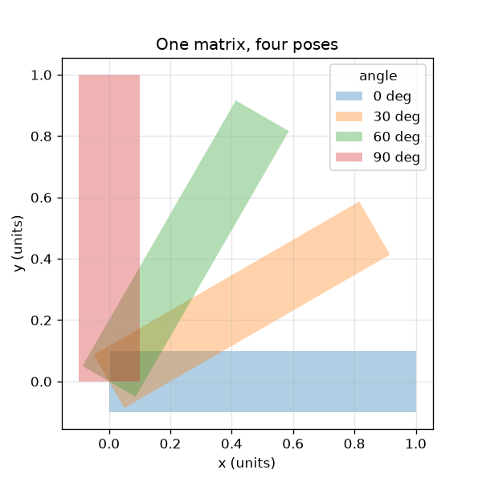
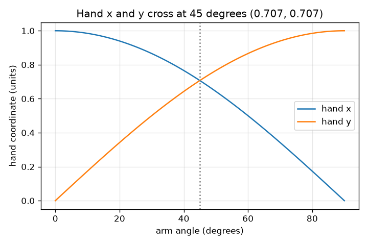

# సెషన్ 1: ఒక మాట్రిక్స్ మొత్తం చేతిని కదిలిస్తుంది

[Session 1 — हिन्दी](README.hi.md)

*స్థాయి 1 (భావనాత్మక ఇంటరాక్టివ్ నమూనా) · సుమారు 60 నిమిషాలు · openvfx*

> ఇది సరళీకరించిన ఒక విద్యా నమూనా (educational model). ఇది ధృవీకరించబడిన డిజైన్ సాధనం కాదు; నిజమైన నిర్మాణాలు, విద్యుత్ ఇన్‌స్టాలేషన్‌లు, వాహనాలు, పారిశ్రామిక ప్రక్రియలు లేదా వైద్య నిర్ణయాల కోసం దీనిని ఉపయోగించకూడదు.

**ముందస్తు జ్ఞానం (Prerequisites)**

- పాఠశాల త్రికోణమితి: సైన్ మరియు కొసైన్.
- మీరు PRIMER.md చదివి `python start.py 1` ఒకసారి రన్ చేశారు.

**అభ్యాస లక్ష్యాలు (Learning objectives).** ఈ సెషన్ తర్వాత మీరు చేయగలరు:

- రొటేషన్ మాట్రిక్స్ ఒక బిందువుకు ఏమి చేస్తుందో వివరించడం.
- R @ p ఉపయోగించి, చేతితో మరియు Python లో, ఒక బిందువు ఎక్కడ చేరుతుందో లెక్కించడం.
- భ్రమణం పొడవును గానీ వైశాల్యాన్ని గానీ ఎప్పుడూ మార్చదని చూపించడం.
- కోణానికి వ్యతిరేకంగా చేతి x, y గ్రాఫ్‌ను చదవడం.

## A. వాస్తవ ప్రపంచ సమస్య
యానిమేటెడ్ సినిమాలోని ప్రతి ఫ్రేమ్ ఒక పాత్రపై వేలాది బిందువులను కదిలిస్తుంది. వాటిని ఎవరూ ఒక్కొక్కటిగా కదపరు: ఒక మాట్రిక్స్ వాటన్నింటినీ ఒకేసారి కదిలిస్తుంది. ఒక పాత్ర చేయి ఊపినప్పుడు చేయి సాగకుండా, కుంచించుకుపోకుండా తిరగాలి. 'అన్నింటినీ 30 డిగ్రీలు తిప్పు' అని ప్రతి బిందువుకు కంప్యూటర్ చేయగల విధంగా ఎలా రాస్తాం?

## B. భావన మరియు సిద్ధాంతం
ఒక బిందువు అంటే నిర్దేశాంకాల జంట (x, y). దాన్ని మూలబిందువు చుట్టూ θ కోణంలో అపసవ్య దిశలో తిప్పినప్పుడు, రొటేషన్ మాట్రిక్స్ R(theta) నుండి కొత్త నిర్దేశాంకాలు వస్తాయి. మాట్రిక్స్‌ను బిందువుతో గుణించడం అంటే: ప్రతి కొత్త నిర్దేశాంకం మాట్రిక్స్ యొక్క ఒక వరుసను (x, y) తో పదం పదంగా గుణించి కూడినది. R యొక్క రెండు నిలువు వరుసలు యూనిట్ పొడవు కలిగి పరస్పరం లంబంగా ఉంటాయి, అందుకే R పొడవులను, కోణాలను నిలుపుతుంది; దాని డిటర్మినెంట్ 1 వైశాల్యం కూడా నిలుస్తుందని చెబుతుంది.

| చిహ్నం | అర్థం | యూనిట్ |
|---|---|---|
| theta | భ్రమణ కోణం, అపసవ్య దిశలో | డిగ్రీలు లేదా రేడియన్లు |
| (x, y) | ఒక బిందువు నిర్దేశాంకాలు | యూనిట్లు (ఏదైనా పొడవు యూనిట్) |
| R | రొటేషన్ మాట్రిక్స్ | యూనిట్ లేదు |
| L | చేతి పొడవు (భుజం నుండి చేతి వరకు దూరం) | యూనిట్లు |

**ఊహలు (Assumptions)**

- చేయి దృఢమైన ఆకారం: అది తిరగగలదు కానీ సాగదు.
- కోణాలు x అక్షం నుండి అపసవ్య దిశలో కొలవబడతాయి.
- భుజం మూలబిందువు (0, 0) వద్ద ఉంది.

$$ R(\theta)=\begin{pmatrix}\cos\theta & -\sin\theta\\ \sin\theta & \cos\theta\end{pmatrix} $$

$$ \begin{pmatrix}x'\\ y'\end{pmatrix}=R(\theta)\begin{pmatrix}x\\ y\end{pmatrix}=\begin{pmatrix}x\cos\theta-y\sin\theta\\ x\sin\theta+y\cos\theta\end{pmatrix} $$

$$ R(\theta)^{\mathsf T}R(\theta)=I\quad\text{(columns are unit length and perpendicular, so lengths are kept)} $$

$$ \det R(\theta)=\cos^2\theta+\sin^2\theta=1\quad\text{(area is kept)} $$

## C. దృశ్య వివరణ
ఎడమ చిత్రం ఒకే మాట్రిక్స్‌తో నాలుగు కోణాలకు తిప్పిన ఒక చేతిని చూపిస్తుంది; ప్రతి భంగిమకు ఒకే పొడవు, మందం ఉన్నాయి. కుడి చిత్రం కోణం పెరిగేకొద్దీ చేతి ఎక్కడ చేరుతుందో గీస్తుంది: దాని x నిర్దేశాంకం కొసైన్ వక్రాన్ని, y నిర్దేశాంకం సైన్ వక్రాన్ని అనుసరిస్తాయి. చేయి (0.707, 0.707) వద్ద ఉండే 45 డిగ్రీల వద్ద రెండు వక్రాలు ఖండించుకుంటాయి.

*ఒక మాట్రిక్స్, నాలుగు భంగిమలు: చేయి తన పొడవును, మందాన్ని నిలుపుకుంటుంది.*

*కోణానికి వ్యతిరేకంగా చేతి x, y: కొసైన్, సైన్ వక్రాలు 45 డిగ్రీల వద్ద ఖండించుకుంటాయి.*

## D. ఇంటరాక్టివ్ సిమ్యులేషన్
పాఠాన్ని రన్ చేయండి (`python start.py 1`), తర్వాత లైవ్ యాప్‌ను తెరవండి: [సెషన్ 1: చేతిని తిప్పండి](https://krunalpanchal1995.github.io/pan-iit-oss/openvfx/session-01/) (లేదా ఈ ఫోల్డర్‌లోని `app.html`). కోణం స్లైడర్‌ను లాగి చేతి వ్యాసార్థం 1 ఉన్న చుక్కల వృత్తాన్ని గీయడాన్ని గమనించండి, తర్వాత గ్రాఫ్ వీక్షణకు మారి x, y కొసైన్, సైన్‌లను అనుసరించడాన్ని చూడండి.

**సవాలు.** చేతిని నేరుగా పైకి, (0, 1) వద్ద, చూపించండి.

## E. సాధించిన ఉదాహరణ మరియు ప్రయోగం
**సమస్య.** చేతిని (పొడవు 1, x దిశలో చూపేది) 30 డిగ్రీలు తిప్పితే చేయి ఎక్కడ చేరుతుంది? పొడవు ఇంకా 1 అని తనిఖీ చేయండి.

1. చేయి (1, 0) వద్ద మొదలవుతుంది. 30 డిగ్రీలకు cos = 0.866, sin = 0.500.
2. కొత్త x = 0.866 * 1 - 0.500 * 0 = 0.866.
3. కొత్త y = 0.500 * 1 + 0.866 * 0 = 0.500.
4. పొడవు = sqrt(0.866^2 + 0.500^2) = sqrt(0.750 + 0.250) = sqrt(1.000) = 1.

**సమాధానం.** చేయి (0.866, 0.500) వద్ద చేరుతుంది, పొడవు ఇంకా 1.

**ప్రయోగం.** చతురస్రాల కాగితంపై ఒక యూనిట్ చేతిని గీసి, ప్రొట్రాక్టర్‌తో 30 డిగ్రీలు తిప్పి, చేతి నిర్దేశాంకాలను చదవండి; మీకు సుమారు (0.87, 0.50) రావాలి. యాప్ రీడౌట్‌తో, checkpoint.py తో పోల్చండి. చిన్న తేడా ప్రొట్రాక్టర్ చదవడం వల్ల వస్తుంది, గణితం వల్ల కాదు: నమూనా ఖచ్చితమైనది, కాగితం కాదు.

## F. మూల్యాంకనం మరియు డిజైన్ సవాలు
**ప్రశ్న రకం A: భావనాత్మక.** భ్రమణం చేతిని ఎప్పటికీ ఎందుకు సాగదీయలేదు? చేతిని సాగదీసే మాట్రిక్స్ ఎలా ఉండాలి?

సూచన

R యొక్క ప్రతి నిలువు వరుస పొడవును చూడండి, డిటర్మినెంట్ ఏమి చెబుతుందో, ఏమి చెప్పదో అడగండి.

దశలవారీ పరిష్కారం

R యొక్క ప్రతి నిలువు వరుస పొడవు 1 ఉన్న సదిశ, రెండు నిలువు వరుసలు లంబంగా ఉంటాయి (R^T R = I), కాబట్టి R పొడవులను, కోణాలను నిలుపుతుంది. డిటర్మినెంట్ cos^2 + sin^2 = 1 వైశాల్యం నిలుస్తుందని మాత్రమే చెబుతుంది: [[1, 1], [0, 1]] వంటి షియర్‌కు కూడా డిటర్మినెంట్ 1 ఉంటుంది, కానీ అది వస్తువులను సాగదీస్తుంది ((1, 1) ను (2, 1) కు పంపుతుంది). x ను రెట్టింపు చేసే [[2, 0], [0, 1]] వంటి చేతిని సాగదీసే మాట్రిక్స్‌కు 1 కంటే పొడవైన నిలువు వరుస ఉంటుంది.

**ప్రశ్న రకం B: సంఖ్యాత్మక.** బిందువు (2, 0) ను అపసవ్య దిశలో 90 డిగ్రీలు తిప్పండి. అది ఎక్కడ చేరుతుంది? మూలబిందువు నుండి దాని దూరాన్ని తనిఖీ చేయండి.

సూచన

90 డిగ్రీలకు cos = 0, sin = 1. కొత్త x = x cos - y sin, కొత్త y = x sin + y cos వర్తింపజేయండి.

దశలవారీ పరిష్కారం

కొత్త x = 2*0 - 0*1 = 0, కొత్త y = 2*1 + 0*0 = 2, కాబట్టి బిందువు (0, 2) వద్ద చేరుతుంది. దూరం = sqrt(0^2 + 2^2) = 2, ముందులాగే. యూనిట్లు: ఇన్‌పుట్ యూనిట్ అదే.

**ప్రశ్న రకం C: గ్రాఫ్ మరియు సిమ్యులేషన్ వ్యాఖ్యానం.** కోణానికి వ్యతిరేకంగా చేతి x, y గ్రాఫ్‌లో, ఏ కోణం వద్ద రెండు వక్రాలు ఖండించుకుంటాయి, అప్పుడు చేయి ఎక్కడ ఉంటుంది?

సూచన

cos = sin అయిన చోట అవి ఖండించుకుంటాయి.

దశలవారీ పరిష్కారం

అవి 45 డిగ్రీల వద్ద (మళ్ళీ 225 డిగ్రీల వద్ద) ఖండించుకుంటాయి. 45 డిగ్రీల వద్ద x = y = 0.707, కాబట్టి చేయి (0.707, 0.707) వద్ద ఉంది. గ్రాఫ్ చదివితే రెండు వక్రాలకు అక్కడ విలువ 0.707.

**ప్రశ్న రకం D: డిజైన్ మరియు ఆప్టిమైజేషన్ (optimisation) సవాలు.** ఒక యానిమేషన్‌లో చేయి కుడివైపు చూపడం నుండి నేరుగా పైకి చూపడానికి సరిగ్గా 3 సమాన దశల్లో (ఫ్రేమ్‌లు) ఊగాలి. ప్రతి ఫ్రేమ్‌కు కోణాన్ని ఎంచుకుని, ప్రతిదానిలో చేతి స్థానాన్ని జాబితా చేయండి.

సూచన

మొత్తం తిరుగుడు 90 డిగ్రీలు; దాన్ని మూడు సమాన దశలుగా భాగించి, ప్రతి సంచిత కోణానికి R ఉపయోగించండి.

దశలవారీ పరిష్కారం

ప్రతి దశ 30 డిగ్రీలు, కాబట్టి ఫ్రేమ్‌లు 30, 60, 90 డిగ్రీల వద్ద ఉన్నాయి. చేతి స్థానాలు: (0.866, 0.500), (0.500, 0.866), (0.000, 1.000). ఊహ: స్థిర వేగం. నిజమైన యానిమేటర్ ఈజ్ ఇన్, ఈజ్ అవుట్ కూడా చేస్తాడు.

[RUBRIC.md](../../RUBRIC.md)తో మిమ్మల్ని మీరు స్కోర్ చేసుకోండి. కాగితంపై చేయడానికి [కార్యాచరణ పత్రం](activity_sheet.md) ప్రింట్ చేయండి.

## సాధారణ అపోహలు
| సాధారణ అపోహ | నిజానికి సరైనది |
|---|---|
| బిందువును తిప్పడం దాన్ని సరళరేఖలో కొత్త చోటికి కదిలిస్తుంది. | అది పివట్ చుట్టూ వృత్తంలో కదులుతుంది; పివట్ నుండి దూరం ఎప్పుడూ మారదు. |
| పెద్ద కోణం ఎల్లప్పుడూ పెద్ద x అని అర్థం. | x cos(theta) ను అనుసరిస్తుంది, అది పెరుగుతూ తగ్గుతుంది; మొదటి 90 డిగ్రీలలో y = sin(theta) మాత్రమే పెరుగుతుంది. |
| మాట్రిక్స్ అంటే సంఖ్యల పట్టిక మాత్రమే. | మాట్రిక్స్ ఒక చర్య: దానితో గుణించడం బిందువులను కదిలిస్తుంది. సంఖ్యలు ఎలాగో చెబుతాయి. |
| డిటర్మినెంట్ 1 ఉన్న మాట్రిక్స్ దేన్నీ సాగదీయదు. | షియర్‌కు డిటర్మినెంట్ 1, అయినా అది పొడవులను సాగదీస్తుంది. డిటర్మినెంట్ 1 వైశాల్యాన్ని మాత్రమే నిలుపుతుంది; భ్రమణాల నిలువు వరుసలు యూనిట్ పొడవు, లంబం కాబట్టి అవి పొడవులను నిలుపుతాయి. |

## పదకోశం (Glossary)
- **రొటేషన్ మాట్రిక్స్ (rotation matrix)**: బిందువులను ఒక కోణంలో తిప్పే సంఖ్యల 2x2 గ్రిడ్
- **ట్రాన్స్‌పోజ్ (transpose)**: వికర్ణం మీదుగా తిప్పిన మాట్రిక్స్; అనేక బిందువులను ఒకేసారి కదిలించడానికి ఉపయోగపడుతుంది
- **డిటర్మినెంట్ (determinant)**: మాట్రిక్స్ వైశాల్యాన్ని ఎంత స్కేల్ చేస్తుంది; స్వచ్ఛమైన భ్రమణానికి సరిగ్గా 1
- **రేడియన్ (radian)**: పూర్తి తిరుగుడు 2 pi అయ్యే కోణ కొలత; NumPy వాడే యూనిట్

## ముగింపు
1. [exercises.md](exercises.md)లోని మూడు కోడింగ్ పనులు చేయండి.
2. మీ మార్పుల తర్వాత `python start.py 1` మళ్ళీ రన్ చేయండి. అది చెక్‌పాయింట్‌తో (checkpoint) ముగుస్తుంది; అది `PASS` అని ప్రింట్ చేసినప్పుడు మీరు పూర్తి చేశారు. (చెక్‌పాయింట్ మాత్రమే: `python start.py check 1`.)

తర్వాత: [సెషన్ 2](../session-02/README.md)
