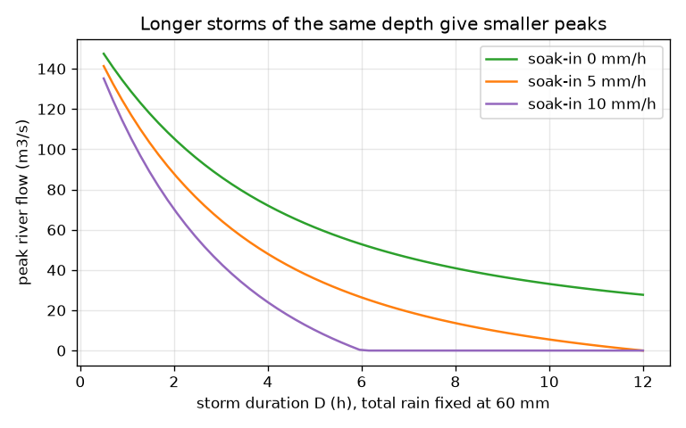
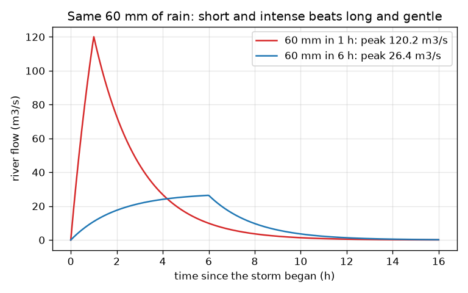

# सत्र 1: वर्षा से नदी तक

*स्तर 1 (वैचारिक इंटरैक्टिव मॉडल) · लगभग 60 मिनट · openwatershed*

> यह एक सरलीकृत शैक्षिक मॉडल है। यह कोई प्रमाणित डिज़ाइन उपकरण नहीं है और इसका उपयोग वास्तविक संरचनाओं, विद्युत स्थापनाओं, वाहनों, औद्योगिक प्रक्रियाओं या चिकित्सा संबंधी निर्णयों के लिए नहीं किया जाना चाहिए।

**पूर्वापेक्षाएँ (Prerequisites)**

- इकाइयों के साथ स्कूली अंकगणित: mm, km2, घंटे।
- आपने PRIMER.md पढ़ लिया है और `python start.py 1` एक बार चला लिया है।

**सीखने के उद्देश्य (Learning objectives)।** इस सत्र के बाद आप:

- वर्षा को उस पानी में बाँट सकेंगे जो ज़मीन में रिसता है और जो बहकर निकल जाता है (अपवाह, run-off)।
- किसी क्षेत्रफल (km2) पर अपवाह गहराई दर (mm/h) को m3/s में प्रवाह (flow) में बदल सकेंगे।
- समझा सकेंगे कि जलग्रहण क्षेत्र (catchment) पानी को नदी तक पहुँचने के रास्ते में कैसे विलंबित और समतल करता है।
- समझा सकेंगे कि समान वर्षा गहराई वाले लंबे हल्के तूफ़ान की तुलना में छोटा तीव्र तूफ़ान अधिक ऊँची बाढ़ क्यों दे सकता है।

## A. वास्तविक दुनिया की समस्या
एक तूफ़ान एक शहर के ऊपर की पहाड़ियों पर वही 60 mm वर्षा दो बार गिराता है: एक बार 1 घंटे में, एक बार 6 घंटों में फैलाकर। किस स्थिति में नदी अधिक ऊँची उठती है? उत्तर तय करता है कि कोई पुल या बाढ़ दीवार कितनी ऊँची होनी चाहिए। यह पाठ एक सरलीकृत शिक्षण मॉडल है: वास्तविक बाढ़ पूर्वानुमान आधिकारिक एजेंसियों और योग्य जलविज्ञानियों (hydrologists) से आते हैं।

## B. अवधारणा और सिद्धांत
ज़मीन पानी को f (mm प्रति घंटा) की दर से सोख सकती है, स्पंज की तरह। f से तेज़ गिरने वाली वर्षा अंदर नहीं रिस सकती, इसलिए अतिरिक्त पानी सतह पर बहकर निकल जाता है। अपवाह एक गहराई दर (mm/h) है जो जलग्रहण क्षेत्रफल A (km2) पर फैली है; 1 km2 पर 1 mm पानी 1000 m3 है, इसलिए 1 km2 पर 1 mm/h, 1000 m3 प्रति घंटा = 0.2778 m3/s है, और m3/s में प्रवाह गहराई दर गुणा क्षेत्रफल भाग 3.6 है। पानी नदी तक एक साथ नहीं पहुँचता: वह ढलानों और नालियों से धीरे-धीरे नीचे आता है। सबसे सरल चित्र रिसाव वाली टंकी (रैखिक जलाशय, linear reservoir) है जिसका विलंब K है: यदि अपवाह प्रवाह D घंटों तक q है, तो नदी का प्रवाह q(1 - exp(-t/K)) के रूप में बढ़ता है, तूफ़ान के अंत में q(1 - exp(-D/K)) तक पहुँचता है, फिर घटता जाता है। K से बहुत छोटा तूफ़ान नदी को कभी q तक नहीं पहुँचने देता, यही कारण है कि समान गहराई का लंबा हल्का तूफ़ान छोटा शिखर देता है।

| प्रतीक | अर्थ | इकाई |
|---|---|---|
| P | तूफ़ान की कुल वर्षा गहराई | mm |
| D | तूफ़ान की अवधि | h |
| i = P / D | वर्षा की तीव्रता | mm/h |
| f | ज़मीन की रिसाव दर | mm/h |
| A | जलग्रहण क्षेत्रफल (इस पाठ में 20) | km2 |
| K | जलग्रहण विलंब (इस पाठ में 2) | h |
| q | अपवाह प्रवाह | m3/s |
| Q_peak | नदी का शिखर प्रवाह | m3/s |

**मान्यताएँ (Assumptions)**

- वर्षा पूरे जलग्रहण क्षेत्र पर और तूफ़ान की पूरी अवधि में एकसमान है।
- रिसाव दर f स्थिर है (वास्तविक मिट्टी भरने पर धीमी हो जाती है)।
- जलग्रहण क्षेत्र विलंब K वाले एक रैखिक जलाशय की तरह व्यवहार करता है।
- शैक्षिक मॉडल: पूर्वानुमान नहीं और डिज़ाइन विधि नहीं।

$$ \text{run-off rate}=\max(i-f,\,0)\qquad i=P/D $$

$$ q=\frac{\max(i-f,0)\,A}{3.6}\quad\left(\tfrac{\text{mm}}{\text{h}}\cdot\text{km}^2\to\text{m}^3/\text{s}\right) $$

$$ Q(t)=q\left(1-e^{-t/K}\right)\ (t\le D),\qquad Q_{\text{peak}}=q\left(1-e^{-D/K}\right) $$

$$ Q(t)=Q_{\text{peak}}\,e^{-(t-D)/K}\ (t>D) $$

## C. दृश्य व्याख्या
पहला चित्र दो तूफ़ानों से नदी का प्रवाह दिखाता है जो दोनों 60 mm गिराते हैं: 1 घंटे का तूफ़ान 120.2 m3/s के शिखर वाली ऊँची संकरी बाढ़ देता है, 6 घंटे का तूफ़ान 26.4 m3/s के शिखर वाली नीची चौड़ी। दूसरा चित्र वर्षा को 60 mm पर स्थिर रखता है और तीन रिसाव दरों के लिए तूफ़ान की अवधि के सापेक्ष शिखर आलेखित करता है: तूफ़ान लंबा होने पर हर वक्र गिरता है, और 10 mm/h की रिसाव दर लंबे तूफ़ानों के लिए बाढ़ को पूरी तरह हटा देती है।

*तीन रिसाव दरों के लिए तूफ़ान की अवधि के सापेक्ष नदी का शिखर प्रवाह।*

*वही 60 mm वर्षा: 1 h का तूफ़ान 120.2 m3/s का शिखर देता है, 6 h का तूफ़ान 26.4 m3/s।*

## D. इंटरैक्टिव सिमुलेशन
पाठ चलाइए (`python start.py 1`), फिर लाइव ऐप खोलिए: [सत्र 1: वर्षा से नदी तक](https://krunalpanchal1995.github.io/pan-iit-oss/openwatershed/session-01/) (या इसी फ़ोल्डर में `app.html`)। वर्षा गहराई 60 mm पर रखिए और अवधि को 12 h से 0.5 h तक खिसकाइए: चित्र में नदी को मोटा होते और ग्राफ़ में शिखर को चढ़ते देखिए। फिर रिसाव दर बढ़ाइए।

**चुनौती।** अधिकतम 60 mm वर्षा और कम से कम 5 mm/h की रिसाव दर का उपयोग करके नदी के शिखर को 100 m3/s से अधिक कीजिए।

## E. हल किया गया उदाहरण और प्रयोग
**समस्या।** f = 5 mm/h और K = 2 h वाले 20 km2 जलग्रहण क्षेत्र पर 1 h में 60 mm वर्षा होती है। अपवाह प्रवाह और नदी का शिखर ज्ञात कीजिए। फिर 6 h में 60 mm के लिए यही कीजिए।

1. तीव्रता i = 60 / 1 = 60 mm/h। अपवाह दर = 60 - 5 = 55 mm/h।
2. प्रवाह q = 55 * 20 / 3.6 = 305.6 m3/s।
3. शिखर = 305.6 * (1 - exp(-1/2)) = 305.6 * 0.3935 = 120.2 m3/s।
4. 6 h का तूफ़ान: i = 10 mm/h, अपवाह दर 5 mm/h, q = 5 * 20 / 3.6 = 27.78 m3/s।
5. शिखर = 27.78 * (1 - exp(-6/2)) = 27.78 * 0.9502 = 26.4 m3/s।
6. अपवाह आयतन: 20 km2 पर 55 mm से 1100 हज़ार m3 और 30 mm से 600 हज़ार m3 मिलते हैं।

**उत्तर।** छोटा तूफ़ान 120.2 m3/s का शिखर देता है और लंबा 26.4 m3/s: उसी 60 mm वर्षा के लिए चार गुना से भी अधिक कम।

**प्रयोग।** नीचे के पास छेद वाली और ऊपर स्पंज रखी बाल्टी में एक स्थिर दर से पानी डालिए (स्पंज रिसाव है, छेद जलग्रहण विलंब है)। 1 लीटर जल्दी डालिए, फिर 1 लीटर धीरे, और छेद से निकलने वाला सबसे अधिक प्रवाह देखिए। जल्दी डालने से अधिक प्रवाह मिलता है। मॉडल वास्तविकता से अलग है क्योंकि वास्तविक मिट्टी भरने पर अपनी रिसाव दर बदलती है और वास्तविक जलग्रहण क्षेत्रों में एक टंकी नहीं, बल्कि कई अलग प्रवाह मार्ग होते हैं।

## F. मूल्यांकन और डिज़ाइन चुनौती
**प्रश्न प्रकार A: वैचारिक।** कम कुल वर्षा वाला तूफ़ान कभी-कभी अधिक वर्षा वाले तूफ़ान से बड़ी बाढ़ क्यों पैदा कर सकता है?

संकेत

उन दो चीज़ों के बारे में सोचिए जो मायने रखती हैं: रिसाव दर की तुलना में वर्षा कितनी तेज़ी से आती है, और जलग्रहण क्षेत्र को पानी इकट्ठा करने में कितना समय लगता है।

चरण-दर-चरण हल

अपवाह तभी शुरू होता है जब तीव्रता रिसाव दर से अधिक हो, और नदी का शिखर इस पर निर्भर करता है कि विलंब समय K के भीतर कितना अपवाह पहुँचता है। मामूली गहराई का एक छोटा तीव्र तूफ़ान f से बहुत अधिक हो सकता है और अपना पानी K के भीतर पहुँचा सकता है, जिससे ऊँचा शिखर मिलता है, जबकि अधिक गहराई का एक लंबा हल्का तूफ़ान f के पास रह सकता है और अपना पानी फैला सकता है। इस मॉडल में, 1 h में 60 mm से 120.2 m3/s मिलता है पर 6 h में 60 mm से केवल 26.4 m3/s।

**प्रश्न प्रकार B: संख्यात्मक।** 20 km2 जलग्रहण क्षेत्र पर 2 h में 60 mm वर्षा होती है (f = 5 mm/h, K = 2 h)। नदी का शिखर ज्ञात कीजिए और इकाइयाँ जाँचिए।

संकेत

i = P / D, फिर अपवाह दर, फिर प्रवाह = दर * क्षेत्रफल / 3.6, फिर 1 - exp(-D/K) से गुणा कीजिए।

चरण-दर-चरण हल

i = 30 mm/h, अपवाह दर 25 mm/h, q = 25 * 20 / 3.6 = 138.9 m3/s, शिखर = 138.9 * (1 - exp(-1)) = 138.9 * 0.6321 = 87.8 m3/s। इकाइयाँ: mm/h * km2 / 3.6 से m3/s मिलता है। जाँच: यह 1 h के उत्तर (120.2) और 6 h के उत्तर (26.4) के बीच है।

**प्रश्न प्रकार C: ग्राफ़ और सिमुलेशन की व्याख्या।** अवधि के सापेक्ष शिखर के ग्राफ़ में (वर्षा 60 mm पर स्थिर), D = 6 h पर 0 और 10 mm/h वक्र आपको क्या बताते हैं? D छोटा होने पर क्या होता है?

संकेत

D = 6 पर और ग्राफ़ के बाएँ किनारे पर वक्र पढ़िए।

चरण-दर-चरण हल

बिना रिसाव (0 mm/h) के 6 h का तूफ़ान 52.8 m3/s का शिखर देता है जबकि 10 mm/h के साथ शून्य देता है क्योंकि तीव्रता (10 mm/h) f से अधिक नहीं है। D छोटा होने पर शिखर पूरी तीव्रता द्वारा निर्धारित ऊपरी सीमा की ओर बढ़ता है: f = 0 के साथ 1 h का तूफ़ान पहले ही 131.2 m3/s देता है और f = 5 के साथ 0.5 h का तूफ़ान 141.3 m3/s देता है। तूफ़ान लंबा होने पर सभी वक्र गिरते हैं।

**प्रश्न प्रकार D: डिज़ाइन और अनुकूलन चुनौती।** डिज़ाइन: भूमि उपयोग में बदलाव f को 5 से 10 mm/h तक बढ़ा सकते हैं (उदाहरण के लिए, अधिक खुली मिट्टी और पेड़)। 60 mm, 1 h तूफ़ान के लिए, क्या यह शिखर को 100 m3/s से नीचे लाता है? आप और क्या बदलेंगे, और आप क्या मानते हैं?

संकेत

f = 10 के साथ शिखर की गणना कीजिए और 100 से तुलना कीजिए; फिर K और तूफ़ान की अवधि के बारे में सोचिए।

चरण-दर-चरण हल

f = 10 के साथ 1 h का शिखर 109.3 m3/s है, 120.2 से कम पर अभी भी 100 से ऊपर। f बढ़ाना तीव्र तूफ़ान के विरुद्ध केवल थोड़ा मदद करता है; पानी संग्रहित करना या उसे धीमा करना (बड़ा K) आवश्यक होगा। मान्यताएँ: f स्थिर है, तूफ़ान एकसमान है, और जलग्रहण क्षेत्र एक टंकी है। एक वास्तविक डिज़ाइनर आधिकारिक वर्षा आँकड़ों का उपयोग करता है और कई तूफ़ान अवधियों की जाँच करता है।

[RUBRIC.md](../../RUBRIC.md) से स्वयं को अंक दीजिए। कागज़ पर काम करने के लिए [गतिविधि पत्रक](activity_sheet.md) प्रिंट कीजिए।

## आम भ्रांतियाँ
| आम भ्रांति | वास्तव में क्या सच है |
|---|---|
| अधिक कुल वर्षा का अर्थ हमेशा बड़ी बाढ़ है। | शिखर रिसाव दर की तुलना में तीव्रता पर और इस पर निर्भर करता है कि जलग्रहण क्षेत्र पानी कितनी तेज़ी से इकट्ठा करता है; समान गहराई बहुत अलग शिखर दे सकती है। |
| गिरने वाली सारी वर्षा जल्दी नदी में पहुँच जाती है। | कुछ रिस जाती है, और बाकी उस समय से विलंबित होती है जो जलग्रहण क्षेत्र को उसे इकट्ठा करने में लगता है, इसलिए नदी का शिखर अपवाह दर से नीचा और बाद में होता है। |
| mm/h में प्रवाह की तुलना m3/s में प्रवाह से नहीं की जा सकती। | वे अलग इकाइयों में एक ही चीज़ हैं: क्षेत्रफल से गुणा कीजिए और 3.6 से भाग दीजिए। |

## शब्दावली
- **जलग्रहण क्षेत्र (catchment)**: भूमि का वह क्षेत्र जिसकी वर्षा नदी के एक बिंदु तक बहती है (इसे watershed भी कहते हैं)
- **अपवाह (run-off)**: वर्षा का वह भाग जो रिसने के बजाय ज़मीन पर बहता है
- **अंतःस्यंदन (infiltration)**: पानी का ज़मीन में रिसना
- **जलालेख (hydrograph)**: समय के सापेक्ष नदी प्रवाह का ग्राफ़
- **रैखिक जलाशय (linear reservoir)**: एक टंकी जो अपने में संग्रहित पानी के समानुपाती दर से खाली होती है

## समापन
1. [exercises.md](exercises.md) में दिए तीन कोडिंग कार्य कीजिए।
2. अपने बदलावों के बाद `python start.py 1` फिर से चलाइए। यह चेकपॉइंट (checkpoint) पर समाप्त होता है; जब यह `PASS` छापे, तो आपका काम पूरा है। (केवल चेकपॉइंट: `python start.py check 1`।)

अगला: [सत्र 2](../session-02/README.md)
